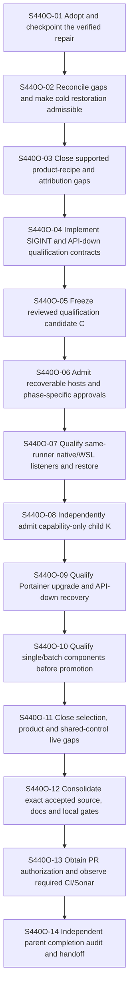

# #440 — Remaining lifecycle acceptance

Workflow ID: issue-440-open-acceptance
workflowVersion: 2.0
Status: EXECUTING; TA440-20261112-02 target clarification pending at S440O-06; separate disposable test reset complete; exact host admission remains pending
Issue: [#440](https://github.com/MatthiasBurger-Coder/Tiny-Swarm-World/issues/440)
Branch: `docs/workflow-issue440-open-20261111`
Committed authoring baseline: `c40d87ed81101dd582a112fe8b427d84372f36e2`
Execution profile: FULL_PATH
Process strand: workflow execute; current consultation run and scope amendment recorded below. Original authoring facts remain historical.

## Executive Summary

Complete the actual remaining #440 acceptance after the verified local repair:
checkpoint its exact source, close proven recipe/recovery gaps, freeze a valid
qualification campaign, establish recoverable hosts, qualify native/WSL listeners,
admit the precise capability, exercise Portainer/components/selection/product
cases, observe applicable final gates and obtain independent parent acceptance.
This new documentation-only branch does not contain the uncommitted repair.
Slice01 must acquire and verify it; absent source is a hard STOP.

## Execution run TA440-20261112-01 — started 2026-11-12

The operator instructed Codex to clear existing installations in the WSL test
environment at test start, stop applications occupying required ports there,
continue error remediation and qualification through completion, start a workflow
for every Three-Amigos consultation, and commit/push each accepted change.
This run extends the existing workflow at S440O-06; it does not create another
EPIC, repeat completed source work or declare the parent complete.

Four real reviewers accepted this bounded scope: Senior Requirement Engineer
(`reset_requirements`), Senior System Architect (`wsl_reset_review`), Senior
Python Automation Developer (`reset_automation`) and Senior Tester
(`reset_test_evidence`). Their decision is READY_FOR_WORKFLOW for disposable-test
preparation, subject to actual target/resource identification before effects.

- Identify the exact disposable WSL distribution, registration/GUID, machine and
  installation resources before deletion. Retain these private host identities
  and raw evidence outside disposable state; do not publish them here.
- Reset test installations once before the suite. Stop/kill only processes
  attributed to that admitted disposable environment, before capturing the
  clean qualification baseline. Reobserve required listeners afterward.
- Preserve original Ubuntu, foreign distributions/resources and the Windows
  boundary. Original-environment downtime uses the existing bounded cold-handoff
  and restoration path; the reset permission does not permit deleting it.
- Preserve each case's `baseline -> add/update -> verify -> repeat -> fault ->
  recover -> verify` chain. Do not erase data, credentials, source installations
  or recovery checkpoints between observations that depend on them.
- Serialize live effects. Continue through host admission, paired listener
  qualification, capability admission, Portainer, components, selections and
  remaining product/shared cases, then independent P01-P15 reconciliation.
- Give each later Three-Amigos consultation a distinct workflow execution-run
  record with findings, chosen slice, action, verification and outcome. Commit
  and push each accepted change separately; never turn a failed check into PASS.

The new instruction supplies test reset, test-process termination and live-test
consent. Earlier missing-consent/no-delete/no-kill notes are historical for this
bounded test scope. It does not establish ownership, backup usability, restore
proof, a fresh hash-bound phase GO or a successful test result.

Frozen private campaign C remains
`77a3356075925edee037bfe009a1f3dfb94cf5d8`; no C/K source or embedded workflow
is edited by this integration-side record. Before a strict source/workflow
binding is used, verify its equivalence and admission explicitly. A helper or
campaign-semantic change requires a reviewed replacement campaign and renewed
source lease/preparation/GO, not an edit to frozen C. Existing architecture and
cold-kernel/scoped-capability policy remain unchanged; no new ADR is required
for this disposable-fixture preparation scope.

Execution ownership: Root integrates and publishes; Senior DevOps owns serial
host operations; independent requirement/architecture/test-evidence reviews
remain the completion authority. This amendment locks only workflow.md,
scenario-plan.md, context-pack.md/json and prerequisite-ledger.md in the
integration worktree. It leaves the existing S440O-06 evidence-file locks in its
runtime worktree unchanged. Verification and operational effects are pending;
no S440O-06 DONE, live PASS, Sonar PASS or parent closure is recorded.

## Execution run TA440-20261112-02 — original-state mismatch

Started after the actual read-only original-runtime baseline check returned
`AUTOSTART_UNSAFE`. All three default-project TSW nodes currently report
`boot.autostart=true`; all four historical TSW nodes are running. The retained
original driver requires disabled autostart and stopped workers. Do not alter
these states merely to satisfy its historical assertions.

Review the operator's requested suite-start deletion against the exact original
test-installation boundary. Target clarification is pending: deletion of the
separate disposable registration is complete; deletion of the existing TSW
installations in the original test distribution has not been performed. Keep
the original running while this distinction is unresolved. The independent
read-only registration PLAN reached the actual baseline observation, then
refused with `BRIDGE_FILE_DRIFT`; no import was attempted. Active original
bridge files did not remain stable during the protected read. Preserve frozen C.

All four independent roles completed this consultation: requirements require
the pending exact-target answer; architecture, automation and test/evidence
reviewed both bounded alternatives. An authorized original-installation reset
can enable direct listener qualification after fresh inventory. Preserving the
original requires a reviewed transaction that restores its actual autostart
configuration and running states. Neither route may fabricate historical driver
receipts or treat listener qualification as product qualification. The latter
still requires the existing disposable-distribution/coordinator contract.

Decision: REQUIRES_REFINEMENT for the destructive-target boundary only. No
original installation, bridge, autostart setting or process was changed. This
run records actual prerequisite failures and conditional execution paths, not a
product-test failure or a completed acceptance. Publish it as a separate
operator-authorized documentation checkpoint after designated-host diff check.

## Verified Baseline and Target Picture

Original repair remains preserved in the original workspace. Its independent
bounded audit accepted 18 targeted tests without skips and full quality4058run/
37declared skips, including corrected premature preview readiness. Those facts
apply only to the recorded five-file source, not this authoring branch, a new
workflow binding, current host readiness, Sonar or live restoration. Completed
S440-02/03/04/05 checkpoints stay historical; do not re-plan their fixes as absent.
P01 historical official0.4.0→0.5.0 remains accepted within its actual scope.

Target: Linux/WSL→Incus/LXC→Docker Engine/Swarm operator paths preserve local
configuration, credential references, installation/service identities and data.
Each required update/selection/recovery is tied to exact source and host evidence.
Parent #440 remains INCOMPLETE until all acceptance and applicable gates pass.

## Requirement Clarification Gate

- Original Request: “Erstelle ein worklow für die offenen punkte”.
- Interpreted Intent: author the complete remaining-work plan; do not execute live changes.
- Change Type: workflow regeneration and traceable remaining acceptance.
- Affected Process Strand: workflow create now; workflow execute later.
- Affected Architecture Area: existing Python lifecycle/CLI, qualification tooling, Windows/WSL cold coordination, Incus capability, evidence and release checks.
- Explicit Requirements: remaining points in the conversation and unchanged47LCM/15parent/45childAC plus late/global obligations.
- Implicit Requirements: preserve uncommitted changes, exact source acquisition, recoverable targets, no false live/Sonar claims, independent reviews and bounded failure recovery.
- Assumptions: original repair source remains owner-retained; missing source blocks execution, not planning. Host, backup, approvals and image availability are not assumed.
- Non-Goals: no new runtime/orchestrator, Kubernetes, browser frontend, Java/Maven/Spring, external CI, automatic PR/merge/release or GitHub issue writes.
- Risks: live interruption, source-chain invalidation, unsupported product targets, incomplete recipe attribution and unavailable Sonar.
- Open Questions: actual host/backup/source/approval/PR access are execution admission conditions with owners in prerequisite-ledger.md.
- Blocking Questions for authoring: none; do not infer answers for execution.
- Confidence Level:95percent, requirement confidence only.
- Decision: READY_FOR_WORKFLOW, four real specialist reviews recorded in authoring-review.md.

## Scope and Architecture Constraints

Preserve hexagonal Python boundaries and canonical core implementations. Native
qualification files remain compatibility delegates; do not create a second
orchestrator/catalog or put shell/filesystem details into application services.
Accepted Classic lifecycle and installation-scoped-profile ADRs remain authority.
No new ADR is needed for this plan; any changed ownership/support/recovery policy
stops its slice for an explicit decision. Keep unsupported/unknown versions,
source/consent drift and uncertain effects fail-closed. Incus is a provider
prerequisite; Portainer remains a mandatory managed Classic foundation.

## Python Automation Assessment and Frontend Assessment

Actual product/component/Portainer public CLI exists. Both product supervisors
still refuse product-v1 cases; reporter supports SIGTERM rather than SIGINT or
API-down. Slices03/04 own concrete source/test repairs before live campaigns.
The existing reporter is modules/tsw_core/tests/e2e/classic/run_lcm_acceptance.py.
No browser frontend exists in this scope. CLI/help changes use console/status
review only when actually changed; no React work is authorized.

## Test Strategy and Quality Gates

Reviewed execution follow-up S440O-01: the first full gate found an authored
noncanonical mode label. Senior Workflow Architect and Requirement Lead approve
this exact wording correction plus workflow/context hash maintenance inside01.
No dependency, requirement, product scope, checker or quality threshold changes.
This is S3_DOC remediation during execution, not workflow regeneration.

Authoring is documentation-only: static metadata/DAG/path/requirement/link/hash
inspection and git diff --check on the designated SSH/WSL host. Full project
quality is NOT_RUN_DOC_ONLY for this plan; prior repair results are historical.
Implementation slices require nearest regressions then the unchanged QUALITY.md
full gate. No tests begin during ongoing development without the applicable
explicit verification or PR-creation authorization; authoring grants no live GO.

All agent-run tests/gates use SSH pc@192.168.178.58 inside Ubuntu WSL. Read
credentials privately from ~/.access; never log/pass them in command arguments
or repository files. Verify remote repository, Python3.12 editable package origin
and exact changed-file equivalence first. Unavailable credentials/SSH/WSL block;
no alternate host fallback. Native deployment qualification remains a separately
approved target; running its mocked tests still uses the mandated test host.

Use actual commands from QUALITY.md: python3 modules/tsw_core/tools/linux/quality_gate.py quality, lint,
arch-lint, arch-tests, typecheck, test and verification-policy. Live/external
pseudo-actions in metadata identify review/evidence obligations, not invented
executables; exact admitted argv must be checked from --help before GO.

## Resilience Requirements

Every live effect requires bounded waits/retries, exact lease/ownership and
fresh source/JIT/GO, usable cold backups and a proven return path BEFORE downtime.
No replay or blanket clearing of uncertain intent. Prove each reachable reset/
bridge/restore failure route; safe refusal is not recoverability. Preserve full
Windows state within the fixture window and separate any later owned destination
refresh during actual original restoration. Record actual process identity,
checkpoint/signal, exit/settlement, no-op, partial failure and repeat recovery.

## Campaign Source Graph and Checkpoint Separation

Complete all helper/workflow/policy changes before freezing clean source C.
The component qualification candidate policy must already be in C before WSL
preparation. After paired fixtures, K is exactly ONE direct child of C changing
ONLY incus-profile-capabilities.json. qualification_revision() permits C or K;
helper, policy or documentation commits cannot be appended to this chain.
No source-binding bypass or unreviewed equivalence exception is authorized.

Keep C and K in dedicated campaign worktrees/refs. Integration-branch slice
checkpoints and progress records must not move their HEAD or dirty their tracked
files. During live slices raw/progress evidence stays in ignored/private external
journals; publish redacted summaries on the integration branch, not into C/K.
Never edit the frozen active workflow merely to mark progress. If a helper or
runtime delta becomes necessary, stop affected cases, create/review a new source
campaign and renew preparation/GO/qualification. Final integrated source needs
explicit independently reviewed equivalence or requalification of affected cases.

## Parallel Execution

- Can this workflow run in parallel? Serial writes/effects by default; independent read-only reviews may run concurrently.
- Conflicting workflows: old #440/#449 campaigns and any writer of the same installation, source, approval or shared host.
- Shared files: qualification producer/reporter/supervisors, active workflow, capability/policy, W09/W10 and coordination evidence.
- Shared infrastructure: designated SSH/WSL test host and separately admitted native/WSL live targets.
- Requires isolated worktree: yes, per workflow/approved stream/campaign.
- Requires serialized live validation: yes; host-wide WSL/network/Incus effects cannot overlap.
- Merge-order constraints:01→02→03→04→05→06→07→08→09→10→11→12→13→14; C/K topology is independent of integration progress commits.

## Automatic Work Distribution Policy

workflow execute automatically inspects each slice for safe specialist stream
splitting. Use real Codex subagents; if unavailable, record explicit role-based
fallback. Before writes create .codex/evidence/slice-<number>-distribution.md;
after consolidation create .codex/evidence/slice-<number>-consolidation.md.
Each record must name this workflow/version, source and slice; old files are
historical, never proof of current acceptance. Codex remains final integration,
verification and PR-readiness owner. Stream workers never merge directly.

Stream map: backend/automation→Senior Python Automation Developer; frontend→
conditional console/status reviewer only; tests/quality→Senior Tester;
runtime→Senior DevOps; documentation→Senior Documentation Engineer;
architecture→Senior System Architect; security→Senior Security Sandbox Engineer.
No parallel writers for overlapping files, unclear architecture/requirements,
mandatory ordering, shared migrations/schemas/generated files, unknown secrets,
unsafe guards or a Three-Amigos not-safely-parallelizable decision. S3D must
revalidate actual locks before every write-capable slice; no automatic widening.

## Git Worktree Execution Rule

Authoring uses its own clean dedicated worktree/branch. Original user repair
changes remain untouched. Execution/stream/campaign branches have explicit owners;
only root consolidates. One slice per checkpoint commit; checkpoint push is not
PR creation, merge or push auto. C/K campaign refs retain frozen source identity.
Do not delete any worktree/branch or stash/reset user changes during authoring.

## Ordered Slices and Dependency Graph



### Slice 01 — Adopt and checkpoint the verified repair

Purpose: Acquire the exact five reviewed files from the preserved original workspace or an independently verified immutable repair revision. Verify every SHA in requirements.json, provenance and the retained 18/4058-test logs; do not copy unrelated workflow edits. Import only those files, rerun applicable targeted/full checks with proper authorization against the new workflow source, independently review and create one repair-only checkpoint. Missing source, a hash mismatch or absent review blocks before writes. This authoring branch starts at c40d87ed and DOES NOT ship the repair.

Prerequisites: branch/source/provenance admission. Mode: LOCAL.

Done criteria: all stated observations and required checks have attributable evidence; independent owner review accepts the exact slice. No planned result counts as executed.

Evidence: `.tiny-swarm/evidence/issue-440-open/slice-01/` with the six issue-completion files. Requirement mapping: P08, P09, P11, P12, P13.

```yaml
{
  "slice_id": "S440O-01",
  "profile": "FULL_PATH",
  "status": "PLANNED",
  "owner": "Senior Python Automation Developer",
  "secondary_reviewers": [
    "Senior Requirement Engineer",
    "Senior System Architect",
    "Senior Tester",
    "Senior Security Sandbox Engineer",
    "Senior DevOps"
  ],
  "affected_files": [
    "modules/tsw_windows_wsl/tools/qualification/wsl_acceptance_guest_switch.ps1",
    "modules/tsw_windows_wsl/tools/qualification/wsl_acceptance_registration.ps1",
    "modules/tsw_windows_wsl/tools/qualification/wsl_acceptance_bridge_binding.ps1",
    "modules/tsw_windows_wsl/tests/tools/test_wsl_acceptance_guest_switch.py",
    "modules/tsw_core/tests/fixtures/wsl_acceptance_guest_switch.ps1",
    "documentation/handbook/05-development/workflow/workflow.md",
    "documentation/handbook/05-development/workflow/context-pack.json"
  ],
  "affected_modules": [
    "existing qualification/lifecycle and evidence"
  ],
  "affected_contracts": [
    "public CLI/evidence/source ownership",
    "frozen C/K campaign provenance"
  ],
  "dependencies": [],
  "parallel_group": "serial-01",
  "parallel_execution_eligible": false,
  "requires_isolated_worktree": true,
  "requires_serialized_live_validation": false,
  "file_locks": [
    "modules/tsw_windows_wsl/tools/qualification/wsl_acceptance_guest_switch.ps1",
    "modules/tsw_windows_wsl/tools/qualification/wsl_acceptance_registration.ps1",
    "modules/tsw_windows_wsl/tools/qualification/wsl_acceptance_bridge_binding.ps1",
    "modules/tsw_windows_wsl/tests/tools/test_wsl_acceptance_guest_switch.py",
    "modules/tsw_core/tests/fixtures/wsl_acceptance_guest_switch.ps1",
    ".tiny-swarm/evidence/issue-440-open/slice-01/**",
    "documentation/handbook/05-development/workflow/workflow.md",
    "documentation/handbook/05-development/workflow/context-pack.json"
  ],
  "contract_locks": [
    "frozen C/K source and exact approval"
  ],
  "architecture_locks": [
    "Classic cold-kernel and scoped capability policy"
  ],
  "module_locks": [],
  "shared_files": [
    "modules/tsw_windows_wsl/tools/qualification/wsl_acceptance_guest_switch.ps1",
    "modules/tsw_windows_wsl/tools/qualification/wsl_acceptance_registration.ps1",
    "modules/tsw_windows_wsl/tools/qualification/wsl_acceptance_bridge_binding.ps1",
    "modules/tsw_windows_wsl/tests/tools/test_wsl_acceptance_guest_switch.py",
    "modules/tsw_core/tests/fixtures/wsl_acceptance_guest_switch.ps1",
    "documentation/handbook/05-development/workflow/workflow.md",
    "documentation/handbook/05-development/workflow/context-pack.json"
  ],
  "shared_infrastructure": [
    "designated SSH/WSL quality host",
    "approved live campaign only when admitted"
  ],
  "conflicting_workflows": [
    "historical #440/#449 and same-host/source writers"
  ],
  "allowed_write_scope": [
    "modules/tsw_windows_wsl/tools/qualification/wsl_acceptance_guest_switch.ps1",
    "modules/tsw_windows_wsl/tools/qualification/wsl_acceptance_registration.ps1",
    "modules/tsw_windows_wsl/tools/qualification/wsl_acceptance_bridge_binding.ps1",
    "modules/tsw_windows_wsl/tests/tools/test_wsl_acceptance_guest_switch.py",
    "modules/tsw_core/tests/fixtures/wsl_acceptance_guest_switch.ps1",
    ".tiny-swarm/evidence/issue-440-open/slice-01/**",
    ".codex/evidence/slice-01-distribution.md",
    ".codex/evidence/slice-01-consolidation.md",
    "documentation/handbook/05-development/workflow/workflow.md",
    "documentation/handbook/05-development/workflow/context-pack.json"
  ],
  "requirement_ids": [
    "P08",
    "P09",
    "P11",
    "P12",
    "P13"
  ],
  "quality_gates": {
    "targeted": [
      "PYTHONPATH=. python3 -m unittest modules.tsw_windows_wsl.tests.tools.test_wsl_acceptance_guest_switch modules.tsw_windows_wsl.tests.tools.test_wsl_acceptance_registration"
    ],
    "required": [
      "python3 modules/tsw_core/tools/linux/quality_gate.py quality"
    ]
  },
  "documentation": {
    "arc42": "Recheck existing ownership/ADR; record N/A or actual approved delta.",
    "adr": "No new decision planned; STOP for unapproved policy change."
  },
  "stop_conditions": [
    "Missing exact source, ownership, required verification, recovery proof or approval; no guard weakening.",
    "Unknown/dirty campaign source, C/K topology mismatch, unsafe pending state or unavailable required external result."
  ]
}
```

### Slice 02 — Reconcile gaps and make cold restoration admissible

Reviewed execution amendment: Architecture, Security, DevOps and Requirement
owners accept the two explicitly proposed source/test paths below as necessary
implementation of this slice's existing re-entry requirement. No new ADR or
user permission is required for code work; no live operation is admitted.
The actual immutable legacy driver/API and existing lock were inspected only
read-only on the designated host: driver SHAfcf16059dced9a3ed07ea54e1d346e7b67726cfe873de2849b58a202519962bd;
exported dependency closure is journal-parametric (PRIVATE referenced only by
legacy main); existing lock is root-owned0600single-link on ext4. These observed
facts are not future lock ownership, original-state restoration or live GO.

Implement fixed fixture/product window identities and derived create-only inner
journals, with immutable prior-final/registration/switch/bridge archive links.
Never retarget legacy globals or alter its old files; chain metadata stays
outside the closed inner journal. Preserve legacy main's umask, ext4/source/
signal/deadline/settlement checks. Acquire the exact existing legacy lock
read-only/no-follow with exclusive flock and path/inode CAS, then fixed machine/
window locks; no create/truncate/rotation of the old lock. All legacy delegation
occurs under those guards. Outer phase GO binds window/source/adapter/backup/
parent and exact nested legacy quiesce GO; restore requires its own outer GO.
Read-only predecessor verification must reject writes via a Journal proxy.
Source staging accepts only the committed fixed helper blob/hash under a
separate metadata mutation approval; no arbitrary path/code selector. Version
registration/source views without changing original receipts or importing a
third distro. Failed read-only bridge previews never write Failure state;
mutation uncertainty tracking must begin before Intent/Archive writes, preserve
old descriptor/intent/transaction in linked evidence, and never clear unknown
outcomes generically. Freeze all adapters/tests before C. Missing or mismatched
legacy API/lock/runtime evidence blocks effects. Unit gates use mocks, not the
private host driver.

Purpose: Reconcile every remaining matrix cell and every reachable cold-switch pending state. Preserve SealFixtureReturn/ReturnFixture and original ReturnOriginal separation. Prove an owned recovery/reconciliation route for early preparation failure, unknown reset, unapplied/uncertain bridge stop, and ambiguous resume/restore BEFORE any downtime. Safe refusal alone is not restoration proof. Implement only a reviewed narrow missing coordinator path within existing cold-kernel policy; no general pending clearing, guessed PID signaling, resource deletion or relaxed listener rule. Rehearse actual PowerShell with mocked host ports. Also implement and test an explicitly approved re-entry from completed fixture restoration to a later product window: the current switch cannot leave stage restored, and a new run/registration collides with its exact two-distro scope. Define a guarded transition preserving immutable prior receipts, exact GUID/VHD/source identity, fresh original quiescence/backup/boot, fresh phase GO and a new chained journal; no hand-edited bookmark, stage reset, unowned retirement or assumed parallel distro. Architecture/Security/DevOps must accept that concrete transition before source freeze; if it cannot be proven within current policy, stop before all downtime for the required decision.

Prerequisites: S440O-01. Mode: LOCAL.

Done criteria: all stated observations and required checks have attributable evidence; independent owner review accepts the exact slice. No planned result counts as executed.

Evidence: `.tiny-swarm/evidence/issue-440-open/slice-02/` with the six issue-completion files. Requirement mapping: P03, P04, P09, P11, P12, P13.

```yaml
{
  "slice_id": "S440O-02",
  "profile": "FULL_PATH",
  "status": "PLANNED",
  "owner": "Senior DevOps",
  "secondary_reviewers": [
    "Senior Requirement Engineer",
    "Senior System Architect",
    "Senior Tester",
    "Senior Security Sandbox Engineer",
    "Senior DevOps",
    "Senior Python Automation Developer"
  ],
  "affected_files": [
    "modules/tsw_windows_wsl/tools/qualification/wsl_acceptance_guest_switch.ps1",
    "modules/tsw_windows_wsl/tools/qualification/wsl_acceptance_registration.ps1",
    "modules/tsw_windows_wsl/tools/qualification/wsl_acceptance_bridge_binding.ps1",
    "modules/tsw_core/tests/fixtures/wsl_acceptance_guest_switch.ps1",
    "modules/tsw_windows_wsl/tests/tools/test_wsl_acceptance_guest_switch.py",
    "modules/tsw_windows_wsl/tests/tools/test_wsl_acceptance_registration.py",
    "modules/tsw_windows_wsl/tests/tools/test_wsl_acceptance_bridge_binding.py",
    "modules/tsw_core/tests/fixtures/wsl_acceptance_registration.ps1",
    "modules/tsw_core/tests/fixtures/wsl_acceptance_bridge_binding.ps1",
    "modules/tsw_core/tools/linux/qualification/wsl_original_runtime_window.py",
    "modules/tsw_windows_wsl/tests/tools/test_wsl_original_runtime_window.py",
    "documentation/handbook/05-development/workflow/workflow.md",
    "documentation/handbook/05-development/workflow/context-pack.json"
  ],
  "affected_modules": [
    "existing qualification/lifecycle and evidence"
  ],
  "affected_contracts": [
    "public CLI/evidence/source ownership",
    "frozen C/K campaign provenance",
    "fixed fixture/product window approvals and immutable parent chains",
    "shared existing legacy lock and journal-parametric immutable API"
  ],
  "dependencies": [
    "S440O-01"
  ],
  "parallel_group": "serial-02",
  "parallel_execution_eligible": false,
  "requires_isolated_worktree": true,
  "requires_serialized_live_validation": false,
  "file_locks": [
    "modules/tsw_windows_wsl/tools/qualification/wsl_acceptance_guest_switch.ps1",
    "modules/tsw_windows_wsl/tools/qualification/wsl_acceptance_registration.ps1",
    "modules/tsw_windows_wsl/tools/qualification/wsl_acceptance_bridge_binding.ps1",
    "modules/tsw_core/tests/fixtures/wsl_acceptance_guest_switch.ps1",
    "modules/tsw_windows_wsl/tests/tools/test_wsl_acceptance_guest_switch.py",
    ".tiny-swarm/evidence/issue-440-open/slice-02/**",
    "modules/tsw_windows_wsl/tests/tools/test_wsl_acceptance_registration.py",
    "modules/tsw_windows_wsl/tests/tools/test_wsl_acceptance_bridge_binding.py",
    "modules/tsw_core/tests/fixtures/wsl_acceptance_registration.ps1",
    "modules/tsw_core/tests/fixtures/wsl_acceptance_bridge_binding.ps1",
    "modules/tsw_core/tools/linux/qualification/wsl_original_runtime_window.py",
    "modules/tsw_windows_wsl/tests/tools/test_wsl_original_runtime_window.py",
    "documentation/handbook/05-development/workflow/workflow.md",
    "documentation/handbook/05-development/workflow/context-pack.json"
  ],
  "contract_locks": [
    "frozen C/K source and exact approval"
  ],
  "architecture_locks": [
    "Classic cold-kernel and scoped capability policy"
  ],
  "module_locks": [],
  "shared_files": [
    "modules/tsw_windows_wsl/tools/qualification/wsl_acceptance_guest_switch.ps1",
    "modules/tsw_windows_wsl/tools/qualification/wsl_acceptance_registration.ps1",
    "modules/tsw_windows_wsl/tools/qualification/wsl_acceptance_bridge_binding.ps1",
    "modules/tsw_core/tests/fixtures/wsl_acceptance_guest_switch.ps1",
    "modules/tsw_windows_wsl/tests/tools/test_wsl_acceptance_guest_switch.py",
    "modules/tsw_windows_wsl/tests/tools/test_wsl_acceptance_registration.py",
    "modules/tsw_windows_wsl/tests/tools/test_wsl_acceptance_bridge_binding.py",
    "modules/tsw_core/tests/fixtures/wsl_acceptance_registration.ps1",
    "modules/tsw_core/tests/fixtures/wsl_acceptance_bridge_binding.ps1",
    "modules/tsw_core/tools/linux/qualification/wsl_original_runtime_window.py",
    "modules/tsw_windows_wsl/tests/tools/test_wsl_original_runtime_window.py",
    "documentation/handbook/05-development/workflow/workflow.md",
    "documentation/handbook/05-development/workflow/context-pack.json"
  ],
  "shared_infrastructure": [
    "designated SSH/WSL quality host",
    "approved live campaign only when admitted"
  ],
  "conflicting_workflows": [
    "historical #440/#449 and same-host/source writers"
  ],
  "allowed_write_scope": [
    "modules/tsw_windows_wsl/tools/qualification/wsl_acceptance_guest_switch.ps1",
    "modules/tsw_windows_wsl/tools/qualification/wsl_acceptance_registration.ps1",
    "modules/tsw_windows_wsl/tools/qualification/wsl_acceptance_bridge_binding.ps1",
    "modules/tsw_core/tests/fixtures/wsl_acceptance_guest_switch.ps1",
    "modules/tsw_windows_wsl/tests/tools/test_wsl_acceptance_guest_switch.py",
    ".tiny-swarm/evidence/issue-440-open/slice-02/**",
    ".codex/evidence/slice-02-distribution.md",
    ".codex/evidence/slice-02-consolidation.md",
    "modules/tsw_windows_wsl/tests/tools/test_wsl_acceptance_registration.py",
    "modules/tsw_windows_wsl/tests/tools/test_wsl_acceptance_bridge_binding.py",
    "modules/tsw_core/tests/fixtures/wsl_acceptance_registration.ps1",
    "modules/tsw_core/tests/fixtures/wsl_acceptance_bridge_binding.ps1",
    "modules/tsw_core/tools/linux/qualification/wsl_original_runtime_window.py",
    "modules/tsw_windows_wsl/tests/tools/test_wsl_original_runtime_window.py",
    "documentation/handbook/05-development/workflow/workflow.md",
    "documentation/handbook/05-development/workflow/context-pack.json"
  ],
  "requirement_ids": [
    "P03",
    "P04",
    "P09",
    "P11",
    "P12",
    "P13"
  ],
  "quality_gates": {
    "targeted": [
      "PYTHONPATH=. python3 -m unittest modules.tsw_windows_wsl.tests.tools.test_wsl_acceptance_guest_switch",
      "PYTHONPATH=. python3 -m unittest modules.tsw_windows_wsl.tests.tools.test_wsl_acceptance_registration modules.tsw_windows_wsl.tests.tools.test_wsl_acceptance_bridge_binding",
      "PYTHONPATH=. python3 -m unittest modules.tsw_windows_wsl.tests.tools.test_wsl_original_runtime_window"
    ],
    "required": [
      "python3 modules/tsw_core/tools/linux/quality_gate.py quality"
    ]
  },
  "documentation": {
    "arc42": "Recheck existing ownership/ADR; record N/A or actual approved delta.",
    "adr": "No new decision planned; STOP for unapproved policy change."
  },
  "stop_conditions": [
    "Missing exact source, ownership, required verification, recovery proof or approval; no guard weakening.",
    "Unknown/dirty campaign source, C/K topology mismatch, unsafe pending state or unavailable required external result."
  ],
  "proposed_files": [
    "modules/tsw_core/tools/linux/qualification/wsl_original_runtime_window.py",
    "modules/tsw_windows_wsl/tests/tools/test_wsl_original_runtime_window.py"
  ]
}
```

### Slice 03 — Close supported product-recipe and attribution gaps

Reviewed execution amendment: Architecture, Security, DevOps, Requirements and
Senior Workflow Architect accept the three existing WSL consumer/regression
paths below, plus workflow/context metadata, as required producer-consumer
compatibility within this slice. The previous stopped-proof reader knows only
24 case IDs and old outcome shapes; the new eight closed refusal cases and
truthful helper-unavailable records would otherwise prevent safe ReturnOriginal.
Accept only the exact fixed new IDs and explicitly bounded old/new schemas.
Unavailable status is restricted to the two v1 helper IDs with exact identity,
command_executed=false, product_result=null, epic_complete=false, no effect or
execution/recovery/disposal intent and no public child launch, including when
C equals K. Executed negative cases retain normal checkout/source/settlement and
disposal proof. They remain product work even when preview or effect=false;
ReturnFixture must still reject product ledgers. No generic reader relaxation,
new file, product policy, target, reader, ADR or dependency change is admitted.
Existing implementation authorization covers this reviewed compatibility fix;
all original quality and consent guards remain authoritative.

Purpose: Inspect product_upgrade_cases and both canonical core supervisors: product kind currently refuses and upgrade-product-v1/recover-product-v1 return NOT_IMPLEMENTED. Implement attributable recipes/reporter coverage for actually supported remaining product transitions using public CLI, or independently prove the proposed positive cell is outside the accepted supported matrix and retain its explicit refusal. Preserve accepted official 0.4.0→0.5.0 historical P01/Q14/Q15. Never enable manifest-v2→legacy-reader-v1 or invent an upgrade target to fill a cell. Every parent requirement must remain mapped; any required positive recipe left unimplemented blocks the slice.

Prerequisites: S440O-02. Mode: LOCAL.

Done criteria: all stated observations and required checks have attributable evidence; independent owner review accepts the exact slice. No planned result counts as executed.

Evidence: `.tiny-swarm/evidence/issue-440-open/slice-03/` with the six issue-completion files. Requirement mapping: P01, P08, P09, P10, P11, P12, P13.

```yaml
{
  "slice_id": "S440O-03",
  "profile": "FULL_PATH",
  "status": "PLANNED",
  "owner": "Senior Python Automation Developer",
  "secondary_reviewers": [
    "Senior Requirement Engineer",
    "Senior System Architect",
    "Senior Tester",
    "Senior Security Sandbox Engineer",
    "Senior DevOps"
  ],
  "affected_files": [
    "modules/tsw_core/tools/linux/qualification/product_upgrade_cases.py",
    "modules/tsw_core/tools/linux/qualification/preserving_product_acceptance.py",
    "modules/tsw_core/tools/linux/qualification/wsl_product_acceptance.py",
    "modules/tsw_core/tests/e2e/classic/run_lcm_acceptance.py",
    "modules/tsw_native_linux/tests/tools/test_product_upgrade_cases.py",
    "modules/tsw_native_linux/tests/tools/test_preserving_product_acceptance.py",
    "modules/tsw_native_linux/tests/tools/test_wsl_product_acceptance.py",
    "modules/tsw_core/tests/tools/test_lcm_acceptance.py",
    "modules/tsw_windows_wsl/tools/qualification/wsl_acceptance_guest_switch.ps1",
    "modules/tsw_windows_wsl/tests/tools/test_wsl_acceptance_guest_switch.py",
    "modules/tsw_core/tests/fixtures/wsl_acceptance_guest_switch.ps1",
    "documentation/handbook/05-development/workflow/workflow.md",
    "documentation/handbook/05-development/workflow/context-pack.json"
  ],
  "affected_modules": [
    "existing qualification/lifecycle and evidence",
    "WSL qualification return-proof consumer"
  ],
  "affected_contracts": [
    "public CLI/evidence/source ownership",
    "frozen C/K campaign provenance",
    "Closed case ledger and helper-unavailable compatibility before safe original return"
  ],
  "dependencies": [
    "S440O-02"
  ],
  "parallel_group": "serial-03",
  "parallel_execution_eligible": false,
  "requires_isolated_worktree": true,
  "requires_serialized_live_validation": false,
  "file_locks": [
    "modules/tsw_core/tools/linux/qualification/product_upgrade_cases.py",
    "modules/tsw_core/tools/linux/qualification/preserving_product_acceptance.py",
    "modules/tsw_core/tools/linux/qualification/wsl_product_acceptance.py",
    "modules/tsw_core/tests/e2e/classic/run_lcm_acceptance.py",
    "modules/tsw_native_linux/tests/tools/test_product_upgrade_cases.py",
    "modules/tsw_native_linux/tests/tools/test_preserving_product_acceptance.py",
    "modules/tsw_native_linux/tests/tools/test_wsl_product_acceptance.py",
    "modules/tsw_core/tests/tools/test_lcm_acceptance.py",
    ".tiny-swarm/evidence/issue-440-open/slice-03/**",
    "modules/tsw_windows_wsl/tools/qualification/wsl_acceptance_guest_switch.ps1",
    "modules/tsw_windows_wsl/tests/tools/test_wsl_acceptance_guest_switch.py",
    "modules/tsw_core/tests/fixtures/wsl_acceptance_guest_switch.ps1",
    "documentation/handbook/05-development/workflow/workflow.md",
    "documentation/handbook/05-development/workflow/context-pack.json"
  ],
  "contract_locks": [
    "frozen C/K source and exact approval"
  ],
  "architecture_locks": [
    "Classic cold-kernel and scoped capability policy"
  ],
  "module_locks": [],
  "shared_files": [
    "modules/tsw_core/tools/linux/qualification/product_upgrade_cases.py",
    "modules/tsw_core/tools/linux/qualification/preserving_product_acceptance.py",
    "modules/tsw_core/tools/linux/qualification/wsl_product_acceptance.py",
    "modules/tsw_core/tests/e2e/classic/run_lcm_acceptance.py",
    "modules/tsw_native_linux/tests/tools/test_product_upgrade_cases.py",
    "modules/tsw_native_linux/tests/tools/test_preserving_product_acceptance.py",
    "modules/tsw_native_linux/tests/tools/test_wsl_product_acceptance.py",
    "modules/tsw_core/tests/tools/test_lcm_acceptance.py",
    "modules/tsw_windows_wsl/tools/qualification/wsl_acceptance_guest_switch.ps1",
    "modules/tsw_windows_wsl/tests/tools/test_wsl_acceptance_guest_switch.py",
    "modules/tsw_core/tests/fixtures/wsl_acceptance_guest_switch.ps1",
    "documentation/handbook/05-development/workflow/workflow.md",
    "documentation/handbook/05-development/workflow/context-pack.json"
  ],
  "shared_infrastructure": [
    "designated SSH/WSL quality host",
    "approved live campaign only when admitted"
  ],
  "conflicting_workflows": [
    "historical #440/#449 and same-host/source writers"
  ],
  "allowed_write_scope": [
    "modules/tsw_core/tools/linux/qualification/product_upgrade_cases.py",
    "modules/tsw_core/tools/linux/qualification/preserving_product_acceptance.py",
    "modules/tsw_core/tools/linux/qualification/wsl_product_acceptance.py",
    "modules/tsw_core/tests/e2e/classic/run_lcm_acceptance.py",
    "modules/tsw_native_linux/tests/tools/test_product_upgrade_cases.py",
    "modules/tsw_native_linux/tests/tools/test_preserving_product_acceptance.py",
    "modules/tsw_native_linux/tests/tools/test_wsl_product_acceptance.py",
    "modules/tsw_core/tests/tools/test_lcm_acceptance.py",
    ".tiny-swarm/evidence/issue-440-open/slice-03/**",
    ".codex/evidence/slice-03-distribution.md",
    ".codex/evidence/slice-03-consolidation.md",
    "modules/tsw_windows_wsl/tools/qualification/wsl_acceptance_guest_switch.ps1",
    "modules/tsw_windows_wsl/tests/tools/test_wsl_acceptance_guest_switch.py",
    "modules/tsw_core/tests/fixtures/wsl_acceptance_guest_switch.ps1",
    "documentation/handbook/05-development/workflow/workflow.md",
    "documentation/handbook/05-development/workflow/context-pack.json"
  ],
  "requirement_ids": [
    "P01",
    "P08",
    "P09",
    "P10",
    "P11",
    "P12",
    "P13"
  ],
  "quality_gates": {
    "targeted": [
      "PYTHONPATH=. python3 -m unittest modules.tsw_native_linux.tests.tools.test_product_upgrade_cases modules.tsw_native_linux.tests.tools.test_preserving_product_acceptance modules.tsw_native_linux.tests.tools.test_wsl_product_acceptance modules.tsw_core.tests.tools.test_lcm_acceptance modules.tsw_windows_wsl.tests.tools.test_wsl_acceptance_guest_switch"
    ],
    "required": [
      "python3 modules/tsw_core/tools/linux/quality_gate.py quality"
    ]
  },
  "documentation": {
    "arc42": "Recheck existing ownership/ADR; record N/A or actual approved delta.",
    "adr": "No new decision planned; STOP for unapproved policy change."
  },
  "stop_conditions": [
    "Missing exact source, ownership, required verification, recovery proof or approval; no guard weakening.",
    "Unknown/dirty campaign source, C/K topology mismatch, unsafe pending state or unavailable required external result."
  ]
}
```

### Slice 04 — Implement SIGINT and API-down qualification contracts

Reviewed execution amendment: all five owners and Senior Workflow Architect
accept five existing source/test paths plus root workflow/context metadata as
necessary to this slice's interruption/return safety. ClassicPortainerUpgradeRuntime
currently awaits bare asyncio.to_thread and can release the installation/journal
lease while a started manager mutation thread still runs after cancellation.
Reuse tiny_swarm_world.application.services.shared.settled_blocking unchanged;
retain lease and checkpoint authority until that bounded worker settles, then
propagate cancellation, including repeated cancellation and worker failure.
No claim that cancellation itself aborts the thread. Add actual service/lock
regressions and reject overlapping mutation. Existing ordinary child-intent
wildcards also match cli-fault-intent; classify only exact 32hex ordinary stems,
validate fault receipts separately and retain unknown/identity/disposal guards.
Add only the four closed SIGINT/API-down IDs; preserve all historical SIGTERM
and Slice03 refusal/input/fixture contracts. No new source file, product policy,
provider, reader, public CLI operation or ADR is admitted. These existing-correctness
repairs remain local/mock-only; actual faults require later exact scenario GO.

Purpose: Existing producer and reporter accept SIGTERM/signal15 only. Add distinct, phase/child/source-bound SIGINT and Portainer API-down scenarios through the existing public CLI and manager-shell recovery path. Match actual signal, checkpoint, process, settlement and resulting exit; never relabel SIGTERM or infer API-down from a missing reply. Add wrong-signal/stale-child/absent-backup/refusal/second-recovery tests; keep private credentials redacted. Shared producer/reporter/supervisor files serialize with Slice03. No live fault is executed by implementation.

Prerequisites: S440O-03. Mode: LOCAL.

Done criteria: all stated observations and required checks have attributable evidence; independent owner review accepts the exact slice. No planned result counts as executed.

Evidence: `.tiny-swarm/evidence/issue-440-open/slice-04/` with the six issue-completion files. Requirement mapping: P03, P08, P09, P11, P12, P13.

```yaml
{
  "slice_id": "S440O-04",
  "profile": "FULL_PATH",
  "status": "PLANNED",
  "owner": "Senior Python Automation Developer",
  "secondary_reviewers": [
    "Senior Requirement Engineer",
    "Senior System Architect",
    "Senior Tester",
    "Senior Security Sandbox Engineer",
    "Senior DevOps"
  ],
  "affected_files": [
    "modules/tsw_core/tools/linux/qualification/product_upgrade_cases.py",
    "modules/tsw_core/tools/linux/qualification/preserving_product_acceptance.py",
    "modules/tsw_core/tools/linux/qualification/wsl_product_acceptance.py",
    "modules/tsw_core/tests/e2e/classic/run_lcm_acceptance.py",
    "modules/tsw_native_linux/tests/tools/test_product_upgrade_cases.py",
    "modules/tsw_native_linux/tests/tools/test_preserving_product_acceptance.py",
    "modules/tsw_native_linux/tests/tools/test_wsl_product_acceptance.py",
    "modules/tsw_core/tests/tools/test_lcm_acceptance.py",
    "modules/tsw_windows_wsl/tools/qualification/wsl_acceptance_guest_switch.ps1",
    "modules/tsw_windows_wsl/tests/tools/test_wsl_acceptance_guest_switch.py",
    "modules/tsw_core/tests/fixtures/wsl_acceptance_guest_switch.ps1",
    "modules/tsw_core/src/infrastructure/adapters/lifecycle/portainer_runtime.py",
    "modules/tsw_core/tests/infrastructure/adapters/lifecycle/test_portainer_runtime.py",
    "documentation/handbook/05-development/workflow/workflow.md",
    "documentation/handbook/05-development/workflow/context-pack.json"
  ],
  "affected_modules": [
    "existing qualification/lifecycle and evidence",
    "core Portainer runtime adapter"
  ],
  "affected_contracts": [
    "public CLI/evidence/source ownership",
    "frozen C/K campaign provenance",
    "Portainer blocking-stage cancellation and installation/journal lease lifetime"
  ],
  "dependencies": [
    "S440O-03"
  ],
  "parallel_group": "serial-04",
  "parallel_execution_eligible": false,
  "requires_isolated_worktree": true,
  "requires_serialized_live_validation": false,
  "file_locks": [
    "modules/tsw_core/tools/linux/qualification/product_upgrade_cases.py",
    "modules/tsw_core/tools/linux/qualification/preserving_product_acceptance.py",
    "modules/tsw_core/tools/linux/qualification/wsl_product_acceptance.py",
    "modules/tsw_core/tests/e2e/classic/run_lcm_acceptance.py",
    "modules/tsw_native_linux/tests/tools/test_product_upgrade_cases.py",
    "modules/tsw_native_linux/tests/tools/test_preserving_product_acceptance.py",
    "modules/tsw_native_linux/tests/tools/test_wsl_product_acceptance.py",
    "modules/tsw_core/tests/tools/test_lcm_acceptance.py",
    ".tiny-swarm/evidence/issue-440-open/slice-04/**",
    "modules/tsw_windows_wsl/tools/qualification/wsl_acceptance_guest_switch.ps1",
    "modules/tsw_windows_wsl/tests/tools/test_wsl_acceptance_guest_switch.py",
    "modules/tsw_core/tests/fixtures/wsl_acceptance_guest_switch.ps1",
    "modules/tsw_core/src/infrastructure/adapters/lifecycle/portainer_runtime.py",
    "modules/tsw_core/tests/infrastructure/adapters/lifecycle/test_portainer_runtime.py",
    "documentation/handbook/05-development/workflow/workflow.md",
    "documentation/handbook/05-development/workflow/context-pack.json"
  ],
  "contract_locks": [
    "frozen C/K source and exact approval",
    "Portainer stage settlement and installation/journal lease"
  ],
  "architecture_locks": [
    "Classic cold-kernel and scoped capability policy"
  ],
  "module_locks": [],
  "shared_files": [
    "modules/tsw_core/tools/linux/qualification/product_upgrade_cases.py",
    "modules/tsw_core/tools/linux/qualification/preserving_product_acceptance.py",
    "modules/tsw_core/tools/linux/qualification/wsl_product_acceptance.py",
    "modules/tsw_core/tests/e2e/classic/run_lcm_acceptance.py",
    "modules/tsw_native_linux/tests/tools/test_product_upgrade_cases.py",
    "modules/tsw_native_linux/tests/tools/test_preserving_product_acceptance.py",
    "modules/tsw_native_linux/tests/tools/test_wsl_product_acceptance.py",
    "modules/tsw_core/tests/tools/test_lcm_acceptance.py",
    "modules/tsw_windows_wsl/tools/qualification/wsl_acceptance_guest_switch.ps1",
    "modules/tsw_windows_wsl/tests/tools/test_wsl_acceptance_guest_switch.py",
    "modules/tsw_core/tests/fixtures/wsl_acceptance_guest_switch.ps1",
    "modules/tsw_core/src/infrastructure/adapters/lifecycle/portainer_runtime.py",
    "modules/tsw_core/tests/infrastructure/adapters/lifecycle/test_portainer_runtime.py",
    "documentation/handbook/05-development/workflow/workflow.md",
    "documentation/handbook/05-development/workflow/context-pack.json"
  ],
  "shared_infrastructure": [
    "designated SSH/WSL quality host",
    "approved live campaign only when admitted"
  ],
  "conflicting_workflows": [
    "historical #440/#449 and same-host/source writers"
  ],
  "allowed_write_scope": [
    "modules/tsw_core/tools/linux/qualification/product_upgrade_cases.py",
    "modules/tsw_core/tools/linux/qualification/preserving_product_acceptance.py",
    "modules/tsw_core/tools/linux/qualification/wsl_product_acceptance.py",
    "modules/tsw_core/tests/e2e/classic/run_lcm_acceptance.py",
    "modules/tsw_native_linux/tests/tools/test_product_upgrade_cases.py",
    "modules/tsw_native_linux/tests/tools/test_preserving_product_acceptance.py",
    "modules/tsw_native_linux/tests/tools/test_wsl_product_acceptance.py",
    "modules/tsw_core/tests/tools/test_lcm_acceptance.py",
    ".tiny-swarm/evidence/issue-440-open/slice-04/**",
    ".codex/evidence/slice-04-distribution.md",
    ".codex/evidence/slice-04-consolidation.md",
    "modules/tsw_windows_wsl/tools/qualification/wsl_acceptance_guest_switch.ps1",
    "modules/tsw_windows_wsl/tests/tools/test_wsl_acceptance_guest_switch.py",
    "modules/tsw_core/tests/fixtures/wsl_acceptance_guest_switch.ps1",
    "modules/tsw_core/src/infrastructure/adapters/lifecycle/portainer_runtime.py",
    "modules/tsw_core/tests/infrastructure/adapters/lifecycle/test_portainer_runtime.py",
    "documentation/handbook/05-development/workflow/workflow.md",
    "documentation/handbook/05-development/workflow/context-pack.json"
  ],
  "requirement_ids": [
    "P03",
    "P08",
    "P09",
    "P11",
    "P12",
    "P13"
  ],
  "quality_gates": {
    "targeted": [
      "PYTHONPATH=. python3 -m unittest modules.tsw_core.tests.infrastructure.adapters.lifecycle.test_portainer_runtime modules.tsw_native_linux.tests.tools.test_product_upgrade_cases modules.tsw_native_linux.tests.tools.test_preserving_product_acceptance modules.tsw_native_linux.tests.tools.test_wsl_product_acceptance modules.tsw_core.tests.tools.test_lcm_acceptance modules.tsw_windows_wsl.tests.tools.test_wsl_acceptance_guest_switch"
    ],
    "required": [
      "python3 modules/tsw_core/tools/linux/quality_gate.py quality"
    ]
  },
  "documentation": {
    "arc42": "Recheck existing ownership/ADR; record N/A or actual approved delta.",
    "adr": "No new decision planned; STOP for unapproved policy change."
  },
  "stop_conditions": [
    "Missing exact source, ownership, required verification, recovery proof or approval; no guard weakening.",
    "Unknown/dirty campaign source, C/K topology mismatch, unsafe pending state or unavailable required external result."
  ]
}
```

### Slice 05 — Freeze reviewed qualification candidate C

Purpose: Finish all helper, runner, workflow and required policy changes before preparation. In a private isolated campaign candidate, review the exact Swagger/Traefik qualification policy delta while production remains candidate-only. Freeze C with clean HEAD, package origin, workflow/runner/test/image hashes and exact budgets. C must already contain the component candidate if that campaign claims components. Prepare exact policy-contract regression coverage before freeze: retain fixed candidate-denial/no-state-change fixtures and add precise reviewed-admission assertions; never skip guards or use blanket conditional success. Prepare capability admission tests before C so K never needs test changes. Keep the active workflow bytes unchanged during live execution. A separate campaign requires new source/preparation/GO/receipts; no implicit reuse.


Reviewed S3_DOC execution clarification: I05 is the fully gated integration checkpoint; shipping Swagger/Traefik policy remains candidate-only. After I05 is pushed, create a separate isolated private campaign branch from exact I05. Commit only the reviewed finite existing two-target policy and exact private-catalog test delta as C; run the targeted and full required SSH/WSL gate on exact clean C before preparation/freeze. Keep fixed independent candidate-denial/no-state-change fixtures unconditional on both hosts for single and batch; separate positives assert only the exact private policy, pins and presets. No runtime override, blanket admission or support claim. Registry availability must verify the seven actual pinned child manifests/configs and declared tag mapping independently before qualified C acceptance/use; no digest substitution.

C and later K remain immutable private campaign refs; K must be exactly one direct single-parent child of C changing only modules/tsw_core/infra/config/incus-profile-capabilities.json, with all remaining tracked bytes/modes identical. Both host preparation receipts and the capability fixture source must identify C; actual Git fixtures reject substituted sources, merges, intervening commits, extra changes and dirty checkout. All capability tests must exist before C. No helper/test/evidence/metadata commit may intervene between C and K. The single integration Slice05 checkpoint is distinct from the private C source-artifact commit; checkpoint push never publishes private C/K. Evidence stays outside frozen worktrees. The strict fourteen-slice DAG and Slice12 independent acceptance before production policy consolidation remain unchanged. Shared native/WSL guards and four existing regression/supervisor paths are required provenance completion within Slice05; no new ADR.

Prerequisites: S440O-04. Mode: LOCAL.

Done criteria: all stated observations and required checks have attributable evidence; independent owner review accepts the exact slice. No planned result counts as executed.

Evidence: `.tiny-swarm/evidence/issue-440-open/slice-05/` with the six issue-completion files. Requirement mapping: P02, P08, P12, P13, P14.

```yaml
{
  "slice_id": "S440O-05",
  "profile": "FULL_PATH",
  "status": "PLANNED",
  "owner": "Senior System Architect",
  "secondary_reviewers": [
    "Senior Requirement Engineer",
    "Senior System Architect",
    "Senior Tester",
    "Senior Security Sandbox Engineer",
    "Senior DevOps"
  ],
  "affected_files": [
    "modules/tsw_core/src/infrastructure/adapters/lifecycle/component_transitions.py",
    "documentation/handbook/07-evidence-release/evidence/lcm-w09-qualification.md",
    "documentation/handbook/07-evidence-release/evidence/lcm-w09-ac5-traceability.md",
    "modules/tsw_core/tests/infrastructure/adapters/lifecycle/test_native_component_transitions.py",
    "modules/tsw_core/tests/test_component_updates_cli.py",
    "modules/tsw_core/tests/infrastructure/adapters/repositories/test_incus_profile_capability_repository.py",
    "modules/tsw_core/tests/domain/lifecycle/test_profile_lifecycle.py",
    "modules/tsw_core/tools/linux/qualification/preserving_product_acceptance.py",
    "modules/tsw_core/tools/linux/qualification/wsl_product_acceptance.py",
    "modules/tsw_native_linux/tests/tools/test_preserving_product_acceptance.py",
    "modules/tsw_native_linux/tests/tools/test_wsl_product_acceptance.py",
    "documentation/handbook/05-development/workflow/workflow.md",
    "documentation/handbook/05-development/workflow/context-pack.json"
  ],
  "affected_modules": [
    "existing qualification/lifecycle and evidence"
  ],
  "affected_contracts": [
    "public CLI/evidence/source ownership",
    "frozen C/K campaign provenance",
    "both host receipts source C, direct single-parent K, sole capability-file change and unchanged remaining tree"
  ],
  "dependencies": [
    "S440O-04"
  ],
  "parallel_group": "serial-05",
  "parallel_execution_eligible": false,
  "requires_isolated_worktree": true,
  "requires_serialized_live_validation": false,
  "file_locks": [
    "modules/tsw_core/src/infrastructure/adapters/lifecycle/component_transitions.py",
    "documentation/handbook/07-evidence-release/evidence/lcm-w09-qualification.md",
    "documentation/handbook/07-evidence-release/evidence/lcm-w09-ac5-traceability.md",
    ".tiny-swarm/evidence/issue-440-open/slice-05/**",
    "modules/tsw_core/tests/infrastructure/adapters/lifecycle/test_native_component_transitions.py",
    "modules/tsw_core/tests/test_component_updates_cli.py",
    "modules/tsw_core/tests/infrastructure/adapters/repositories/test_incus_profile_capability_repository.py",
    "modules/tsw_core/tests/domain/lifecycle/test_profile_lifecycle.py",
    "modules/tsw_core/tools/linux/qualification/preserving_product_acceptance.py",
    "modules/tsw_core/tools/linux/qualification/wsl_product_acceptance.py",
    "modules/tsw_native_linux/tests/tools/test_preserving_product_acceptance.py",
    "modules/tsw_native_linux/tests/tools/test_wsl_product_acceptance.py",
    "documentation/handbook/05-development/workflow/workflow.md",
    "documentation/handbook/05-development/workflow/context-pack.json"
  ],
  "contract_locks": [
    "frozen C/K source and exact approval",
    "paired preparation source C and strict capability-only direct-child provenance"
  ],
  "architecture_locks": [
    "Classic cold-kernel and scoped capability policy"
  ],
  "module_locks": [],
  "shared_files": [
    "modules/tsw_core/src/infrastructure/adapters/lifecycle/component_transitions.py",
    "documentation/handbook/07-evidence-release/evidence/lcm-w09-qualification.md",
    "documentation/handbook/07-evidence-release/evidence/lcm-w09-ac5-traceability.md",
    "modules/tsw_core/tests/infrastructure/adapters/lifecycle/test_native_component_transitions.py",
    "modules/tsw_core/tests/test_component_updates_cli.py",
    "modules/tsw_core/tests/infrastructure/adapters/repositories/test_incus_profile_capability_repository.py",
    "modules/tsw_core/tests/domain/lifecycle/test_profile_lifecycle.py",
    "modules/tsw_core/tools/linux/qualification/preserving_product_acceptance.py",
    "modules/tsw_core/tools/linux/qualification/wsl_product_acceptance.py",
    "modules/tsw_native_linux/tests/tools/test_preserving_product_acceptance.py",
    "modules/tsw_native_linux/tests/tools/test_wsl_product_acceptance.py",
    "documentation/handbook/05-development/workflow/workflow.md",
    "documentation/handbook/05-development/workflow/context-pack.json"
  ],
  "shared_infrastructure": [
    "designated SSH/WSL quality host",
    "approved live campaign only when admitted"
  ],
  "conflicting_workflows": [
    "historical #440/#449 and same-host/source writers"
  ],
  "allowed_write_scope": [
    "modules/tsw_core/src/infrastructure/adapters/lifecycle/component_transitions.py",
    "documentation/handbook/07-evidence-release/evidence/lcm-w09-qualification.md",
    "documentation/handbook/07-evidence-release/evidence/lcm-w09-ac5-traceability.md",
    ".tiny-swarm/evidence/issue-440-open/slice-05/**",
    ".codex/evidence/slice-05-distribution.md",
    ".codex/evidence/slice-05-consolidation.md",
    "modules/tsw_core/tests/infrastructure/adapters/lifecycle/test_native_component_transitions.py",
    "modules/tsw_core/tests/test_component_updates_cli.py",
    "modules/tsw_core/tests/infrastructure/adapters/repositories/test_incus_profile_capability_repository.py",
    "modules/tsw_core/tests/domain/lifecycle/test_profile_lifecycle.py",
    "modules/tsw_core/tools/linux/qualification/preserving_product_acceptance.py",
    "modules/tsw_core/tools/linux/qualification/wsl_product_acceptance.py",
    "modules/tsw_native_linux/tests/tools/test_preserving_product_acceptance.py",
    "modules/tsw_native_linux/tests/tools/test_wsl_product_acceptance.py",
    "documentation/handbook/05-development/workflow/workflow.md",
    "documentation/handbook/05-development/workflow/context-pack.json"
  ],
  "requirement_ids": [
    "P02",
    "P08",
    "P12",
    "P13",
    "P14"
  ],
  "quality_gates": {
    "targeted": [
      "PYTHONPATH=. python3 -m unittest modules.tsw_native_linux.tests.tools.test_preserving_product_acceptance modules.tsw_native_linux.tests.tools.test_wsl_product_acceptance",
      "PYTHONPATH=. python3 -m unittest modules.tsw_core.tests.infrastructure.adapters.lifecycle.test_native_component_transitions modules.tsw_core.tests.test_component_updates_cli",
      "PYTHONPATH=. python3 -m unittest modules.tsw_core.tests.infrastructure.adapters.repositories.test_incus_profile_capability_repository modules.tsw_core.tests.domain.lifecycle.test_profile_lifecycle"
    ],
    "required": [
      "python3 modules/tsw_core/tools/linux/quality_gate.py quality"
    ]
  },
  "documentation": {
    "arc42": "Recheck existing ownership/ADR; record N/A or actual approved delta.",
    "adr": "No new decision planned; STOP for unapproved policy change."
  },
  "stop_conditions": [
    "Missing exact source, ownership, required verification, recovery proof or approval; no guard weakening.",
    "Unknown/dirty campaign source, C/K topology mismatch, unsafe pending state or unavailable required external result.",
    "Private C policy/test delta must never enter shipping I05 or be publicly pushed; immutable C/K cannot receive evidence or metadata commits."
  ]
}
```

### Slice 06 — Admit recoverable hosts and phase-specific approvals

Purpose: Freshly inspect native and WSL owners, exact Incus client/server6.0.5, all-project resources, machine/boot/GUID/VHD, root-owned installed source and original runtime driver. Verify actual usable backups, original running/stopped states, Windows firewall/PortProxy/hosts/archive and an independently rehearsed restore route for all reachable failures. Reserve approved loopback high port61000–65535 and preserve10001. Existing80/443/16080/16081 listeners block the fixture; use the admitted cold isolated guest and never assume two WSL distros are isolated. TA440-20261112-01 permits reset and attributed listener cleanup only inside the identified disposable WSL test environment before baseline capture; it does not permit killing original/foreign active-install listeners. Record exact outage/fixture/return GO and independent same-hash reviews. Earlier deterministic test consent alone grants no live operation; the new operator instruction supplies bounded live-test consent, not proof of readiness.

Prerequisites: S440O-05. Mode: live prerequisite admission (read-only before scenario consent).

Done criteria: all stated observations and required checks have attributable evidence; independent owner review accepts the exact slice. No planned result counts as executed.

Evidence: `.tiny-swarm/evidence/issue-440-open/slice-06/` with the six issue-completion files. Requirement mapping: P03, P04, P09, P12.

```yaml
{
  "slice_id": "S440O-06",
  "profile": "FULL_PATH",
  "status": "PLANNED",
  "owner": "Senior DevOps",
  "secondary_reviewers": [
    "Senior Requirement Engineer",
    "Senior System Architect",
    "Senior Tester",
    "Senior Security Sandbox Engineer",
    "Senior DevOps"
  ],
  "affected_files": [
    "documentation/handbook/07-evidence-release/evidence/lcm-w09-qualification.md",
    "documentation/handbook/07-evidence-release/evidence/lcm-w09-ac5-traceability.md"
  ],
  "affected_modules": [
    "existing qualification/lifecycle and evidence"
  ],
  "affected_contracts": [
    "public CLI/evidence/source ownership",
    "frozen C/K campaign provenance"
  ],
  "dependencies": [
    "S440O-05"
  ],
  "parallel_group": "serial-06",
  "parallel_execution_eligible": false,
  "requires_isolated_worktree": true,
  "requires_serialized_live_validation": true,
  "file_locks": [
    "documentation/handbook/07-evidence-release/evidence/lcm-w09-qualification.md",
    "documentation/handbook/07-evidence-release/evidence/lcm-w09-ac5-traceability.md",
    ".tiny-swarm/evidence/issue-440-open/slice-06/**"
  ],
  "contract_locks": [
    "frozen C/K source and exact approval"
  ],
  "architecture_locks": [
    "Classic cold-kernel and scoped capability policy"
  ],
  "module_locks": [],
  "shared_files": [
    "documentation/handbook/07-evidence-release/evidence/lcm-w09-qualification.md",
    "documentation/handbook/07-evidence-release/evidence/lcm-w09-ac5-traceability.md"
  ],
  "shared_infrastructure": [
    "designated SSH/WSL quality host",
    "approved live campaign only when admitted"
  ],
  "conflicting_workflows": [
    "historical #440/#449 and same-host/source writers"
  ],
  "allowed_write_scope": [
    "documentation/handbook/07-evidence-release/evidence/lcm-w09-qualification.md",
    "documentation/handbook/07-evidence-release/evidence/lcm-w09-ac5-traceability.md",
    ".tiny-swarm/evidence/issue-440-open/slice-06/**",
    ".codex/evidence/slice-06-distribution.md",
    ".codex/evidence/slice-06-consolidation.md"
  ],
  "requirement_ids": [
    "P03",
    "P04",
    "P09",
    "P12"
  ],
  "quality_gates": {
    "targeted": [
      "READ_ONLY_HOST_INVENTORY_AND_PROTECTED_BACKUP_REVIEW"
    ],
    "required": [
      "git diff --check"
    ]
  },
  "documentation": {
    "arc42": "Recheck existing ownership/ADR; record N/A or actual approved delta.",
    "adr": "No new decision planned; STOP for unapproved policy change."
  },
  "stop_conditions": [
    "Missing exact source, ownership, required verification, recovery proof or approval; no guard weakening.",
    "Unknown/dirty campaign source, C/K topology mismatch, unsafe pending state or unavailable required external result."
  ]
}
```

### Slice 07 — Qualify same-runner native/WSL listeners and restore

Purpose: Execute only admitted exact-source loopback fixtures on both hosts under their own GO. Keep Windows bridge original-stopped and unbound during fixture; no BindNew/product action. Prove no prestart listener, attributable127.0.0.1 HTTP after start, no wildcard/forbidden listener, unchanged10001 and full fixture-window Windows/foreign state, exact cleanup and settled workers. Seal and return via fixture-only route; verify actual original resources, service/bridge/payload, routes and data restored. Original owned destination refresh is its own approved maintenance boundary. Retain source-specific native history without treating it as the fresh pair; unknown outcomes stay recovery-required.

Prerequisites: S440O-06. Mode: LIVE.

Done criteria: all stated observations and required checks have attributable evidence; independent owner review accepts the exact slice. No planned result counts as executed.

Evidence: `.tiny-swarm/evidence/issue-440-open/slice-07/` with the six issue-completion files. Requirement mapping: P03, P04, P09, P12.

```yaml
{
  "slice_id": "S440O-07",
  "profile": "FULL_PATH",
  "status": "PLANNED",
  "owner": "Senior DevOps",
  "secondary_reviewers": [
    "Senior Requirement Engineer",
    "Senior System Architect",
    "Senior Tester",
    "Senior Security Sandbox Engineer",
    "Senior DevOps"
  ],
  "affected_files": [
    "documentation/handbook/07-evidence-release/evidence/lcm-w09-qualification.md",
    "documentation/handbook/07-evidence-release/evidence/lcm-w09-ac5-traceability.md"
  ],
  "affected_modules": [
    "existing qualification/lifecycle and evidence"
  ],
  "affected_contracts": [
    "public CLI/evidence/source ownership",
    "frozen C/K campaign provenance"
  ],
  "dependencies": [
    "S440O-06"
  ],
  "parallel_group": "serial-07",
  "parallel_execution_eligible": false,
  "requires_isolated_worktree": true,
  "requires_serialized_live_validation": true,
  "file_locks": [
    "documentation/handbook/07-evidence-release/evidence/lcm-w09-qualification.md",
    "documentation/handbook/07-evidence-release/evidence/lcm-w09-ac5-traceability.md",
    ".tiny-swarm/evidence/issue-440-open/slice-07/**"
  ],
  "contract_locks": [
    "frozen C/K source and exact approval"
  ],
  "architecture_locks": [
    "Classic cold-kernel and scoped capability policy"
  ],
  "module_locks": [],
  "shared_files": [
    "documentation/handbook/07-evidence-release/evidence/lcm-w09-qualification.md",
    "documentation/handbook/07-evidence-release/evidence/lcm-w09-ac5-traceability.md"
  ],
  "shared_infrastructure": [
    "designated SSH/WSL quality host",
    "approved live campaign only when admitted"
  ],
  "conflicting_workflows": [
    "historical #440/#449 and same-host/source writers"
  ],
  "allowed_write_scope": [
    "documentation/handbook/07-evidence-release/evidence/lcm-w09-qualification.md",
    "documentation/handbook/07-evidence-release/evidence/lcm-w09-ac5-traceability.md",
    ".tiny-swarm/evidence/issue-440-open/slice-07/**",
    ".codex/evidence/slice-07-distribution.md",
    ".codex/evidence/slice-07-consolidation.md"
  ],
  "requirement_ids": [
    "P03",
    "P04",
    "P09",
    "P12"
  ],
  "quality_gates": {
    "targeted": [
      "EXACT_SOURCE_FIXTURE_TRANSCRIPT_AND_INDEPENDENT_EVIDENCE_REVIEW"
    ],
    "required": [
      "git diff --check"
    ]
  },
  "documentation": {
    "arc42": "Recheck existing ownership/ADR; record N/A or actual approved delta.",
    "adr": "No new decision planned; STOP for unapproved policy change."
  },
  "stop_conditions": [
    "Missing exact source, ownership, required verification, recovery proof or approval; no guard weakening.",
    "Unknown/dirty campaign source, C/K topology mismatch, unsafe pending state or unavailable required external result."
  ]
}
```

### Slice 08 — Independently admit capability-only child K

Purpose: Five-perspective Requirements/Architecture/Security/DevOps/Evidence review must accept paired exact runner results. Construct K as ONE direct child of frozen C with ONLY incus-profile-capabilities.json changed. No documentation, evidence, helper or policy edit may enter K. This is the sole allowed post-preparation source delta in qualification_revision. Verify unknown versions and direct/recovery callers still refuse. Keep campaign evidence outside clean C/K worktrees; checkpoint bookkeeping on the integration branch must not be inserted into the C→K parent chain. Fixture success alone never admits capability.

Prerequisites: S440O-07. Mode: LOCAL_AND_ADMISSION.

Done criteria: all stated observations and required checks have attributable evidence; independent owner review accepts the exact slice. No planned result counts as executed.

Evidence: `.tiny-swarm/evidence/issue-440-open/slice-08/` with the six issue-completion files. Requirement mapping: P03, P04, P12, P13.

```yaml
{
  "slice_id": "S440O-08",
  "profile": "FULL_PATH",
  "status": "PLANNED",
  "owner": "Senior System Architect",
  "secondary_reviewers": [
    "Senior Requirement Engineer",
    "Senior System Architect",
    "Senior Tester",
    "Senior Security Sandbox Engineer",
    "Senior DevOps"
  ],
  "affected_files": [
    "modules/tsw_core/infra/config/incus-profile-capabilities.json"
  ],
  "affected_modules": [
    "existing qualification/lifecycle and evidence"
  ],
  "affected_contracts": [
    "public CLI/evidence/source ownership",
    "frozen C/K campaign provenance"
  ],
  "dependencies": [
    "S440O-07"
  ],
  "parallel_group": "serial-08",
  "parallel_execution_eligible": false,
  "requires_isolated_worktree": true,
  "requires_serialized_live_validation": false,
  "file_locks": [
    "modules/tsw_core/infra/config/incus-profile-capabilities.json",
    ".tiny-swarm/evidence/issue-440-open/slice-08/**"
  ],
  "contract_locks": [
    "frozen C/K source and exact approval"
  ],
  "architecture_locks": [
    "Classic cold-kernel and scoped capability policy"
  ],
  "module_locks": [],
  "shared_files": [
    "modules/tsw_core/infra/config/incus-profile-capabilities.json"
  ],
  "shared_infrastructure": [
    "designated SSH/WSL quality host",
    "approved live campaign only when admitted"
  ],
  "conflicting_workflows": [
    "historical #440/#449 and same-host/source writers"
  ],
  "allowed_write_scope": [
    "modules/tsw_core/infra/config/incus-profile-capabilities.json",
    ".tiny-swarm/evidence/issue-440-open/slice-08/**",
    ".codex/evidence/slice-08-distribution.md",
    ".codex/evidence/slice-08-consolidation.md"
  ],
  "requirement_ids": [
    "P03",
    "P04",
    "P12",
    "P13"
  ],
  "quality_gates": {
    "targeted": [
      "PYTHONPATH=. python3 -m unittest modules.tsw_core.tests.infrastructure.adapters.repositories.test_incus_profile_capability_repository modules.tsw_core.tests.domain.lifecycle.test_profile_lifecycle"
    ],
    "required": [
      "python3 modules/tsw_core/tools/linux/quality_gate.py quality"
    ]
  },
  "documentation": {
    "arc42": "Recheck existing ownership/ADR; record N/A or actual approved delta.",
    "adr": "No new decision planned; STOP for unapproved policy change."
  },
  "stop_conditions": [
    "Missing exact source, ownership, required verification, recovery proof or approval; no guard weakening.",
    "Unknown/dirty campaign source, C/K topology mismatch, unsafe pending state or unavailable required external result."
  ]
}
```

### Slice 09 — Qualify Portainer upgrade and API-down recovery

Purpose: Use preparation receipts pinned to C and execute on admitted K with fresh scenario GO and owned Portainer-managed pre-existing stack. After Slice07 restored the original and retained the stopped fixture guest, reopen the product window ONLY through the Slice02 implemented/reviewed re-entry, rechecking registrations, source, backup, current boot, quiescence, boundary and new GO; otherwise stop. Structural qualification_revision acceptance of C does not admit an empty capability matrix. Validate usable cold /data backup; perform CE Server/Agent2.45.0→2.45.1, authenticated API/admin, unchanged endpoint/data/stack ownership, subsequent managed update and converged tasks. Record repeat no-op, separately attributable SIGINT and actual API-down recovery without exclusive dependence on unavailable API, repeat recovery and final restoration. SIGTERM evidence and reachable login alone do not satisfy these cases.

Prerequisites: S440O-08. Mode: LIVE.

Done criteria: all stated observations and required checks have attributable evidence; independent owner review accepts the exact slice. No planned result counts as executed.

Evidence: `.tiny-swarm/evidence/issue-440-open/slice-09/` with the six issue-completion files. Requirement mapping: P03, P08, P09, P10, P11, P12.

```yaml
{
  "slice_id": "S440O-09",
  "profile": "FULL_PATH",
  "status": "PLANNED",
  "owner": "Senior DevOps",
  "secondary_reviewers": [
    "Senior Requirement Engineer",
    "Senior System Architect",
    "Senior Tester",
    "Senior Security Sandbox Engineer",
    "Senior DevOps"
  ],
  "affected_files": [
    "documentation/handbook/07-evidence-release/evidence/lcm-w09-qualification.md",
    "documentation/handbook/07-evidence-release/evidence/lcm-w09-ac5-traceability.md"
  ],
  "affected_modules": [
    "existing qualification/lifecycle and evidence"
  ],
  "affected_contracts": [
    "public CLI/evidence/source ownership",
    "frozen C/K campaign provenance"
  ],
  "dependencies": [
    "S440O-08"
  ],
  "parallel_group": "serial-09",
  "parallel_execution_eligible": false,
  "requires_isolated_worktree": true,
  "requires_serialized_live_validation": true,
  "file_locks": [
    "documentation/handbook/07-evidence-release/evidence/lcm-w09-qualification.md",
    "documentation/handbook/07-evidence-release/evidence/lcm-w09-ac5-traceability.md",
    ".tiny-swarm/evidence/issue-440-open/slice-09/**"
  ],
  "contract_locks": [
    "frozen C/K source and exact approval"
  ],
  "architecture_locks": [
    "Classic cold-kernel and scoped capability policy"
  ],
  "module_locks": [],
  "shared_files": [
    "documentation/handbook/07-evidence-release/evidence/lcm-w09-qualification.md",
    "documentation/handbook/07-evidence-release/evidence/lcm-w09-ac5-traceability.md"
  ],
  "shared_infrastructure": [
    "designated SSH/WSL quality host",
    "approved live campaign only when admitted"
  ],
  "conflicting_workflows": [
    "historical #440/#449 and same-host/source writers"
  ],
  "allowed_write_scope": [
    "documentation/handbook/07-evidence-release/evidence/lcm-w09-qualification.md",
    "documentation/handbook/07-evidence-release/evidence/lcm-w09-ac5-traceability.md",
    ".tiny-swarm/evidence/issue-440-open/slice-09/**",
    ".codex/evidence/slice-09-distribution.md",
    ".codex/evidence/slice-09-consolidation.md"
  ],
  "requirement_ids": [
    "P03",
    "P08",
    "P09",
    "P10",
    "P11",
    "P12"
  ],
  "quality_gates": {
    "targeted": [
      "PUBLIC_CLI_PORTAINER_AND_CHILD_ATTRIBUTION_REPORT"
    ],
    "required": [
      "git diff --check"
    ]
  },
  "documentation": {
    "arc42": "Recheck existing ownership/ADR; record N/A or actual approved delta.",
    "adr": "No new decision planned; STOP for unapproved policy change."
  },
  "stop_conditions": [
    "Missing exact source, ownership, required verification, recovery proof or approval; no guard weakening.",
    "Unknown/dirty campaign source, C/K topology mismatch, unsafe pending state or unavailable required external result."
  ]
}
```

### Slice 10 — Qualify single/batch components before promotion

Purpose: On the already prepared reviewed private candidate, exercise Swagger single and Swagger+Traefik batch with BOTH members changing through public CLI. Prove actual task digest convergence, authenticated behavior, desired pin persistence and retention after ordinary setup, no-op, partial failure/interruption/recovery, stale/mixed task and drift refusal. Mainline policy remains candidate-only until independent acceptance; then consolidate exactly the accepted policy bytes in Slice12. No monkeypatch, general force flag or direct-adapter bypass. Recheck actual image/tag/platform/digest availability and qualification approval scope.

Prerequisites: S440O-09. Mode: LIVE.

Done criteria: all stated observations and required checks have attributable evidence; independent owner review accepts the exact slice. No planned result counts as executed.

Evidence: `.tiny-swarm/evidence/issue-440-open/slice-10/` with the six issue-completion files. Requirement mapping: P02, P08, P09, P10, P11, P12, P14.

```yaml
{
  "slice_id": "S440O-10",
  "profile": "FULL_PATH",
  "status": "PLANNED",
  "owner": "Senior DevOps",
  "secondary_reviewers": [
    "Senior Requirement Engineer",
    "Senior System Architect",
    "Senior Tester",
    "Senior Security Sandbox Engineer",
    "Senior DevOps"
  ],
  "affected_files": [
    "documentation/handbook/07-evidence-release/evidence/lcm-w09-qualification.md",
    "documentation/handbook/07-evidence-release/evidence/lcm-w09-ac5-traceability.md"
  ],
  "affected_modules": [
    "existing qualification/lifecycle and evidence"
  ],
  "affected_contracts": [
    "public CLI/evidence/source ownership",
    "frozen C/K campaign provenance"
  ],
  "dependencies": [
    "S440O-09"
  ],
  "parallel_group": "serial-10",
  "parallel_execution_eligible": false,
  "requires_isolated_worktree": true,
  "requires_serialized_live_validation": true,
  "file_locks": [
    "documentation/handbook/07-evidence-release/evidence/lcm-w09-qualification.md",
    "documentation/handbook/07-evidence-release/evidence/lcm-w09-ac5-traceability.md",
    ".tiny-swarm/evidence/issue-440-open/slice-10/**"
  ],
  "contract_locks": [
    "frozen C/K source and exact approval"
  ],
  "architecture_locks": [
    "Classic cold-kernel and scoped capability policy"
  ],
  "module_locks": [],
  "shared_files": [
    "documentation/handbook/07-evidence-release/evidence/lcm-w09-qualification.md",
    "documentation/handbook/07-evidence-release/evidence/lcm-w09-ac5-traceability.md"
  ],
  "shared_infrastructure": [
    "designated SSH/WSL quality host",
    "approved live campaign only when admitted"
  ],
  "conflicting_workflows": [
    "historical #440/#449 and same-host/source writers"
  ],
  "allowed_write_scope": [
    "documentation/handbook/07-evidence-release/evidence/lcm-w09-qualification.md",
    "documentation/handbook/07-evidence-release/evidence/lcm-w09-ac5-traceability.md",
    ".tiny-swarm/evidence/issue-440-open/slice-10/**",
    ".codex/evidence/slice-10-distribution.md",
    ".codex/evidence/slice-10-consolidation.md"
  ],
  "requirement_ids": [
    "P02",
    "P08",
    "P09",
    "P10",
    "P11",
    "P12",
    "P14"
  ],
  "quality_gates": {
    "targeted": [
      "PUBLIC_CLI_SINGLE_BATCH_RECOVERY_AND_PIN_RETENTION_REPORT"
    ],
    "required": [
      "git diff --check"
    ]
  },
  "documentation": {
    "arc42": "Recheck existing ownership/ADR; record N/A or actual approved delta.",
    "adr": "No new decision planned; STOP for unapproved policy change."
  },
  "stop_conditions": [
    "Missing exact source, ownership, required verification, recovery proof or approval; no guard weakening.",
    "Unknown/dirty campaign source, C/K topology mismatch, unsafe pending state or unavailable required external result."
  ]
}
```

### Slice 11 — Close selection, product and shared-control live gaps

Purpose: Run only remaining matrix cells on each claimed host/source: minimal plus TWO distinct resolved optional service sets, add-service identity/data/credential/override preservation, retention, selected-only routes/output/checks and preview-only removal. Execute required supported product cases after Slice03, preserving historical P01 and unsupported v2→legacy refusal. Record no-op, actual checkpoint-bound interruption/recovery, refused consent/input/downgrade, dirty/unofficial/moved sources, stale journals, mixed tasks and runtime/config drift. Full installation/browser smoke never fills these lifecycle gaps.

Prerequisites: S440O-10. Mode: LIVE.

Done criteria: all stated observations and required checks have attributable evidence; independent owner review accepts the exact slice. No planned result counts as executed.

Evidence: `.tiny-swarm/evidence/issue-440-open/slice-11/` with the six issue-completion files. Requirement mapping: P01, P04, P05, P06, P07, P08, P09, P10, P11, P12.

```yaml
{
  "slice_id": "S440O-11",
  "profile": "FULL_PATH",
  "status": "PLANNED",
  "owner": "Senior DevOps",
  "secondary_reviewers": [
    "Senior Requirement Engineer",
    "Senior System Architect",
    "Senior Tester",
    "Senior Security Sandbox Engineer",
    "Senior DevOps"
  ],
  "affected_files": [
    "documentation/handbook/07-evidence-release/evidence/lcm-w09-qualification.md",
    "documentation/handbook/07-evidence-release/evidence/lcm-w09-ac5-traceability.md"
  ],
  "affected_modules": [
    "existing qualification/lifecycle and evidence"
  ],
  "affected_contracts": [
    "public CLI/evidence/source ownership",
    "frozen C/K campaign provenance"
  ],
  "dependencies": [
    "S440O-10"
  ],
  "parallel_group": "serial-11",
  "parallel_execution_eligible": false,
  "requires_isolated_worktree": true,
  "requires_serialized_live_validation": true,
  "file_locks": [
    "documentation/handbook/07-evidence-release/evidence/lcm-w09-qualification.md",
    "documentation/handbook/07-evidence-release/evidence/lcm-w09-ac5-traceability.md",
    ".tiny-swarm/evidence/issue-440-open/slice-11/**"
  ],
  "contract_locks": [
    "frozen C/K source and exact approval"
  ],
  "architecture_locks": [
    "Classic cold-kernel and scoped capability policy"
  ],
  "module_locks": [],
  "shared_files": [
    "documentation/handbook/07-evidence-release/evidence/lcm-w09-qualification.md",
    "documentation/handbook/07-evidence-release/evidence/lcm-w09-ac5-traceability.md"
  ],
  "shared_infrastructure": [
    "designated SSH/WSL quality host",
    "approved live campaign only when admitted"
  ],
  "conflicting_workflows": [
    "historical #440/#449 and same-host/source writers"
  ],
  "allowed_write_scope": [
    "documentation/handbook/07-evidence-release/evidence/lcm-w09-qualification.md",
    "documentation/handbook/07-evidence-release/evidence/lcm-w09-ac5-traceability.md",
    ".tiny-swarm/evidence/issue-440-open/slice-11/**",
    ".codex/evidence/slice-11-distribution.md",
    ".codex/evidence/slice-11-consolidation.md"
  ],
  "requirement_ids": [
    "P01",
    "P04",
    "P05",
    "P06",
    "P07",
    "P08",
    "P09",
    "P10",
    "P11",
    "P12"
  ],
  "quality_gates": {
    "targeted": [
      "PUBLIC_CLI_SELECTION_PRODUCT_AND_REFUSAL_MATRIX_REPORT"
    ],
    "required": [
      "git diff --check"
    ]
  },
  "documentation": {
    "arc42": "Recheck existing ownership/ADR; record N/A or actual approved delta.",
    "adr": "No new decision planned; STOP for unapproved policy change."
  },
  "stop_conditions": [
    "Missing exact source, ownership, required verification, recovery proof or approval; no guard weakening.",
    "Unknown/dirty campaign source, C/K topology mismatch, unsafe pending state or unavailable required external result."
  ]
}
```

### Slice 12 — Consolidate exact accepted source, docs and local gates

Purpose: Only after independent scenario acceptance consolidate exact accepted candidate policy/capability/source bytes. Reconcile final integrated source with each captured C/K scenario; evidence-only changes require explicit equivalence review, runtime changes requalify affected cases. Verify actual installed CLI help/examples and truthful support/data-restore limits; update W09/W10 and all47LCM/15parent/45childAC/late/global mappings. Run applicable targeted checks then full quality on exact final source. Verify final admitted-policy expectations while retaining independent fixed candidate/unknown-target refusal fixtures; no weakened or skipped policy tests. No closed child or old local PASS closes an open live row.

Prerequisites: S440O-11. Mode: LOCAL.

Done criteria: all stated observations and required checks have attributable evidence; independent owner review accepts the exact slice. No planned result counts as executed.

Evidence: `.tiny-swarm/evidence/issue-440-open/slice-12/` with the six issue-completion files. Requirement mapping: P01, P02, P03, P04, P05, P06, P07, P08, P09, P10, P11, P12, P13, P14.

```yaml
{
  "slice_id": "S440O-12",
  "profile": "FULL_PATH",
  "status": "PLANNED",
  "owner": "Senior Python Automation Developer",
  "secondary_reviewers": [
    "Senior Requirement Engineer",
    "Senior System Architect",
    "Senior Tester",
    "Senior Security Sandbox Engineer",
    "Senior DevOps",
    "Senior Documentation Engineer"
  ],
  "affected_files": [
    "modules/tsw_core/src/infrastructure/adapters/lifecycle/component_transitions.py",
    "modules/tsw_core/infra/config/incus-profile-capabilities.json",
    "documentation/handbook/07-evidence-release/evidence/issue-450-epic-audit.md",
    "documentation/handbook/03-user-guide/user_guide/component-updates.md",
    "documentation/handbook/03-user-guide/user_guide/product-upgrades.md",
    "documentation/handbook/07-evidence-release/evidence/lcm-w09-qualification.md",
    "documentation/handbook/07-evidence-release/evidence/lcm-w09-ac5-traceability.md",
    "modules/tsw_core/tests/infrastructure/adapters/lifecycle/test_native_component_transitions.py",
    "modules/tsw_core/tests/test_component_updates_cli.py"
  ],
  "affected_modules": [
    "existing qualification/lifecycle and evidence"
  ],
  "affected_contracts": [
    "public CLI/evidence/source ownership",
    "frozen C/K campaign provenance"
  ],
  "dependencies": [
    "S440O-11"
  ],
  "parallel_group": "serial-12",
  "parallel_execution_eligible": false,
  "requires_isolated_worktree": true,
  "requires_serialized_live_validation": false,
  "file_locks": [
    "modules/tsw_core/src/infrastructure/adapters/lifecycle/component_transitions.py",
    "modules/tsw_core/infra/config/incus-profile-capabilities.json",
    "documentation/handbook/07-evidence-release/evidence/issue-450-epic-audit.md",
    "documentation/handbook/03-user-guide/user_guide/component-updates.md",
    "documentation/handbook/03-user-guide/user_guide/product-upgrades.md",
    "documentation/handbook/07-evidence-release/evidence/lcm-w09-qualification.md",
    "documentation/handbook/07-evidence-release/evidence/lcm-w09-ac5-traceability.md",
    ".tiny-swarm/evidence/issue-440-open/slice-12/**",
    "modules/tsw_core/tests/infrastructure/adapters/lifecycle/test_native_component_transitions.py",
    "modules/tsw_core/tests/test_component_updates_cli.py"
  ],
  "contract_locks": [
    "frozen C/K source and exact approval"
  ],
  "architecture_locks": [
    "Classic cold-kernel and scoped capability policy"
  ],
  "module_locks": [],
  "shared_files": [
    "modules/tsw_core/src/infrastructure/adapters/lifecycle/component_transitions.py",
    "modules/tsw_core/infra/config/incus-profile-capabilities.json",
    "documentation/handbook/07-evidence-release/evidence/issue-450-epic-audit.md",
    "documentation/handbook/03-user-guide/user_guide/component-updates.md",
    "documentation/handbook/03-user-guide/user_guide/product-upgrades.md",
    "documentation/handbook/07-evidence-release/evidence/lcm-w09-qualification.md",
    "documentation/handbook/07-evidence-release/evidence/lcm-w09-ac5-traceability.md",
    "modules/tsw_core/tests/infrastructure/adapters/lifecycle/test_native_component_transitions.py",
    "modules/tsw_core/tests/test_component_updates_cli.py"
  ],
  "shared_infrastructure": [
    "designated SSH/WSL quality host",
    "approved live campaign only when admitted"
  ],
  "conflicting_workflows": [
    "historical #440/#449 and same-host/source writers"
  ],
  "allowed_write_scope": [
    "modules/tsw_core/src/infrastructure/adapters/lifecycle/component_transitions.py",
    "modules/tsw_core/infra/config/incus-profile-capabilities.json",
    "documentation/handbook/07-evidence-release/evidence/issue-450-epic-audit.md",
    "documentation/handbook/03-user-guide/user_guide/component-updates.md",
    "documentation/handbook/03-user-guide/user_guide/product-upgrades.md",
    "documentation/handbook/07-evidence-release/evidence/lcm-w09-qualification.md",
    "documentation/handbook/07-evidence-release/evidence/lcm-w09-ac5-traceability.md",
    ".tiny-swarm/evidence/issue-440-open/slice-12/**",
    ".codex/evidence/slice-12-distribution.md",
    ".codex/evidence/slice-12-consolidation.md",
    "modules/tsw_core/tests/infrastructure/adapters/lifecycle/test_native_component_transitions.py",
    "modules/tsw_core/tests/test_component_updates_cli.py"
  ],
  "requirement_ids": [
    "P01",
    "P02",
    "P03",
    "P04",
    "P05",
    "P06",
    "P07",
    "P08",
    "P09",
    "P10",
    "P11",
    "P12",
    "P13",
    "P14"
  ],
  "quality_gates": {
    "targeted": [
      "PYTHONPATH=. python3 -m unittest modules.tsw_core.tests.tools.test_lcm_acceptance",
      "PYTHONPATH=. python3 -m unittest modules.tsw_core.tests.infrastructure.adapters.lifecycle.test_native_component_transitions modules.tsw_core.tests.test_component_updates_cli"
    ],
    "required": [
      "python3 modules/tsw_core/tools/linux/quality_gate.py quality"
    ]
  },
  "documentation": {
    "arc42": "Recheck existing ownership/ADR; record N/A or actual approved delta.",
    "adr": "No new decision planned; STOP for unapproved policy change."
  },
  "stop_conditions": [
    "Missing exact source, ownership, required verification, recovery proof or approval; no guard weakening.",
    "Unknown/dirty campaign source, C/K topology mismatch, unsafe pending state or unavailable required external result."
  ]
}
```

### Slice 13 — Obtain PR authorization and observe required CI/Sonar

Purpose: Workflow-create publication and execution checkpoint pushes do not create a PR or trigger the trusted Sonar workflow. Obtain/reuse explicit implementation-PR publication authorization, run commit readiness, create/reuse PR against main only when authorized, and observe actual required CI and configured Sonar analysis for the exact head. Existing sonar_external_gate.yml runs trusted PR workflow_run or push main; ordinary feature push is insufficient. Missing permission/access/result is EXTERNAL_GATE_UNAVAILABLE/BLOCKED, never green. Do not add CI, bypass findings, merge, force-push or clean branches under this slice.

Prerequisites: S440O-12. Mode: EXTERNAL.

Done criteria: all stated observations and required checks have attributable evidence; independent owner review accepts the exact slice. No planned result counts as executed.

Evidence: `.tiny-swarm/evidence/issue-440-open/slice-13/` with the six issue-completion files. Requirement mapping: P12, P13, P14.

```yaml
{
  "slice_id": "S440O-13",
  "profile": "FULL_PATH",
  "status": "PLANNED",
  "owner": "Senior DevOps",
  "secondary_reviewers": [
    "Senior Requirement Engineer",
    "Senior System Architect",
    "Senior Tester",
    "Senior Security Sandbox Engineer",
    "Senior DevOps"
  ],
  "affected_files": [
    "documentation/handbook/07-evidence-release/evidence/lcm-w09-qualification.md",
    "documentation/handbook/07-evidence-release/evidence/lcm-w09-ac5-traceability.md"
  ],
  "affected_modules": [
    "existing qualification/lifecycle and evidence"
  ],
  "affected_contracts": [
    "public CLI/evidence/source ownership",
    "frozen C/K campaign provenance"
  ],
  "dependencies": [
    "S440O-12"
  ],
  "parallel_group": "serial-13",
  "parallel_execution_eligible": false,
  "requires_isolated_worktree": true,
  "requires_serialized_live_validation": false,
  "file_locks": [
    "documentation/handbook/07-evidence-release/evidence/lcm-w09-qualification.md",
    "documentation/handbook/07-evidence-release/evidence/lcm-w09-ac5-traceability.md",
    ".tiny-swarm/evidence/issue-440-open/slice-13/**"
  ],
  "contract_locks": [
    "frozen C/K source and exact approval"
  ],
  "architecture_locks": [
    "Classic cold-kernel and scoped capability policy"
  ],
  "module_locks": [],
  "shared_files": [
    "documentation/handbook/07-evidence-release/evidence/lcm-w09-qualification.md",
    "documentation/handbook/07-evidence-release/evidence/lcm-w09-ac5-traceability.md"
  ],
  "shared_infrastructure": [
    "designated SSH/WSL quality host",
    "approved live campaign only when admitted"
  ],
  "conflicting_workflows": [
    "historical #440/#449 and same-host/source writers"
  ],
  "allowed_write_scope": [
    "documentation/handbook/07-evidence-release/evidence/lcm-w09-qualification.md",
    "documentation/handbook/07-evidence-release/evidence/lcm-w09-ac5-traceability.md",
    ".tiny-swarm/evidence/issue-440-open/slice-13/**",
    ".codex/evidence/slice-13-distribution.md",
    ".codex/evidence/slice-13-consolidation.md"
  ],
  "requirement_ids": [
    "P12",
    "P13",
    "P14"
  ],
  "quality_gates": {
    "targeted": [
      "OBSERVE_EXISTING_REQUIRED_CI_AND_SONAR_FOR_EXACT_PR_HEAD"
    ],
    "required": [
      "git diff --check",
      "OBSERVED_REQUIRED_PR_CHECKS_AND_SONAR"
    ]
  },
  "documentation": {
    "arc42": "Recheck existing ownership/ADR; record N/A or actual approved delta.",
    "adr": "No new decision planned; STOP for unapproved policy change."
  },
  "stop_conditions": [
    "Missing exact source, ownership, required verification, recovery proof or approval; no guard weakening.",
    "Unknown/dirty campaign source, C/K topology mismatch, unsafe pending state or unavailable required external result."
  ]
}
```

### Slice 14 — Independent parent completion audit and handoff

Purpose: Independent Requirement, Architecture and Test/Evidence reviewers plus issue-completion-auditor evaluate every row against actual final source, commands, exit/state/process evidence, host versions and preservation/recovery results. PASS only with no open/unverified acceptance, required actual external results and approved source equivalence. Otherwise INCOMPLETE/BLOCKED with owner and next action. Workflow authoring, fixture PASS, local quality and child closures are not Epic completion. GitHub comments/closure, merge and release require their separate explicit authorization.

Prerequisites: S440O-13. Mode: AUDIT.

Done criteria: all stated observations and required checks have attributable evidence; independent owner review accepts the exact slice. No planned result counts as executed.

Evidence: `.tiny-swarm/evidence/issue-440-open/slice-14/` with the six issue-completion files. Requirement mapping: P01, P02, P03, P04, P05, P06, P07, P08, P09, P10, P11, P12, P13, P14, P15.

```yaml
{
  "slice_id": "S440O-14",
  "profile": "FULL_PATH",
  "status": "PLANNED",
  "owner": "Senior Requirement Engineer",
  "secondary_reviewers": [
    "Senior Requirement Engineer",
    "Senior System Architect",
    "Senior Tester",
    "Senior Security Sandbox Engineer",
    "Senior DevOps"
  ],
  "affected_files": [
    "documentation/handbook/07-evidence-release/evidence/issue-450-epic-audit.md",
    "documentation/handbook/03-user-guide/user_guide/component-updates.md",
    "documentation/handbook/03-user-guide/user_guide/product-upgrades.md",
    "documentation/handbook/07-evidence-release/evidence/lcm-w09-qualification.md",
    "documentation/handbook/07-evidence-release/evidence/lcm-w09-ac5-traceability.md"
  ],
  "affected_modules": [
    "existing qualification/lifecycle and evidence"
  ],
  "affected_contracts": [
    "public CLI/evidence/source ownership",
    "frozen C/K campaign provenance"
  ],
  "dependencies": [
    "S440O-13"
  ],
  "parallel_group": "serial-14",
  "parallel_execution_eligible": false,
  "requires_isolated_worktree": true,
  "requires_serialized_live_validation": false,
  "file_locks": [
    "documentation/handbook/07-evidence-release/evidence/issue-450-epic-audit.md",
    "documentation/handbook/03-user-guide/user_guide/component-updates.md",
    "documentation/handbook/03-user-guide/user_guide/product-upgrades.md",
    "documentation/handbook/07-evidence-release/evidence/lcm-w09-qualification.md",
    "documentation/handbook/07-evidence-release/evidence/lcm-w09-ac5-traceability.md",
    ".tiny-swarm/evidence/issue-440-open/slice-14/**"
  ],
  "contract_locks": [
    "frozen C/K source and exact approval"
  ],
  "architecture_locks": [
    "Classic cold-kernel and scoped capability policy"
  ],
  "module_locks": [],
  "shared_files": [
    "documentation/handbook/07-evidence-release/evidence/issue-450-epic-audit.md",
    "documentation/handbook/03-user-guide/user_guide/component-updates.md",
    "documentation/handbook/03-user-guide/user_guide/product-upgrades.md",
    "documentation/handbook/07-evidence-release/evidence/lcm-w09-qualification.md",
    "documentation/handbook/07-evidence-release/evidence/lcm-w09-ac5-traceability.md"
  ],
  "shared_infrastructure": [
    "designated SSH/WSL quality host",
    "approved live campaign only when admitted"
  ],
  "conflicting_workflows": [
    "historical #440/#449 and same-host/source writers"
  ],
  "allowed_write_scope": [
    "documentation/handbook/07-evidence-release/evidence/issue-450-epic-audit.md",
    "documentation/handbook/03-user-guide/user_guide/component-updates.md",
    "documentation/handbook/03-user-guide/user_guide/product-upgrades.md",
    "documentation/handbook/07-evidence-release/evidence/lcm-w09-qualification.md",
    "documentation/handbook/07-evidence-release/evidence/lcm-w09-ac5-traceability.md",
    ".tiny-swarm/evidence/issue-440-open/slice-14/**",
    ".codex/evidence/slice-14-distribution.md",
    ".codex/evidence/slice-14-consolidation.md"
  ],
  "requirement_ids": [
    "P01",
    "P02",
    "P03",
    "P04",
    "P05",
    "P06",
    "P07",
    "P08",
    "P09",
    "P10",
    "P11",
    "P12",
    "P13",
    "P14",
    "P15"
  ],
  "quality_gates": {
    "targeted": [
      "INDEPENDENT_REQUIREMENT_ARCHITECTURE_EVIDENCE_AUDIT"
    ],
    "required": [
      "git diff --check"
    ]
  },
  "documentation": {
    "arc42": "Recheck existing ownership/ADR; record N/A or actual approved delta.",
    "adr": "No new decision planned; STOP for unapproved policy change."
  },
  "stop_conditions": [
    "Missing exact source, ownership, required verification, recovery proof or approval; no guard weakening.",
    "Unknown/dirty campaign source, C/K topology mismatch, unsafe pending state or unavailable required external result."
  ]
}
```

## Issue Completion Discipline

- Requirement matrix path: requirement-matrix.md; machine inventory requirements.json.
- Required evidence path: .tiny-swarm/evidence/issue-440-open/slice-<number>/ and final parent package.
- Required evidence files: requirement_matrix.md, implementation_summary.md, changed_files.md, test_results.md, remaining_risks.md, acceptance_checklist.md.
- Requirement Lead review: all47LCM/15parent/45childAC/late/global rows, no hidden reduction.
- System Architect Reviewer review: source topology, capability boundary, lifecycle and actual restoration.
- Test / Evidence Reviewer review: exact source/host/command/process/result and executed applicable checks.
- Issue Completion Auditor review: independent from implementation, after required evidence/gates.
- DONE blocking rule: every open/unverified required row forces INCOMPLETE, BLOCKED or FAILED; never parent PASS from bounded repair/mock/fixture success alone.

## Documentation Synchronization and arc42 Check Status

Checked existing building-block, runtime/deployment views and accepted Classic
lifecycle/installation-scoped-profile ADRs. No architecture policy changed by
planning; hashes are in context-pack.json. New sources remain in handbook Part5;
all nine existing catalogue links remain valid. Actual operator/evidence changes
belong to Slice12, independent parent audit Slice14. No planned behavior is
presented as delivered. Version/status progress cannot edit a frozen campaign.

## Commit and Push Plan

workflow-authoring publishes only regenerated documentation to the dedicated
branch after governance validation and independent commit review. No runtime
repair, private logs/configuration or original working-tree edits are staged.
No PR, merge, release, issue write or branch cleanup is authorized by authoring.
During execution each checkpoint represents exactly one slice with Slice-ID,
workflowVersion, source/rollback, checks and CP_RECORD. External Sonar requires
the separately authorized implementation PR in Slice13; checkpoint pushes do
not trigger it. Publication/merge permissions must not be inferred from time.

## Stop Conditions and Uncertainty Escalation

Unknown/missing baseline repair, source hash/GO mismatch, incomplete recovery,
foreign/unknown resources, unreviewed capabilities or drift stop the affected
action before effects. Retry ordinary defects via Typed Error Router:
TEST_FAILURE→Tester+owner; BUILD_FAILURE→Python/DevOps; ARCH_VIOLATION→Architect;
DOC_GOVERNANCE_FAILURE→Documentation/Requirement; LOCK_CONFLICT→S3D;
UNKNOWN_FAILURE→Root Architect. Max3 unresolved retries; do not lower gates.
Missing live consent/prerequisites and unavailable Sonar are explicit canonical
non-success states, not reasons to fabricate acceptance. Continue only proven
independent safe work. A new architectural/support policy requires its own review.

## Definition of Done and Handoff to workflow execute

Use exactly this worktree/branch and root workflow, version2.0; check index,
context hashes, branch/ref/status, four-role review and S3/S3D first. Start with
S440O-01: the published docs branch DOES NOT contain the owner-retained repair.
Its source files must match the manifest and be independently checkpointed.
The plan can be READY while source/host/backup/live/PR access remain execution
conditions. Do not execute authoring backwards from workflow execute.

The Epic is complete only when all mapped requirements have implementation and
actual applicable verification, preserved historical acceptance, accepted source
equivalence, current host lifecycle results, required CI/Sonar and independent
P15 acceptance. Native/WSL/live/local/external states remain distinct. No issue
closure, PR merge, cleanup or release is performed by this plan's publication.
