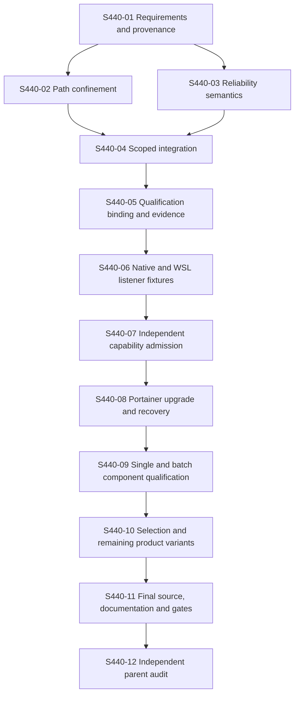

# #440 — Complete lifecycle qualification and parent acceptance

Workflow ID: issue-440-final-acceptance
workflowVersion: 1.0
Status: EXECUTING; S440-01 PARTIAL (inventory accepted, live readiness NOT_VERIFIED); no live GO granted
Issue: [#440](https://github.com/MatthiasBurger-Coder/Tiny-Swarm-World/issues/440)
Branch: `docs/workflow-issue440-acceptance-20261110`
Baseline: `ca6902579f51c2c6d9439bf9c58dec02bfb45a93`
Execution profile: FULL_PATH
Process strand: workflow create; implementation requires workflow execute

## Executive Summary

Close the actual #440 acceptance gaps through existing Classic lifecycle paths:
repair the four observed Sonar findings without weakening validation, finish any
proven scoped-profile integration gaps, bind qualification tooling to the new
workflow, qualify exact Incus prerequisites, execute attributable Portainer,
component and selective-installation scenarios, and obtain independent final
acceptance. Work-package closure, installation success and reachable login pages
do not establish this parent acceptance.

## Target Picture

The delivered Linux/WSL → Incus/LXC → Docker Engine/Swarm operator path performs
supported product and component updates and selective setup/add without losing
configuration, credential references, installation/service identities or data.
Inspect/preview/consent/apply/verify/recover remain coherent. Supported targets
have attributable exact-source evidence; unqualified targets remain blocked.
The final parent matrix has no open requirement and all applicable gates pass.

## Requirement Clarification Gate

- Original Request: “Dann müssen diese behoben werden => erslle einen workflow”.
- Interpreted Intent: create and publish the complete workflow for the open #440 criteria; do not execute it during authoring.
- Change Type: planned bug remediation, prerequisite completion and cross-host lifecycle qualification.
- Affected Process Strand: workflow create now; separately invoked workflow execute later.
- Affected Architecture Area: existing lifecycle services/ports, profile ownership, Incus/Portainer adapters, catalogs, checkpoints, evidence and CLI wiring.
- Explicit Requirements: 47 LCM-01–05 items, 15 parent criteria P01–P15 and four late acceptance groups, recorded in requirement-matrix.md and requirements.json.
- Implicit Requirements: exact-source/host attribution, preservation, denied-path checks, trustworthy qualification-to-admission ordering, independent reviews and no silent scope reduction.
- Assumptions: preserve the accepted historical 0.4.0→0.5.0 transition; use the existing native and WSL fixture design; investigate missing implementation inside the named foundational slices.
- Non-Goals: Kubernetes/Podman, another orchestration engine, generic Incus package upgrades, clean Windows one-command setup (#488), arbitrary component versions, unattended updates, destructive reuse of existing installations, new external CI, rule/threshold weakening or issue closure during authoring.
- Risks: missing backups, shared-host effects, stale workflow/source hashes, ambiguous checkpoints, unsafe qualification promotion, false-positive remediation that weakens type/path/cancellation guards.
- Open Questions: exact private fixture ownership, resource capacity and preservation receipts are runtime preflight inputs; S440-01 must resolve the scenario ledger before live work. Any required API/contract expansion needs review in its owning slice.
- Blocking Questions: none for this authoring scope. Missing live consent or capability admission blocks its dependent live slice, not deterministic implementation.
- Confidence Level: 94% in requirement/scope readiness; this is not runtime evidence. Clarification attempt 1 of maxRetries 3.
- Decision: READY_FOR_WORKFLOW, with explicit prerequisite, review and scenario-specific consent gates.
- Four mandatory authoring roles: Requirement, System Architecture, Python Automation and Tester, performed as recorded role passes by one agent. These are not independent completion approvals.

## Verified Baseline

PR #518 is merged as `ca6902579f51c2c6d9439bf9c58dec02bfb45a93` and its nine commits remain in history. The
working tree was clean before this dedicated branch was created. Existing WSL
full quality passed 4,011 tests with 37 explicit skips. Main hosted quality,
coverage export and Python 3.12/3.13/3.14 passed. Sonar run 42900701586 completed
analysis of this merge; its actual security and reliability gates failed (both
E). New coverage 86.6% passed the 80% threshold. One S2083 finding and three
S7497/S3403 findings are in files unchanged by #518; they remain in scope here.

`incus-profile-capabilities.json` has an empty admitted_versions list. Scoped
composition/services/runtime callers exist and must be traced rather than
recreated. The separate data-only incus_capability classifier remains unsupported.
Swagger/Traefik entries are candidate-transition. Listener fixture git_preflight
and native_lxd_maintenance still reference the old indexed #449 workflow; that
binding must be repaired and tested before new live qualification.

This workflow replaces the old root #355 plan and indexed #449 planning tree;
their exact historical content remains in Git at `ca6902579f51c2c6d9439bf9c58dec02bfb45a93`. Existing issue/live
evidence outside the workflow directory is retained. Old #449 commands/plans are
not automatically selected or authorized. The old fixture fails closed on the
new workflow tree until S440-05 supplies an independently reviewed exact binding.

## Scope and Architecture Constraints

Use the canonical catalog and installation manifest, existing lifecycle services,
ports and #297-backed update executor. Domain remains free of host/process/HTTP
dependencies; application owns orchestration via ports; infrastructure owns
filesystem, process, Git/package, Incus and Portainer effects. CLI stays thin.
Do not add an alternate runner that bypasses these boundaries. Preserve public
commands and explicit failures, credential-source references, state schema and
legacy full Classic behavior unless a reviewed requirement requires a change.

Follow the accepted lifecycle, selection/stack ownership, scoped-route and
installation-scoped-profile ADRs. R67k permits mock-only implementation before
listener qualification; it does not admit a version or grant a host-effect GO.
Every mutating scoped caller, recovery and cleanup must pass pre-effect capability
admission, exact ownership and durable checkpoint rules. A fixture result,
capability admission, candidate qualification and product acceptance are separate
decisions. Unknown version/source/consumer or uncertain acknowledgement fails closed.

## Python Automation Assessment

Use the shipped Python 3.12+ package and verified Linux/WSL launchers. The trace is
`tiny-swarm-world`/`tsw` → core __main__/CLI dispatch → existing installation,
component/product/Portainer/profile services → ports → concrete adapters and
manifest/journal writes. Verify this exact trace and its flags in S440-01.
Source maps and existing tests are listed per slice. Proposed new harness files
are explicitly identified in S440-05; no unimplemented helper is an executable
verification command. No tests or infrastructure are run during workflow authoring.

## Frontend Assessment

No new browser frontend exists or is proposed. Existing Selenium/service-browser
checks are live evidence only. Console/status UI review is conditional for any
change to human/JSON status, progress, help or actionable error output; preserve
exit/JSON contracts. No React/Java/Maven scope is introduced.

## Test Strategy and Resilience Requirements

All agent-run deterministic tests and quality gates execute via SSH to the
Windows PC identified in AGENTS.md, inside its Ubuntu WSL. Read credentials from
~/.access without printing or putting them in argv/logs/Git. Verify source hashes,
repository root and installed package before each relevant check. SSH/WSL outage
is BLOCKED; never silently test elsewhere. Native deployment qualification is a
separate admitted target/scenario controlled from that WSL session; browser tests
against a native host do not qualify a deployment inside WSL.

Run meaningful targeted regressions first, then the canonical gate for changed
runtime source. Use fake effects/temp files by default. Live/scenario evidence
requires separately admitted, recoverable targets and explicit applicable consent.
Missing consent or prerequisites must never count as verification; record the applicable blocked verification state.
do not reinterpret workflow create as live approval. Preserve existing explicit
authorization only when its exact target, action and scenario still apply.

Before each live scenario bind the reviewed candidate, executable/arguments,
host/client/server versions, resource/route/consumer state, selection, cold backup,
rollback/recovery boundaries and no-external-writer window. Serialize writers and
shared hosts. Capture signals against actual process/checkpoint identities,
lost acknowledgements and post-state readback; retain uncertain state rather than
blindly retrying or deleting. Preserve unrelated issue447 assets, Windows rules,
PortProxy and route baselines. Fixture loopback ports are not customer routes.

Authoring: static/doc checks APPLICABLE_LOCAL, live LIVE_NOT_APPLICABLE and
external gate EXTERNAL_GATE_NOT_APPLICABLE to branch-only planning publication.
Execution: deterministic gates APPLICABLE_LOCAL, required host/service/browser
scenarios APPLICABLE_LIVE, configured hosted/Sonar checks APPLICABLE_EXTERNAL.
Actual per-scenario applicability, consent and result remain separately recorded.

## Ordered Slices and Dependency Graph



Only S440-02 and S440-03 may run concurrently after disjoint-lock confirmation;
everything else follows the graph. Scenario source changes invalidate affected
downstream evidence. Expected effort is 11–24 engineer-days including prerequisite
implementation, qualification and review effort; host access, image transfer,
external CI and reviewer waiting add calendar time. Estimate confidence is medium
to low until S440-01 inventories actual fixtures and implementation deltas.

### Slice 01 — Freeze requirements, provenance and qualification scope

Purpose: Re-extract the complete parent, late additions and child requirements. Assign every normative statement to implementation, current tests and historical/live evidence; classify reused, stale, missing and failed results. Inspect the installed launcher and every public command through composition to actual effects.

Prerequisites: Verified dedicated branch, complete context and S3/S3D preflight.

Requirement mapping: P05, P08, P10, P12, P14. Read the corresponding LCM and late-addition rows in requirement-matrix.md.

Done criteria: A complete requirement-to-command/evidence inventory, approved fixture ownership and recovery plan, exact test/deployment host distinction, source/archive binding and per-scenario gaps exist. No missing foundation is treated as supplied by a closed issue.

Stop conditions: Unclear host ownership, ambiguous product/selection semantics, unexpected local changes or an unbound evidence source blocks the affected scenario; continue independent deterministic fixes.

Evidence: `.tiny-swarm/evidence/issue-440/slice-01/`; retain exact commands/results and before/after source/state bindings. Effort: 0.5–1 engineer-day.

Allowed files, locks, owners, dependencies and verified commands:

```yaml
{
  "slice_id": "S440-01",
  "profile": "FULL_PATH",
  "status": "PARTIAL_INVENTORY_ACCEPTED_LIVE_READINESS_PENDING",
  "owner": "Senior Requirement Engineer",
  "secondary_reviewers": [
    "Senior Requirement Engineer",
    "Senior System Architect",
    "Senior Python Automation Developer",
    "Senior Tester"
  ],
  "affected_files": [
    "documentation/handbook/05-development/workflow/requirement-matrix.md",
    "documentation/handbook/05-development/workflow/prerequisite-ledger.md",
    "documentation/handbook/05-development/workflow/scenario-plan.md"
  ],
  "affected_modules": [
    "governance",
    "lifecycle acceptance"
  ],
  "affected_contracts": [
    "P01-P15",
    "LCM-01-LCM-05"
  ],
  "dependencies": [],
  "parallel_group": "serial-01",
  "parallel_execution_eligible": false,
  "requires_isolated_worktree": true,
  "requires_serialized_live_validation": true,
  "file_locks": [
    "documentation/handbook/05-development/workflow/requirement-matrix.md",
    "documentation/handbook/05-development/workflow/prerequisite-ledger.md",
    "documentation/handbook/05-development/workflow/scenario-plan.md",
    ".tiny-swarm/evidence/issue-440/slice-01/**"
  ],
  "contract_locks": [
    "P01-P15",
    "LCM-01-LCM-05"
  ],
  "architecture_locks": [],
  "module_locks": [],
  "shared_files": [],
  "shared_infrastructure": [
    "designated SSH/WSL quality host"
  ],
  "conflicting_workflows": [
    "historical issue-449 qualification",
    "any writer on the same installation/host"
  ],
  "allowed_write_scope": [
    "documentation/handbook/05-development/workflow/requirement-matrix.md",
    "documentation/handbook/05-development/workflow/prerequisite-ledger.md",
    "documentation/handbook/05-development/workflow/scenario-plan.md",
    ".tiny-swarm/evidence/issue-440/slice-01/**",
    ".codex/evidence/slice-01-distribution.md",
    ".codex/evidence/slice-01-consolidation.md"
  ],
  "requirement_ids": [
    "P05",
    "P08",
    "P10",
    "P12",
    "P14"
  ],
  "quality_gates": {
    "targeted": [
      "PYTHONPATH=. python3 -m unittest modules.tsw_core.tests.test_package_entrypoint modules.tsw_core.tests.test_selective_setup_cli modules.tsw_core.tests.test_portainer_upgrade_cli modules.tsw_core.tests.test_component_updates_cli modules.tsw_core.tests.test_product_upgrade_cli"
    ],
    "required": [
      "git diff --check"
    ]
  },
  "documentation": {
    "arc42": "Review existing relevant boundaries/ADRs; update only if an approved delta requires it.",
    "adr": "Accepted installation-scoped-profile and Classic lifecycle decisions remain authoritative."
  },
  "stop_conditions": [
    "Unclear host ownership, ambiguous product/selection semantics, unexpected local changes or an unbound evidence source blocks the affected scenario; continue independent deterministic fixes.",
    "No guard/rule/threshold weakening; no unapproved live or external writes."
  ]
}
```

### Slice 02 — Resolve the WSL path-traversal finding

Purpose: Reproduce Sonar pythonsecurity:S2083 at the actual file-effect boundary. Preserve legitimate WSL user-profile handling while proving confinement, symlink/reparse refusal, validation of external command output and safe backup/write ownership; preserve contents on refusal.

Prerequisites: S440-01.

Requirement mapping: P11, P13. Read the corresponding LCM and late-addition rows in requirement-matrix.md.

Done criteria: Adversarial traversal, malformed/multiline paths, symlink/redirect and replacement cases cannot read or write outside the explicitly admitted profile/config target. Existing supported-path and backup behavior remain verified. Resolve the specific Sonar finding through code or a separately reviewed, evidence-backed false-positive decision; never suppress the rule or broaden exclusions.

Stop conditions: Unknown filesystem identity, TOCTOU gap or a required network/Windows mutation without scenario consent blocks live checks; no WSL shutdown or host repair is run during deterministic regression work.

Evidence: `.tiny-swarm/evidence/issue-440/slice-02/`; retain exact commands/results and before/after source/state bindings. Effort: 1–2 engineer-days.

Allowed files, locks, owners, dependencies and verified commands:

```yaml
{
  "slice_id": "S440-02",
  "profile": "FULL_PATH",
  "status": "PLANNED",
  "owner": "Senior Security Sandbox Engineer",
  "secondary_reviewers": [
    "Senior Requirement Engineer",
    "Senior System Architect",
    "Senior Python Automation Developer",
    "Senior Tester",
    "Senior Security Sandbox Engineer",
    "Senior DevOps"
  ],
  "affected_files": [
    "modules/tsw_core/src/infrastructure/adapters/network/host_network_repair.py",
    "modules/tsw_core/tests/infrastructure/adapters/network/test_host_network_repair.py"
  ],
  "affected_modules": [
    "core network adapter"
  ],
  "affected_contracts": [
    "host config path confinement",
    "secret-safe repair results"
  ],
  "dependencies": [
    "S440-01"
  ],
  "parallel_group": "independent-fixes",
  "parallel_execution_eligible": true,
  "requires_isolated_worktree": true,
  "requires_serialized_live_validation": true,
  "file_locks": [
    "modules/tsw_core/src/infrastructure/adapters/network/host_network_repair.py",
    "modules/tsw_core/tests/infrastructure/adapters/network/test_host_network_repair.py",
    ".tiny-swarm/evidence/issue-440/slice-02/**"
  ],
  "contract_locks": [
    "host config path confinement",
    "secret-safe repair results"
  ],
  "architecture_locks": [],
  "module_locks": [],
  "shared_files": [],
  "shared_infrastructure": [
    "designated SSH/WSL quality host"
  ],
  "conflicting_workflows": [
    "historical issue-449 qualification",
    "any writer on the same installation/host"
  ],
  "allowed_write_scope": [
    "modules/tsw_core/src/infrastructure/adapters/network/host_network_repair.py",
    "modules/tsw_core/tests/infrastructure/adapters/network/test_host_network_repair.py",
    ".tiny-swarm/evidence/issue-440/slice-02/**",
    ".codex/evidence/slice-02-distribution.md",
    ".codex/evidence/slice-02-consolidation.md"
  ],
  "requirement_ids": [
    "P11",
    "P13"
  ],
  "quality_gates": {
    "targeted": [
      "PYTHONPATH=. python3 -m unittest modules.tsw_core.tests.infrastructure.adapters.network.test_host_network_repair"
    ],
    "required": [
      "python3 modules/tsw_core/tools/linux/quality_gate.py quality"
    ]
  },
  "documentation": {
    "arc42": "Review existing relevant boundaries/ADRs; update only if an approved delta requires it.",
    "adr": "Accepted installation-scoped-profile and Classic lifecycle decisions remain authoritative."
  },
  "stop_conditions": [
    "Unknown filesystem identity, TOCTOU gap or a required network/Windows mutation without scenario consent blocks live checks; no WSL shutdown or host repair is run during deterministic regression work.",
    "No guard/rule/threshold weakening; no unapproved live or external writes."
  ]
}
```

### Slice 03 — Resolve cancellation and strict-type reliability findings

Purpose: Review python:S7497 and both python:S3403 findings semantically before editing. Preserve exact-type rejection, bool/int distinctions, malformed-input refusals and CAS behavior. Preserve durable operation-lock ownership while an admitted child settles and always propagate caller cancellation.

Prerequisites: S440-01.

Requirement mapping: P08, P09, P11, P13. Read the corresponding LCM and late-addition rows in requirement-matrix.md.

Done criteria: Tests prove single/repeated cancellation, child failure and cancellation, ownership until settlement, cancellation propagation, strict input types and unchanged no-mutation refusal semantics. Findings are fixed or individually adjudicated with independent evidence; do not mechanically weaken exact-type checks to satisfy static analysis.

Stop conditions: A proposed change can release ownership before effects settle, swallow cancellation, accept wrong types or change denial exits; return to architecture/test review.

Evidence: `.tiny-swarm/evidence/issue-440/slice-03/`; retain exact commands/results and before/after source/state bindings. Effort: 1–2 engineer-days.

Allowed files, locks, owners, dependencies and verified commands:

```yaml
{
  "slice_id": "S440-03",
  "profile": "FULL_PATH",
  "status": "PLANNED",
  "owner": "Senior Python Automation Developer",
  "secondary_reviewers": [
    "Senior Requirement Engineer",
    "Senior System Architect",
    "Senior Python Automation Developer",
    "Senior Tester"
  ],
  "affected_files": [
    "modules/tsw_core/src/application/services/installation_profile.py",
    "modules/tsw_core/src/infrastructure/adapters/lifecycle/versioned_manifest_repository.py",
    "modules/tsw_core/src/infrastructure/adapters/cli/migration_admission.py",
    "modules/tsw_core/tests/application/services/test_installation_profile.py",
    "modules/tsw_core/tests/infrastructure/adapters/lifecycle/test_versioned_manifest_repository.py",
    "modules/tsw_core/tests/test_migration_admission_cli.py",
    "modules/tsw_core/tests/application/services/test_migration_admission.py"
  ],
  "affected_modules": [
    "core application",
    "manifest repository",
    "CLI admission"
  ],
  "affected_contracts": [
    "cancellation ownership",
    "exact-type validation",
    "CAS safety"
  ],
  "dependencies": [
    "S440-01"
  ],
  "parallel_group": "independent-fixes",
  "parallel_execution_eligible": true,
  "requires_isolated_worktree": true,
  "requires_serialized_live_validation": true,
  "file_locks": [
    "modules/tsw_core/src/application/services/installation_profile.py",
    "modules/tsw_core/src/infrastructure/adapters/lifecycle/versioned_manifest_repository.py",
    "modules/tsw_core/src/infrastructure/adapters/cli/migration_admission.py",
    "modules/tsw_core/tests/application/services/test_installation_profile.py",
    "modules/tsw_core/tests/infrastructure/adapters/lifecycle/test_versioned_manifest_repository.py",
    "modules/tsw_core/tests/test_migration_admission_cli.py",
    "modules/tsw_core/tests/application/services/test_migration_admission.py",
    ".tiny-swarm/evidence/issue-440/slice-03/**"
  ],
  "contract_locks": [
    "cancellation ownership",
    "exact-type validation",
    "CAS safety"
  ],
  "architecture_locks": [],
  "module_locks": [],
  "shared_files": [],
  "shared_infrastructure": [
    "designated SSH/WSL quality host"
  ],
  "conflicting_workflows": [
    "historical issue-449 qualification",
    "any writer on the same installation/host"
  ],
  "allowed_write_scope": [
    "modules/tsw_core/src/application/services/installation_profile.py",
    "modules/tsw_core/src/infrastructure/adapters/lifecycle/versioned_manifest_repository.py",
    "modules/tsw_core/src/infrastructure/adapters/cli/migration_admission.py",
    "modules/tsw_core/tests/application/services/test_installation_profile.py",
    "modules/tsw_core/tests/infrastructure/adapters/lifecycle/test_versioned_manifest_repository.py",
    "modules/tsw_core/tests/test_migration_admission_cli.py",
    "modules/tsw_core/tests/application/services/test_migration_admission.py",
    ".tiny-swarm/evidence/issue-440/slice-03/**",
    ".codex/evidence/slice-03-distribution.md",
    ".codex/evidence/slice-03-consolidation.md"
  ],
  "requirement_ids": [
    "P08",
    "P09",
    "P11",
    "P13"
  ],
  "quality_gates": {
    "targeted": [
      "PYTHONPATH=. python3 -m unittest modules.tsw_core.tests.application.services.test_installation_profile modules.tsw_core.tests.infrastructure.adapters.lifecycle.test_versioned_manifest_repository modules.tsw_core.tests.test_migration_admission_cli modules.tsw_core.tests.application.services.test_migration_admission"
    ],
    "required": [
      "python3 modules/tsw_core/tools/linux/quality_gate.py quality"
    ]
  },
  "documentation": {
    "arc42": "Review existing relevant boundaries/ADRs; update only if an approved delta requires it.",
    "adr": "Accepted installation-scoped-profile and Classic lifecycle decisions remain authoritative."
  },
  "stop_conditions": [
    "A proposed change can release ownership before effects settle, swallow cancellation, accept wrong types or change denial exits; return to architecture/test review.",
    "No guard/rule/threshold weakening; no unapproved live or external writes."
  ]
}
```

### Slice 04 — Complete and prove the scoped lifecycle integration

Purpose: Trace the existing integrated implementation rather than rebuilding it. Repair only proven gaps in pre-effect capability admission, stopped-manager init/route readback/start ordering, effective inherited devices, consumer drift, durable checkpoints and lost-ack handling for setup/add/update/recovery/cleanup.

Prerequisites: S440-02, S440-03.

Requirement mapping: P03, P04, P05, P06, P07, P08, P09, P11, P13. Read the corresponding LCM and late-addition rows in requirement-matrix.md.

Done criteria: Every delivered caller, including recovery and cleanup, is fail-closed with an empty/unknown capability matrix; legacy full Classic behavior remains separate. Exact route sets derive from persisted post-operation selection; changed or uncertain observations retain recoverable state. Installation lock ordering and safe ownership are tested. New application/port/domain files require an explicitly reviewed scope amendment before writing.

Stop conditions: A new unguarded effect route, ambiguous legacy migration or necessary contract expansion requires a reviewed plan/ADR amendment before that path changes.

Evidence: `.tiny-swarm/evidence/issue-440/slice-04/`; retain exact commands/results and before/after source/state bindings. Effort: 1–3 engineer-days, depending on the proven delta.

Allowed files, locks, owners, dependencies and verified commands:

```yaml
{
  "slice_id": "S440-04",
  "profile": "FULL_PATH",
  "status": "PLANNED",
  "owner": "Senior Python Automation Developer",
  "secondary_reviewers": [
    "Senior Requirement Engineer",
    "Senior System Architect",
    "Senior Python Automation Developer",
    "Senior Tester",
    "Senior Security Sandbox Engineer",
    "Senior DevOps"
  ],
  "affected_files": [
    "modules/tsw_core/src/application/services/profile_setup.py",
    "modules/tsw_core/src/application/services/installation_profile.py",
    "modules/tsw_core/src/application/services/profile_change.py",
    "modules/tsw_core/src/application/services/profile_completion.py",
    "modules/tsw_core/src/infrastructure/composition_profile.py",
    "modules/tsw_core/src/infrastructure/composition_profile_runtime.py",
    "modules/tsw_core/src/infrastructure/adapters/lifecycle/profile_setup.py",
    "modules/tsw_core/src/infrastructure/adapters/lifecycle/profile_change.py",
    "modules/tsw_core/src/infrastructure/adapters/lifecycle/profile_completion.py",
    "modules/tsw_core/src/infrastructure/adapters/lifecycle/installation_operation_lock.py",
    "modules/tsw_core/src/infrastructure/adapters/clients/lxc/profile/**",
    "modules/tsw_core/src/infrastructure/adapters/clients/lxc/node/scoped.py",
    "modules/tsw_core/tests/application/services/test_profile_change.py",
    "modules/tsw_core/tests/application/services/test_installation_profile.py",
    "modules/tsw_core/tests/infrastructure/adapters/clients/test_lxc_profile_lifecycle.py",
    "modules/tsw_core/tests/infrastructure/adapters/lifecycle/test_installation_operation_lock.py",
    "modules/tsw_core/tests/test_profile_recovery_cli.py",
    "modules/tsw_core/tests/test_profile_legacy_compatibility.py"
  ],
  "affected_modules": [
    "core profile application ports/adapters",
    "Incus scoped runtime"
  ],
  "affected_contracts": [
    "installation lock",
    "checkpoint-bound profile/routes",
    "selection and recovery"
  ],
  "dependencies": [
    "S440-02",
    "S440-03"
  ],
  "parallel_group": "serial-04",
  "parallel_execution_eligible": false,
  "requires_isolated_worktree": true,
  "requires_serialized_live_validation": true,
  "file_locks": [
    "modules/tsw_core/src/application/services/profile_setup.py",
    "modules/tsw_core/src/application/services/installation_profile.py",
    "modules/tsw_core/src/application/services/profile_change.py",
    "modules/tsw_core/src/application/services/profile_completion.py",
    "modules/tsw_core/src/infrastructure/composition_profile.py",
    "modules/tsw_core/src/infrastructure/composition_profile_runtime.py",
    "modules/tsw_core/src/infrastructure/adapters/lifecycle/profile_setup.py",
    "modules/tsw_core/src/infrastructure/adapters/lifecycle/profile_change.py",
    "modules/tsw_core/src/infrastructure/adapters/lifecycle/profile_completion.py",
    "modules/tsw_core/src/infrastructure/adapters/lifecycle/installation_operation_lock.py",
    "modules/tsw_core/src/infrastructure/adapters/clients/lxc/profile/**",
    "modules/tsw_core/src/infrastructure/adapters/clients/lxc/node/scoped.py",
    "modules/tsw_core/tests/application/services/test_profile_change.py",
    "modules/tsw_core/tests/application/services/test_installation_profile.py",
    "modules/tsw_core/tests/infrastructure/adapters/clients/test_lxc_profile_lifecycle.py",
    "modules/tsw_core/tests/infrastructure/adapters/lifecycle/test_installation_operation_lock.py",
    "modules/tsw_core/tests/test_profile_recovery_cli.py",
    "modules/tsw_core/tests/test_profile_legacy_compatibility.py",
    ".tiny-swarm/evidence/issue-440/slice-04/**"
  ],
  "contract_locks": [
    "installation lock",
    "checkpoint-bound profile/routes",
    "selection and recovery"
  ],
  "architecture_locks": [
    "scoped-profile-boundary"
  ],
  "module_locks": [],
  "shared_files": [],
  "shared_infrastructure": [
    "designated SSH/WSL quality host"
  ],
  "conflicting_workflows": [
    "historical issue-449 qualification",
    "any writer on the same installation/host"
  ],
  "allowed_write_scope": [
    "modules/tsw_core/src/application/services/profile_setup.py",
    "modules/tsw_core/src/application/services/installation_profile.py",
    "modules/tsw_core/src/application/services/profile_change.py",
    "modules/tsw_core/src/application/services/profile_completion.py",
    "modules/tsw_core/src/infrastructure/composition_profile.py",
    "modules/tsw_core/src/infrastructure/composition_profile_runtime.py",
    "modules/tsw_core/src/infrastructure/adapters/lifecycle/profile_setup.py",
    "modules/tsw_core/src/infrastructure/adapters/lifecycle/profile_change.py",
    "modules/tsw_core/src/infrastructure/adapters/lifecycle/profile_completion.py",
    "modules/tsw_core/src/infrastructure/adapters/lifecycle/installation_operation_lock.py",
    "modules/tsw_core/src/infrastructure/adapters/clients/lxc/profile/**",
    "modules/tsw_core/src/infrastructure/adapters/clients/lxc/node/scoped.py",
    "modules/tsw_core/tests/application/services/test_profile_change.py",
    "modules/tsw_core/tests/application/services/test_installation_profile.py",
    "modules/tsw_core/tests/infrastructure/adapters/clients/test_lxc_profile_lifecycle.py",
    "modules/tsw_core/tests/infrastructure/adapters/lifecycle/test_installation_operation_lock.py",
    "modules/tsw_core/tests/test_profile_recovery_cli.py",
    "modules/tsw_core/tests/test_profile_legacy_compatibility.py",
    ".tiny-swarm/evidence/issue-440/slice-04/**",
    ".codex/evidence/slice-04-distribution.md",
    ".codex/evidence/slice-04-consolidation.md"
  ],
  "requirement_ids": [
    "P03",
    "P04",
    "P05",
    "P06",
    "P07",
    "P08",
    "P09",
    "P11",
    "P13"
  ],
  "quality_gates": {
    "targeted": [
      "PYTHONPATH=. python3 -m unittest modules.tsw_core.tests.application.services.test_installation_profile modules.tsw_core.tests.application.services.test_profile_change modules.tsw_core.tests.infrastructure.adapters.clients.test_lxc_profile_lifecycle modules.tsw_core.tests.infrastructure.adapters.lifecycle.test_installation_operation_lock modules.tsw_core.tests.test_profile_recovery_cli modules.tsw_core.tests.test_profile_legacy_compatibility"
    ],
    "required": [
      "python3 modules/tsw_core/tools/linux/quality_gate.py quality"
    ]
  },
  "documentation": {
    "arc42": "Review existing relevant boundaries/ADRs; update only if an approved delta requires it.",
    "adr": "Accepted installation-scoped-profile and Classic lifecycle decisions remain authoritative."
  },
  "stop_conditions": [
    "A new unguarded effect route, ambiguous legacy migration or necessary contract expansion requires a reviewed plan/ADR amendment before that path changes.",
    "No guard/rule/threshold weakening; no unapproved live or external writes."
  ]
}
```

### Slice 05 — Bind qualification helpers to this workflow and complete evidence capture

Purpose: Replace the hardcoded historical issue-449 workflow binding with an explicit reviewed binding to the checked active workflow, retaining clean-HEAD, exact hash, target and GO validation. Complete missing bounded scenario capture around the real public CLI, not a second lifecycle engine. The two run_lcm_acceptance/test_lcm_acceptance files are explicitly proposed new files, not existing executable commands.

Prerequisites: S440-04.

Requirement mapping: P02, P08, P09, P12, P13. Read the corresponding LCM and late-addition rows in requirement-matrix.md.

Done criteria: Old/stale/foreign workflow approvals fail before mutation. Each scenario records exact source, executable/argv, host/version/selection, parent/child process, timestamps, exits, durable stage and private before/after checksums. Capture lost acknowledgements, signal attribution, output limits and redaction. New harness CLI/help is specified and reviewed in S440-01, implemented/tested here and only then entered as executable commands in scenario-plan.md. No fabricated checkpoint, runtime observation or generic force flag.

Stop conditions: The current fixture cannot consume a reviewed active-workflow binding, an evidence read is ambiguous, or a proposed helper bypasses public CLI admission. The historical helper is not usable for this campaign until this slice passes.

Evidence: `.tiny-swarm/evidence/issue-440/slice-05/`; retain exact commands/results and before/after source/state bindings. Effort: 1–2 engineer-days.

Allowed files, locks, owners, dependencies and verified commands:

```yaml
{
  "slice_id": "S440-05",
  "profile": "FULL_PATH",
  "status": "PLANNED",
  "owner": "Senior Python Automation Developer",
  "secondary_reviewers": [
    "Senior Requirement Engineer",
    "Senior System Architect",
    "Senior Python Automation Developer",
    "Senior Tester",
    "Senior Security Sandbox Engineer",
    "Senior DevOps"
  ],
  "affected_files": [
    "modules/tsw_core/tools/linux/qualification/incus_profile_listener_fixture.py",
    "modules/tsw_core/tools/linux/qualification/native_lxd_maintenance.py",
    "modules/tsw_core/tools/linux/qualification/preserving_product_acceptance.py",
    "modules/tsw_core/tools/linux/qualification/product_upgrade_cases.py",
    "modules/tsw_core/tools/linux/qualification/wsl_product_acceptance.py",
    "modules/tsw_core/tests/infrastructure/adapters/clients/test_lxc_profile_listener_fixture.py",
    "modules/tsw_native_linux/tests/tools/test_native_lxd_maintenance.py",
    "modules/tsw_core/tests/e2e/classic/run_lcm_acceptance.py",
    "modules/tsw_core/tests/tools/test_lcm_acceptance.py"
  ],
  "affected_modules": [
    "core qualification tooling",
    "native delegates",
    "existing lifecycle CLI"
  ],
  "affected_contracts": [
    "workflow/source approval identity",
    "attributable scenario evidence"
  ],
  "dependencies": [
    "S440-04"
  ],
  "parallel_group": "serial-05",
  "parallel_execution_eligible": false,
  "requires_isolated_worktree": true,
  "requires_serialized_live_validation": true,
  "file_locks": [
    "modules/tsw_core/tools/linux/qualification/incus_profile_listener_fixture.py",
    "modules/tsw_core/tools/linux/qualification/native_lxd_maintenance.py",
    "modules/tsw_core/tools/linux/qualification/preserving_product_acceptance.py",
    "modules/tsw_core/tools/linux/qualification/product_upgrade_cases.py",
    "modules/tsw_core/tools/linux/qualification/wsl_product_acceptance.py",
    "modules/tsw_core/tests/infrastructure/adapters/clients/test_lxc_profile_listener_fixture.py",
    "modules/tsw_native_linux/tests/tools/test_native_lxd_maintenance.py",
    "modules/tsw_core/tests/e2e/classic/run_lcm_acceptance.py",
    "modules/tsw_core/tests/tools/test_lcm_acceptance.py",
    ".tiny-swarm/evidence/issue-440/slice-05/**"
  ],
  "contract_locks": [
    "workflow/source approval identity",
    "attributable scenario evidence"
  ],
  "architecture_locks": [
    "qualification-approval-boundary"
  ],
  "module_locks": [],
  "shared_files": [],
  "shared_infrastructure": [
    "designated SSH/WSL quality host"
  ],
  "conflicting_workflows": [
    "historical issue-449 qualification",
    "any writer on the same installation/host"
  ],
  "allowed_write_scope": [
    "modules/tsw_core/tools/linux/qualification/incus_profile_listener_fixture.py",
    "modules/tsw_core/tools/linux/qualification/native_lxd_maintenance.py",
    "modules/tsw_core/tools/linux/qualification/preserving_product_acceptance.py",
    "modules/tsw_core/tools/linux/qualification/product_upgrade_cases.py",
    "modules/tsw_core/tools/linux/qualification/wsl_product_acceptance.py",
    "modules/tsw_core/tests/infrastructure/adapters/clients/test_lxc_profile_listener_fixture.py",
    "modules/tsw_native_linux/tests/tools/test_native_lxd_maintenance.py",
    "modules/tsw_core/tests/e2e/classic/run_lcm_acceptance.py",
    "modules/tsw_core/tests/tools/test_lcm_acceptance.py",
    ".tiny-swarm/evidence/issue-440/slice-05/**",
    ".codex/evidence/slice-05-distribution.md",
    ".codex/evidence/slice-05-consolidation.md"
  ],
  "requirement_ids": [
    "P02",
    "P08",
    "P09",
    "P12",
    "P13"
  ],
  "quality_gates": {
    "targeted": [
      "PYTHONPATH=. python3 -m unittest modules.tsw_core.tests.infrastructure.adapters.clients.test_lxc_profile_listener_fixture",
      "PYTHONPATH=. python3 -m unittest modules.tsw_native_linux.tests.tools.test_native_lxd_maintenance"
    ],
    "required": [
      "python3 modules/tsw_core/tools/linux/quality_gate.py quality"
    ]
  },
  "documentation": {
    "arc42": "Review existing relevant boundaries/ADRs; update only if an approved delta requires it.",
    "adr": "Accepted installation-scoped-profile and Classic lifecycle decisions remain authoritative."
  },
  "stop_conditions": [
    "The current fixture cannot consume a reviewed active-workflow binding, an evidence read is ambiguous, or a proposed helper bypasses public CLI admission. The historical helper is not usable for this campaign until this slice passes.",
    "No guard/rule/threshold weakening; no unapproved live or external writes."
  ]
}
```

### Slice 06 — Qualify paired exact-version Incus listener fixtures

Purpose: After exact-source deterministic quality and independent same-hash review, obtain/verify scenario consent and JIT inventory for each independent host. Qualify Incus client/server 6.0.5 with the bounded isolated loopback proxy fixture. Historical native PASS is reusable only with an explicit source/evidence equivalence review.

Prerequisites: S440-05.

Requirement mapping: P03, P04, P12. Read the corresponding LCM and late-addition rows in requirement-matrix.md.

Done criteria: Each claimed host has attributable listener/HTTP timing, exact process/device/profile/consumer identity and cleanup proof. Preserve existing Portainer route tuples, Windows firewall/PortProxy and foreign instances/projects. No fixture wildcard listener or customer-route expansion. A fixture PASS does not admit production capability or qualify a service upgrade.

Stop conditions: Missing scenario consent, non-6.0.5 client/server identity, external writers, listener drift, unsafe preservation/restoration or missing source/GO binding blocks before the next mutation. No host-package upgrade is authorized implicitly.

Evidence: `.tiny-swarm/evidence/issue-440/slice-06/`; retain exact commands/results and before/after source/state bindings. Effort: 1–2 engineer-days excluding host access/review waiting.

Allowed files, locks, owners, dependencies and verified commands:

```yaml
{
  "slice_id": "S440-06",
  "profile": "FULL_PATH",
  "status": "PLANNED",
  "owner": "Senior DevOps",
  "secondary_reviewers": [
    "Senior Requirement Engineer",
    "Senior System Architect",
    "Senior Python Automation Developer",
    "Senior Tester",
    "Senior Security Sandbox Engineer",
    "Senior DevOps"
  ],
  "affected_files": [
    "documentation/handbook/07-evidence-release/evidence/lcm-w09-qualification.md"
  ],
  "affected_modules": [
    "native Incus fixture",
    "WSL Incus fixture"
  ],
  "affected_contracts": [
    "ADR installation-scoped profile fixture",
    "pre-existing route preservation"
  ],
  "dependencies": [
    "S440-05"
  ],
  "parallel_group": "serial-06",
  "parallel_execution_eligible": false,
  "requires_isolated_worktree": true,
  "requires_serialized_live_validation": true,
  "file_locks": [
    "documentation/handbook/07-evidence-release/evidence/lcm-w09-qualification.md",
    ".tiny-swarm/evidence/issue-440/slice-06/**"
  ],
  "contract_locks": [
    "ADR installation-scoped profile fixture",
    "pre-existing route preservation"
  ],
  "architecture_locks": [],
  "module_locks": [],
  "shared_files": [],
  "shared_infrastructure": [
    "designated SSH/WSL quality host",
    "approved native/WSL fixture resources"
  ],
  "conflicting_workflows": [
    "historical issue-449 qualification",
    "any writer on the same installation/host"
  ],
  "allowed_write_scope": [
    "documentation/handbook/07-evidence-release/evidence/lcm-w09-qualification.md",
    ".tiny-swarm/evidence/issue-440/slice-06/**",
    ".codex/evidence/slice-06-distribution.md",
    ".codex/evidence/slice-06-consolidation.md"
  ],
  "requirement_ids": [
    "P03",
    "P04",
    "P12"
  ],
  "quality_gates": {
    "targeted": [
      "PYTHONPATH=. python3 -m unittest modules.tsw_core.tests.infrastructure.adapters.clients.test_lxc_profile_listener_fixture"
    ],
    "required": [
      "git diff --check"
    ]
  },
  "documentation": {
    "arc42": "Review existing relevant boundaries/ADRs; update only if an approved delta requires it.",
    "adr": "Accepted installation-scoped-profile and Classic lifecycle decisions remain authoritative."
  },
  "stop_conditions": [
    "Missing scenario consent, non-6.0.5 client/server identity, external writers, listener drift, unsafe preservation/restoration or missing source/GO binding blocks before the next mutation. No host-package upgrade is authorized implicitly.",
    "No guard/rule/threshold weakening; no unapproved live or external writes."
  ]
}
```

### Slice 07 — Independently review and admit the precise profile capability

Purpose: Requirements, Architecture, Security, DevOps and Test/Evidence independently assess the paired fixtures, runtime callers and exact version. Amend the capability asset only after that acceptance; verify unknown versions still refuse. Treat the data-only incus_capability.py legacy classifier as its existing separate contract, not a second mutable support registry.

Prerequisites: S440-06.

Requirement mapping: P03, P04, P12, P13. Read the corresponding LCM and late-addition rows in requirement-matrix.md.

Done criteria: A separately recorded support decision binds precise client/server versions, host/platform and capability to accepted evidence. Denial, direct caller, recovery/cleanup and asset-integrity tests pass. No automatic qualification from a successful fixture, version string or closed issue.

Stop conditions: Independent review rejects or cannot bind evidence, consumers disagree about the authority, or another version would be admitted transitively.

Evidence: `.tiny-swarm/evidence/issue-440/slice-07/`; retain exact commands/results and before/after source/state bindings. Effort: 0.5–1 engineer-day plus independent review.

Allowed files, locks, owners, dependencies and verified commands:

```yaml
{
  "slice_id": "S440-07",
  "profile": "FULL_PATH",
  "status": "PLANNED",
  "owner": "Senior System Architect",
  "secondary_reviewers": [
    "Senior Requirement Engineer",
    "Senior System Architect",
    "Senior Python Automation Developer",
    "Senior Tester",
    "Senior Security Sandbox Engineer",
    "Senior DevOps"
  ],
  "affected_files": [
    "modules/tsw_core/infra/config/incus-profile-capabilities.json",
    "modules/tsw_core/src/infrastructure/adapters/repositories/incus_profile_capability_repository.py",
    "modules/tsw_core/src/domain/lifecycle/profile_lifecycle.py",
    "modules/tsw_core/tests/infrastructure/adapters/repositories/test_incus_profile_capability_repository.py",
    "modules/tsw_core/tests/domain/lifecycle/test_profile_lifecycle.py",
    "documentation/handbook/07-evidence-release/evidence/lcm-w09-qualification.md"
  ],
  "affected_modules": [
    "profile capability policy"
  ],
  "affected_contracts": [
    "exact reviewed version admission",
    "legacy versus scoped intent"
  ],
  "dependencies": [
    "S440-06"
  ],
  "parallel_group": "serial-07",
  "parallel_execution_eligible": false,
  "requires_isolated_worktree": true,
  "requires_serialized_live_validation": true,
  "file_locks": [
    "modules/tsw_core/infra/config/incus-profile-capabilities.json",
    "modules/tsw_core/src/infrastructure/adapters/repositories/incus_profile_capability_repository.py",
    "modules/tsw_core/src/domain/lifecycle/profile_lifecycle.py",
    "modules/tsw_core/tests/infrastructure/adapters/repositories/test_incus_profile_capability_repository.py",
    "modules/tsw_core/tests/domain/lifecycle/test_profile_lifecycle.py",
    "documentation/handbook/07-evidence-release/evidence/lcm-w09-qualification.md",
    ".tiny-swarm/evidence/issue-440/slice-07/**"
  ],
  "contract_locks": [
    "exact reviewed version admission",
    "legacy versus scoped intent"
  ],
  "architecture_locks": [],
  "module_locks": [],
  "shared_files": [],
  "shared_infrastructure": [
    "designated SSH/WSL quality host"
  ],
  "conflicting_workflows": [
    "historical issue-449 qualification",
    "any writer on the same installation/host"
  ],
  "allowed_write_scope": [
    "modules/tsw_core/infra/config/incus-profile-capabilities.json",
    "modules/tsw_core/src/infrastructure/adapters/repositories/incus_profile_capability_repository.py",
    "modules/tsw_core/src/domain/lifecycle/profile_lifecycle.py",
    "modules/tsw_core/tests/infrastructure/adapters/repositories/test_incus_profile_capability_repository.py",
    "modules/tsw_core/tests/domain/lifecycle/test_profile_lifecycle.py",
    "documentation/handbook/07-evidence-release/evidence/lcm-w09-qualification.md",
    ".tiny-swarm/evidence/issue-440/slice-07/**",
    ".codex/evidence/slice-07-distribution.md",
    ".codex/evidence/slice-07-consolidation.md"
  ],
  "requirement_ids": [
    "P03",
    "P04",
    "P12",
    "P13"
  ],
  "quality_gates": {
    "targeted": [
      "PYTHONPATH=. python3 -m unittest modules.tsw_core.tests.infrastructure.adapters.repositories.test_incus_profile_capability_repository modules.tsw_core.tests.domain.lifecycle.test_profile_lifecycle modules.tsw_core.tests.application.services.test_installation_profile"
    ],
    "required": [
      "python3 modules/tsw_core/tools/linux/quality_gate.py quality"
    ]
  },
  "documentation": {
    "arc42": "Review existing relevant boundaries/ADRs; update only if an approved delta requires it.",
    "adr": "Accepted installation-scoped-profile and Classic lifecycle decisions remain authoritative."
  },
  "stop_conditions": [
    "Independent review rejects or cannot bind evidence, consumers disagree about the authority, or another version would be admitted transitively.",
    "No guard/rule/threshold weakening; no unapproved live or external writes."
  ]
}
```

### Slice 08 — Qualify Portainer upgrade, managed deployment and API-down recovery

Purpose: Reconcile bounded native history and execute missing current-source cases, particularly WSL, on admitted recoverable fixtures with an already TSW-selected Portainer-managed stack. Use the dedicated Portainer public CLI path and real cold /data backup, not the generic image updater.

Prerequisites: S440-07.

Requirement mapping: P03, P09, P10, P11, P12. Read the corresponding LCM and late-addition rows in requirement-matrix.md.

Done criteria: Record source/target Server and Agent pins, actual upgrade, authenticated API access, unchanged admin/endpoint/data/stack identities, a subsequent managed stack update and converged Swarm tasks. Record literal repeat no-op plus separately attributed interruption and API-down cold recovery to the supported source, verified retained failed data and repeat recovery/no-op. Prove unrelated service/route preservation.

Stop conditions: Missing verified cold backup/restore path, unmanaged-only stack, lost API-down process attribution, unknown endpoint identity or unsafe checkpoint recovery. Installation/login success is not upgrade success.

Evidence: `.tiny-swarm/evidence/issue-440/slice-08/`; retain exact commands/results and before/after source/state bindings. Effort: 1–2 engineer-days plus runtime execution.

Allowed files, locks, owners, dependencies and verified commands:

```yaml
{
  "slice_id": "S440-08",
  "profile": "FULL_PATH",
  "status": "PLANNED",
  "owner": "Senior Tester",
  "secondary_reviewers": [
    "Senior Requirement Engineer",
    "Senior System Architect",
    "Senior Python Automation Developer",
    "Senior Tester",
    "Senior Security Sandbox Engineer",
    "Senior DevOps"
  ],
  "affected_files": [
    "documentation/handbook/07-evidence-release/evidence/lcm-w09-qualification.md",
    "documentation/handbook/07-evidence-release/evidence/lcm-w09-q12-design-proposal.md"
  ],
  "affected_modules": [
    "Portainer lifecycle",
    "recoverable owned Swarm fixture"
  ],
  "affected_contracts": [
    "CE Server/Agent 2.45.0→2.45.1",
    "cold data backup",
    "managed stack ownership"
  ],
  "dependencies": [
    "S440-07"
  ],
  "parallel_group": "serial-08",
  "parallel_execution_eligible": false,
  "requires_isolated_worktree": true,
  "requires_serialized_live_validation": true,
  "file_locks": [
    "documentation/handbook/07-evidence-release/evidence/lcm-w09-qualification.md",
    "documentation/handbook/07-evidence-release/evidence/lcm-w09-q12-design-proposal.md",
    ".tiny-swarm/evidence/issue-440/slice-08/**"
  ],
  "contract_locks": [
    "CE Server/Agent 2.45.0→2.45.1",
    "cold data backup",
    "managed stack ownership"
  ],
  "architecture_locks": [],
  "module_locks": [],
  "shared_files": [],
  "shared_infrastructure": [
    "designated SSH/WSL quality host",
    "approved native/WSL fixture resources"
  ],
  "conflicting_workflows": [
    "historical issue-449 qualification",
    "any writer on the same installation/host"
  ],
  "allowed_write_scope": [
    "documentation/handbook/07-evidence-release/evidence/lcm-w09-qualification.md",
    "documentation/handbook/07-evidence-release/evidence/lcm-w09-q12-design-proposal.md",
    ".tiny-swarm/evidence/issue-440/slice-08/**",
    ".codex/evidence/slice-08-distribution.md",
    ".codex/evidence/slice-08-consolidation.md"
  ],
  "requirement_ids": [
    "P03",
    "P09",
    "P10",
    "P11",
    "P12"
  ],
  "quality_gates": {
    "targeted": [
      "PYTHONPATH=. python3 -m unittest modules.tsw_core.tests.application.services.test_portainer_upgrade modules.tsw_core.tests.test_portainer_upgrade_cli modules.tsw_core.tests.infrastructure.adapters.lifecycle.test_portainer_runtime"
    ],
    "required": [
      "git diff --check"
    ]
  },
  "documentation": {
    "arc42": "Review existing relevant boundaries/ADRs; update only if an approved delta requires it.",
    "adr": "Accepted installation-scoped-profile and Classic lifecycle decisions remain authoritative."
  },
  "stop_conditions": [
    "Missing verified cold backup/restore path, unmanaged-only stack, lost API-down process attribution, unknown endpoint identity or unsafe checkpoint recovery. Installation/login success is not upgrade success.",
    "No guard/rule/threshold weakening; no unapproved live or external writes."
  ]
}
```

### Slice 09 — Qualify and admit real single and two-service component updates

Purpose: Re-resolve and review the pinned Swagger UI 5.32.6→5.32.7 and Traefik 3.7.4→3.7.5 bundles/platform identities. Qualify single Swagger and a selected Swagger+Traefik batch where both change on each claimed host using the real CLI and existing #297-backed execution.

Prerequisites: S440-08.

Requirement mapping: P02, P09, P10, P11, P12, P13, P14. Read the corresponding LCM and late-addition rows in requirement-matrix.md.

Done criteria: Prove actual task-digest convergence, authenticated behavior, unrelated bundle identity, persisted desired pins, repeat no-op and later ordinary setup retaining targets. Inject attributable interruption/partial batch failure; verify supported resume/original-plan recovery and drift refusal. Production discovery advertises supported targets only after attributable exact-candidate evidence and independent policy acceptance. Retain denial tests for unsupported targets.

Stop conditions: No reviewed way to test the proposed policy through the real admission path, tag/digest/platform mismatch, only one member of the claimed batch changes, healthy old tasks, ambiguous interrupted process or production promotion without evidence. See the qualification/admission sequencing contract in scenario-plan.md.

Evidence: `.tiny-swarm/evidence/issue-440/slice-09/`; retain exact commands/results and before/after source/state bindings. Effort: 1–2 engineer-days plus both-host execution.

Allowed files, locks, owners, dependencies and verified commands:

```yaml
{
  "slice_id": "S440-09",
  "profile": "FULL_PATH",
  "status": "PLANNED",
  "owner": "Senior Tester",
  "secondary_reviewers": [
    "Senior Requirement Engineer",
    "Senior System Architect",
    "Senior Python Automation Developer",
    "Senior Tester",
    "Senior Security Sandbox Engineer",
    "Senior DevOps"
  ],
  "affected_files": [
    "modules/tsw_core/src/infrastructure/adapters/lifecycle/component_transitions.py",
    "modules/tsw_core/tests/infrastructure/adapters/lifecycle/test_native_component_transitions.py",
    "modules/tsw_core/tests/test_component_updates_cli.py",
    "documentation/handbook/07-evidence-release/evidence/lcm-w09-transition-proposal.md",
    "documentation/handbook/07-evidence-release/evidence/lcm-w09-qualification.md"
  ],
  "affected_modules": [
    "component catalog/executor",
    "Swagger",
    "Traefik"
  ],
  "affected_contracts": [
    "immutable source/target bundle",
    "candidate admission",
    "verified desired pin persistence"
  ],
  "dependencies": [
    "S440-08"
  ],
  "parallel_group": "serial-09",
  "parallel_execution_eligible": false,
  "requires_isolated_worktree": true,
  "requires_serialized_live_validation": true,
  "file_locks": [
    "modules/tsw_core/src/infrastructure/adapters/lifecycle/component_transitions.py",
    "modules/tsw_core/tests/infrastructure/adapters/lifecycle/test_native_component_transitions.py",
    "modules/tsw_core/tests/test_component_updates_cli.py",
    "documentation/handbook/07-evidence-release/evidence/lcm-w09-transition-proposal.md",
    "documentation/handbook/07-evidence-release/evidence/lcm-w09-qualification.md",
    ".tiny-swarm/evidence/issue-440/slice-09/**"
  ],
  "contract_locks": [
    "immutable source/target bundle",
    "candidate admission",
    "verified desired pin persistence"
  ],
  "architecture_locks": [],
  "module_locks": [],
  "shared_files": [],
  "shared_infrastructure": [
    "designated SSH/WSL quality host",
    "approved native/WSL fixture resources"
  ],
  "conflicting_workflows": [
    "historical issue-449 qualification",
    "any writer on the same installation/host"
  ],
  "allowed_write_scope": [
    "modules/tsw_core/src/infrastructure/adapters/lifecycle/component_transitions.py",
    "modules/tsw_core/tests/infrastructure/adapters/lifecycle/test_native_component_transitions.py",
    "modules/tsw_core/tests/test_component_updates_cli.py",
    "documentation/handbook/07-evidence-release/evidence/lcm-w09-transition-proposal.md",
    "documentation/handbook/07-evidence-release/evidence/lcm-w09-qualification.md",
    ".tiny-swarm/evidence/issue-440/slice-09/**",
    ".codex/evidence/slice-09-distribution.md",
    ".codex/evidence/slice-09-consolidation.md"
  ],
  "requirement_ids": [
    "P02",
    "P09",
    "P10",
    "P11",
    "P12",
    "P13",
    "P14"
  ],
  "quality_gates": {
    "targeted": [
      "PYTHONPATH=. python3 -m unittest modules.tsw_core.tests.infrastructure.adapters.lifecycle.test_native_component_transitions modules.tsw_core.tests.test_component_updates_cli modules.tsw_core.tests.application.services.test_component_updates modules.tsw_core.tests.application.services.test_component_execution"
    ],
    "required": [
      "python3 modules/tsw_core/tools/linux/quality_gate.py quality"
    ]
  },
  "documentation": {
    "arc42": "Review existing relevant boundaries/ADRs; update only if an approved delta requires it.",
    "adr": "Accepted installation-scoped-profile and Classic lifecycle decisions remain authoritative."
  },
  "stop_conditions": [
    "No reviewed way to test the proposed policy through the real admission path, tag/digest/platform mismatch, only one member of the claimed batch changes, healthy old tasks, ambiguous interrupted process or production promotion without evidence. See the qualification/admission sequencing contract in scenario-plan.md.",
    "No guard/rule/threshold weakening; no unapproved live or external writes."
  ]
}
```

### Slice 10 — Close selective-installation, product and shared-control gaps

Purpose: Run only gaps after explicit historical evidence reconciliation: fresh minimal plus two genuinely distinct resolved optional sets, add-service preservation, exact selected routes/access/output and omitted-service handling. Retain accepted historical product 0.4.0→0.5.0 results and qualify only missing current-candidate/source/recovery variants.

Prerequisites: S440-09.

Requirement mapping: P01, P04, P05, P06, P07, P08, P09, P10, P11, P12. Read the corresponding LCM and late-addition rows in requirement-matrix.md.

Done criteria: Selection is persisted and reused by setup/reconcile/update/verification; service/data/credential and override fingerprints prove preservation without exposing values. Include foundation/unknown-ID/cycle/unsupported-combination refusals, preview-only removals, downgrade/migration refusal, dirty/unofficial/moved-source semantics, mixed/old tasks, stale checkpoints, consent declines and interruption/no-op/recovery variants. Every Q row states the exact exercised scope and remaining gap.

Stop conditions: Two requests resolve to the same set, omitted services are reported as installed/failed, source state is guessed, test credentials are rotated, or a selection requires destructive reuse of an unrelated installation.

Evidence: `.tiny-swarm/evidence/issue-440/slice-10/`; retain exact commands/results and before/after source/state bindings. Effort: 2–4 engineer-days plus fixture provisioning.

Allowed files, locks, owners, dependencies and verified commands:

```yaml
{
  "slice_id": "S440-10",
  "profile": "FULL_PATH",
  "status": "PLANNED",
  "owner": "Senior Tester",
  "secondary_reviewers": [
    "Senior Requirement Engineer",
    "Senior System Architect",
    "Senior Python Automation Developer",
    "Senior Tester",
    "Senior Security Sandbox Engineer",
    "Senior DevOps"
  ],
  "affected_files": [
    "documentation/handbook/07-evidence-release/evidence/lcm-w09-qualification.md",
    "documentation/handbook/07-evidence-release/evidence/lcm-w09-ac5-traceability.md"
  ],
  "affected_modules": [
    "selection/setup/add",
    "product lifecycle",
    "shared admission/recovery"
  ],
  "affected_contracts": [
    "P01/P04-P12",
    "Q01-Q20"
  ],
  "dependencies": [
    "S440-09"
  ],
  "parallel_group": "serial-10",
  "parallel_execution_eligible": false,
  "requires_isolated_worktree": true,
  "requires_serialized_live_validation": true,
  "file_locks": [
    "documentation/handbook/07-evidence-release/evidence/lcm-w09-qualification.md",
    "documentation/handbook/07-evidence-release/evidence/lcm-w09-ac5-traceability.md",
    ".tiny-swarm/evidence/issue-440/slice-10/**"
  ],
  "contract_locks": [
    "P01/P04-P12",
    "Q01-Q20"
  ],
  "architecture_locks": [],
  "module_locks": [],
  "shared_files": [],
  "shared_infrastructure": [
    "designated SSH/WSL quality host",
    "approved native/WSL fixture resources"
  ],
  "conflicting_workflows": [
    "historical issue-449 qualification",
    "any writer on the same installation/host"
  ],
  "allowed_write_scope": [
    "documentation/handbook/07-evidence-release/evidence/lcm-w09-qualification.md",
    "documentation/handbook/07-evidence-release/evidence/lcm-w09-ac5-traceability.md",
    ".tiny-swarm/evidence/issue-440/slice-10/**",
    ".codex/evidence/slice-10-distribution.md",
    ".codex/evidence/slice-10-consolidation.md"
  ],
  "requirement_ids": [
    "P01",
    "P04",
    "P05",
    "P06",
    "P07",
    "P08",
    "P09",
    "P10",
    "P11",
    "P12"
  ],
  "quality_gates": {
    "targeted": [
      "PYTHONPATH=. python3 -m unittest modules.tsw_core.tests.test_selective_setup_cli modules.tsw_core.tests.infrastructure.test_selective_setup modules.tsw_core.tests.infrastructure.test_selective_followups modules.tsw_core.tests.test_product_upgrade_cli modules.tsw_core.tests.test_profile_route_preview modules.tsw_core.tests.test_profile_recovery_cli"
    ],
    "required": [
      "git diff --check"
    ]
  },
  "documentation": {
    "arc42": "Review existing relevant boundaries/ADRs; update only if an approved delta requires it.",
    "adr": "Accepted installation-scoped-profile and Classic lifecycle decisions remain authoritative."
  },
  "stop_conditions": [
    "Two requests resolve to the same set, omitted services are reported as installed/failed, source state is guessed, test credentials are rotated, or a selection requires destructive reuse of an unrelated installation.",
    "No guard/rule/threshold weakening; no unapproved live or external writes."
  ]
}
```

### Slice 11 — Verify final candidate, documentation and required external gates

Purpose: Freeze the integrated runtime candidate and validate every documented command/example with its actual help/preview/refusal or separately authorized live result. Reconcile P01-P15 and Q01-Q20, preservation and recovery limits, support admission and post-operation retention.

Prerequisites: S440-10.

Requirement mapping: P02, P07, P08, P10, P12, P13, P14. Read the corresponding LCM and late-addition rows in requirement-matrix.md.

Done criteria: Full exact-source SSH/WSL quality passes; all Python compatibility entries and actual SonarCloud analysis/gate are observable and green. Coverage/source scopes and thresholds remain intact. Any post-qualification code/asset/entrypoint change invalidates affected live rows until requalified. Evidence-only deltas need explicit independent equivalence review, not an assumed same-SHA claim.

Stop conditions: Any failed/unavailable required check, unsupported example, stale qualification hash, concealed caveat or unreviewed source equivalence. The old configuration-only merge exception cannot be reused.

Evidence: `.tiny-swarm/evidence/issue-440/slice-11/`; retain exact commands/results and before/after source/state bindings. Effort: 0.5–1.5 engineer-days.

Allowed files, locks, owners, dependencies and verified commands:

```yaml
{
  "slice_id": "S440-11",
  "profile": "FULL_PATH",
  "status": "PLANNED",
  "owner": "Senior Documentation Engineer",
  "secondary_reviewers": [
    "Senior Requirement Engineer",
    "Senior System Architect",
    "Senior Python Automation Developer",
    "Senior Tester"
  ],
  "affected_files": [
    "documentation/handbook/03-user-guide/user_guide/component-updates.md",
    "documentation/handbook/03-user-guide/user_guide/product-upgrades.md",
    "documentation/handbook/03-user-guide/user_guide/selective-setup.md",
    "documentation/handbook/07-evidence-release/evidence/lcm-w09-qualification.md",
    "documentation/handbook/07-evidence-release/evidence/issue-450-epic-audit.md",
    "documentation/handbook/07-evidence-release/evidence/lcm-w09-ac5-traceability.md"
  ],
  "affected_modules": [
    "handbook",
    "quality/evidence reconciliation"
  ],
  "affected_contracts": [
    "exact final source evidence",
    "operator command truth"
  ],
  "dependencies": [
    "S440-10"
  ],
  "parallel_group": "serial-11",
  "parallel_execution_eligible": false,
  "requires_isolated_worktree": true,
  "requires_serialized_live_validation": true,
  "file_locks": [
    "documentation/handbook/03-user-guide/user_guide/component-updates.md",
    "documentation/handbook/03-user-guide/user_guide/product-upgrades.md",
    "documentation/handbook/03-user-guide/user_guide/selective-setup.md",
    "documentation/handbook/07-evidence-release/evidence/lcm-w09-qualification.md",
    "documentation/handbook/07-evidence-release/evidence/issue-450-epic-audit.md",
    "documentation/handbook/07-evidence-release/evidence/lcm-w09-ac5-traceability.md",
    ".tiny-swarm/evidence/issue-440/slice-11/**"
  ],
  "contract_locks": [
    "exact final source evidence",
    "operator command truth"
  ],
  "architecture_locks": [],
  "module_locks": [],
  "shared_files": [],
  "shared_infrastructure": [
    "designated SSH/WSL quality host"
  ],
  "conflicting_workflows": [
    "historical issue-449 qualification",
    "any writer on the same installation/host"
  ],
  "allowed_write_scope": [
    "documentation/handbook/03-user-guide/user_guide/component-updates.md",
    "documentation/handbook/03-user-guide/user_guide/product-upgrades.md",
    "documentation/handbook/03-user-guide/user_guide/selective-setup.md",
    "documentation/handbook/07-evidence-release/evidence/lcm-w09-qualification.md",
    "documentation/handbook/07-evidence-release/evidence/issue-450-epic-audit.md",
    "documentation/handbook/07-evidence-release/evidence/lcm-w09-ac5-traceability.md",
    ".tiny-swarm/evidence/issue-440/slice-11/**",
    ".codex/evidence/slice-11-distribution.md",
    ".codex/evidence/slice-11-consolidation.md"
  ],
  "requirement_ids": [
    "P02",
    "P07",
    "P08",
    "P10",
    "P12",
    "P13",
    "P14"
  ],
  "quality_gates": {
    "targeted": [
      "python3 modules/tsw_core/tools/linux/quality_gate.py quality",
      "git diff --check"
    ],
    "required": [
      "python3 modules/tsw_core/tools/linux/quality_gate.py quality"
    ]
  },
  "documentation": {
    "arc42": "Review existing relevant boundaries/ADRs; update only if an approved delta requires it.",
    "adr": "Accepted installation-scoped-profile and Classic lifecycle decisions remain authoritative."
  },
  "stop_conditions": [
    "Any failed/unavailable required check, unsupported example, stale qualification hash, concealed caveat or unreviewed source equivalence. The old configuration-only merge exception cannot be reused.",
    "No guard/rule/threshold weakening; no unapproved live or external writes."
  ]
}
```

### Slice 12 — Independent parent completion audit and governed handoff

Purpose: A reviewer who did not implement the affected scope audits all parent and child/late requirements, actual installed paths, exact-source live records and all quality/security results. Check historical acceptance without silently reducing the original criteria.

Prerequisites: S440-11.

Requirement mapping: P01, P02, P03, P04, P05, P06, P07, P08, P09, P10, P11, P12, P13, P14, P15. Read the corresponding LCM and late-addition rows in requirement-matrix.md.

Done criteria: PASS only if every normative requirement and P01-P15 criterion has implementation and accepted verification at the required level. Otherwise return INCOMPLETE/BLOCKED/REJECTED with exact gaps. Record retained state, rollback/recovery boundaries and the final source. Epic checkbox/closure and implementation PR merge occur only under the applicable explicit publication authorization and current green checks.

Stop conditions: Open requirements, missing independent reviewer, unsupported host/component claim, incomplete evidence, failed security gate or unapproved external publication. No issue is closed merely because implementation children are closed.

Evidence: `.tiny-swarm/evidence/issue-440/slice-12/`; retain exact commands/results and before/after source/state bindings. Effort: 0.5–1 engineer-day plus review availability.

Allowed files, locks, owners, dependencies and verified commands:

```yaml
{
  "slice_id": "S440-12",
  "profile": "FULL_PATH",
  "status": "PLANNED",
  "owner": "Issue Completion Auditor",
  "secondary_reviewers": [
    "Senior Requirement Engineer",
    "Senior System Architect",
    "Senior Python Automation Developer",
    "Senior Tester"
  ],
  "affected_files": [
    "documentation/handbook/07-evidence-release/evidence/issue-450-epic-audit.md",
    "documentation/handbook/07-evidence-release/evidence/lcm-w09-ac5-traceability.md"
  ],
  "affected_modules": [
    "independent completion audit"
  ],
  "affected_contracts": [
    "complete parent requirements",
    "publication/closure authority"
  ],
  "dependencies": [
    "S440-11"
  ],
  "parallel_group": "serial-12",
  "parallel_execution_eligible": false,
  "requires_isolated_worktree": true,
  "requires_serialized_live_validation": true,
  "file_locks": [
    "documentation/handbook/07-evidence-release/evidence/issue-450-epic-audit.md",
    "documentation/handbook/07-evidence-release/evidence/lcm-w09-ac5-traceability.md",
    ".tiny-swarm/evidence/issue-440/slice-12/**"
  ],
  "contract_locks": [
    "complete parent requirements",
    "publication/closure authority"
  ],
  "architecture_locks": [],
  "module_locks": [],
  "shared_files": [],
  "shared_infrastructure": [
    "designated SSH/WSL quality host"
  ],
  "conflicting_workflows": [
    "historical issue-449 qualification",
    "any writer on the same installation/host"
  ],
  "allowed_write_scope": [
    "documentation/handbook/07-evidence-release/evidence/issue-450-epic-audit.md",
    "documentation/handbook/07-evidence-release/evidence/lcm-w09-ac5-traceability.md",
    ".tiny-swarm/evidence/issue-440/slice-12/**",
    ".codex/evidence/slice-12-distribution.md",
    ".codex/evidence/slice-12-consolidation.md"
  ],
  "requirement_ids": [
    "P01",
    "P02",
    "P03",
    "P04",
    "P05",
    "P06",
    "P07",
    "P08",
    "P09",
    "P10",
    "P11",
    "P12",
    "P13",
    "P14",
    "P15"
  ],
  "quality_gates": {
    "targeted": [
      "git diff --check"
    ],
    "required": [
      "git diff --check"
    ]
  },
  "documentation": {
    "arc42": "Review existing relevant boundaries/ADRs; update only if an approved delta requires it.",
    "adr": "Accepted installation-scoped-profile and Classic lifecycle decisions remain authoritative."
  },
  "stop_conditions": [
    "Open requirements, missing independent reviewer, unsupported host/component claim, incomplete evidence, failed security gate or unapproved external publication. No issue is closed merely because implementation children are closed.",
    "No guard/rule/threshold weakening; no unapproved live or external writes."
  ]
}
```

## Parallel Execution

- Can this workflow run in parallel? Only disjoint S440-02/S440-03 implementation streams after Three Amigos/S3D accept actual locks; otherwise serial.
- Conflicting workflows: historical #449 qualification and any host, installation, shared policy, profile, journal or manifest writer.
- Shared files: workflow status/context/evidence indexes are integration-owner writes only; serialize them outside worker scopes. Source policy/checkpoints require the explicit graph order.
- Shared infrastructure: designated SSH/WSL quality host, native/WSL fixtures, Incus profiles/ports, Swarm and Portainer ownership. Serialize full quality runs and live resource use.
- Requires isolated worktree: yes for this workflow and every parallel stream; use a workflow worktree verified before execution without force-resetting this authoring worktree.
- Requires serialized live validation: yes; no shared-host live parallelism even when artifact filenames differ.
- Merge-order constraints: consolidate 02/03 into the workflow branch before 04; then 04→05→06→07→08→09→10→11→12. No direct stream merge to main.

## Automatic Work Distribution Policy

On workflow execute automatically inspect each slice for safe specialist streams.
Use real Codex subagents where supported and authorized by that execution command;
otherwise record explicit role-pass fallback without claiming independence.
Before implementation write `.codex/evidence/slice-<number>-distribution.md`;
after accepted implementation write `.codex/evidence/slice-<number>-consolidation.md`.
Codex remains final integration owner. A true independent final reviewer is still
required for P15; fallback role passes by the implementer cannot provide it.

Stream map: backend → Senior Python Automation Developer; frontend → conditional
Console/status UI reviewer only; tests → Senior Tester; runtime → Senior DevOps;
documentation → Senior Documentation Engineer; quality → Senior Tester/quality-gate
skills; architecture → Senior System Architect; security → Senior Security Sandbox
Engineer. No browser frontend stream is planned.

Do not split overlapping files, unstable contracts, architecture ambiguity,
contradictory requirements, ordered migrations/state transitions, generated-file
conflicts, unclear secret handling or any plan rejected by Three Amigos. Never
weaken guards to unlock parallel execution. Coordinator-owned shared documentation
and final test-host access are serialized.

## Git Worktree Execution Rule

Verify `git status`, local ref, branch, scope and locks before any write. The
checked workflow branch is `docs/workflow-issue440-acceptance-20261110`; workflow execute must not invent a
replacement branch. Attach this branch to a dedicated execution worktree safely
or verify that the current isolated worktree belongs solely to this workflow.
Parallel stream branches are `<workflow-branch>-slice-<number>-<stream>` in their
own worktrees. Workers verify their branch and never integrate directly into the
workflow branch. Codex reviews and consolidates accepted changes in graph order.

## Issue Completion Discipline

- Requirement matrix path: `documentation/handbook/05-development/workflow/requirement-matrix.md`; initialize the full runtime trace/evidence mapping in S440-01.
- Required evidence path: `.tiny-swarm/evidence/issue-440/` and per-slice subdirectories; retain historical issue-449 evidence separately.
- Required evidence files: requirement_matrix.md, implementation_summary.md, changed_files.md, test_results.md, remaining_risks.md, acceptance_checklist.md.
- Requirement Lead review: every original/late parent requirement plus child acceptance and the full operator outcome.
- System Architect Reviewer review: real public path, correct ownership/ports/locks/state, capability boundaries and no alternate engine.
- Test / Evidence Reviewer review: exact-source system results, preservation, negative cases, meaningful failure/recovery and truthful non-pass states.
- Issue Completion Auditor review: independent final reviewer in S440-12; this authoring review is not completion authority.
- DONE blocking rule: any open, unverified or failed requirement forces INCOMPLETE, BLOCKED or FAILED; no parent PASS/closure on partial scope.

## Quality Gates, Checkpoints and Publication

Execution source changes require targeted regressions and `python3 modules/tsw_core/tools/linux/quality_gate.py quality` on the
designated SSH/WSL host. Reuse an already valid exact-source result for pure
review/evidence-only steps; do not rerun broad suites without a new source delta
or unresolved verification concern. Record explicit skips and applicability.
No architecture import contract, coverage scope/threshold, test assertion,
Sonar rule or trusted workflow boundary may be weakened.

Commit each accepted executable slice separately with its issue/slice, actual
behavior and verification. Follow governed workflow checkpoint pushes only to
the current branch; no force-push, direct main push, PR creation/merge or branch
cleanup is authorized by this planning publication. Later implementation PR
publication requires the active explicit authorization and observed required
checks, including SonarCloud. The one-time #518 stale-path exception is exhausted
and does not waive actual analysis findings or future gates.

Authoring validation is doc/static only: reviewed diff, `git diff --check`, parsed
slice metadata/dependency DAG, source/test path existence, requirement coverage,
context hashes and handbook links. Full Python quality is not rerun for this
planning-only delta; no product, tests, CI or ADR semantics changed. Existing
baseline test results are historical evidence, not a test of this new plan.
The workflow-authoring skill requires committing and pushing this dedicated
planning branch. Publication SHA/result are recorded in the authoring evidence
and handoff; do not create/merge a PR during workflow create.

## Documentation Synchronization and arc42 Check Status

CHECKED: existing arc42 building blocks, runtime/deployment views, accepted Classic
lifecycle and installation-scoped-profile ADRs; governing SHA-256 values are in
context-pack.json. No architecture decision is changed by authoring. S440-04 and
S440-07 must revisit ownership/admission before any semantic amendment. The
operator component/product/selection guides and W09/W10 evidence update alongside
the relevant slice, with final example reconciliation in S440-11. This plan has
one source-catalogue assignment in handbook Part 5.

## Stop Conditions and Uncertainty Escalation

Wrong/dirty branch, stale governing hashes, unknown paths or command spellings,
cyclic dependencies, overlapping ownership, unavailable required quality/security
results, ambiguous runtime observations, missing cold backups, unknown consumers,
unapproved host changes or unsupported semantics block the affected action.
Route architecture/security/requirement issues to their named owners; ordinary
implementation defects are repaired within the owning slice. Bounded discovery
may refine slice scope only through a reviewed workflow/context refresh. Stop
after three unresolved requirement clarification attempts; do not keep cycling or
silently shrink acceptance. Do not implement a different architecture to evade a
host prerequisite. Continue independent safe work when a downstream live gate is
blocked.

## Definition of Done

All 47 LCM requirements, 15 parent criteria and late additions are traced to the
delivered candidate and accepted evidence at the required level. Actual supported
component/Portainer/product transitions, distinct selections, preservation,
interruption/recovery, refusal and drift behavior are verified on each claimed
host. Applicable local/hosted/security gates pass and docs match supported behavior.
Independent P15 acceptance is present; no unverified requirement is hidden by a
closed child, fixture PASS, full-install smoke or historical result. Parent/child
GitHub state is changed only by an authorized publication step after this decision.

## Handoff to workflow execute

Select exactly `documentation/handbook/05-development/workflow/workflow.md`
(the sole ACTIVE_FOR_ISSUE_440 row), verify `docs/workflow-issue440-acceptance-20261110`, context hashes,
publication baseline and S3/S3D. Begin S440-01; no implementation has run. S440-02
and S440-03 can follow its accepted inventory independently. Before each live
slice establish applicable existing consent or obtain the specific missing
scenario approval, backup/ownership/JIT and independent GO; elapsed time is never
approval. This plan does not grant a live GO or waive any acceptance criterion.
