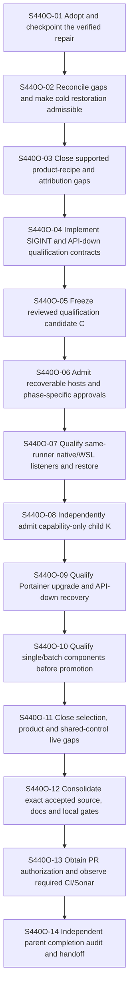

# #440 — Remaining lifecycle acceptance

Workflow ID: issue-440-open-acceptance
workflowVersion: 2.0
Status: EXECUTING; TA06 FAILED_RESTORED audit accepted; TA07 four-role diagnostic PLAN accepted, exact effects review pending; root cause unproven; no diagnostic effects/source edit admitted; WSL PASS retained
Issue: [#440](https://github.com/MatthiasBurger-Coder/Tiny-Swarm-World/issues/440)
Branch: `docs/workflow-issue440-open-20261111`
Committed authoring baseline: `c40d87ed81101dd582a112fe8b427d84372f36e2`
Execution profile: FULL_PATH
Process strand: workflow execute; current consultation run and scope amendment recorded below. Original authoring facts remain historical.

## Executive Summary

Complete the actual remaining #440 acceptance after the verified local repair:
checkpoint its exact source, close proven recipe/recovery gaps, freeze a valid
qualification campaign, establish recoverable hosts, qualify native/WSL listeners,
admit the precise capability, exercise Portainer/components/selection/product
cases, observe applicable final gates and obtain independent parent acceptance.
This new documentation-only branch does not contain the uncommitted repair.
Slice01 must acquire and verify it; absent source is a hard STOP.

## Execution run TA440-20261112-01 — started 2026-11-12

The operator instructed Codex to clear existing installations in the WSL test
environment at test start, stop applications occupying required ports there,
continue error remediation and qualification through completion, start a workflow
for every Three-Amigos consultation, and commit/push each accepted change.
This run extends the existing workflow at S440O-06; it does not create another
EPIC, repeat completed source work or declare the parent complete.

Four real reviewers accepted this bounded scope: Senior Requirement Engineer
(`reset_requirements`), Senior System Architect (`wsl_reset_review`), Senior
Python Automation Developer (`reset_automation`) and Senior Tester
(`reset_test_evidence`). Their decision is READY_FOR_WORKFLOW for disposable-test
preparation, subject to actual target/resource identification before effects.

- Identify the exact disposable WSL distribution, registration/GUID, machine and
  installation resources before deletion. Retain these private host identities
  and raw evidence outside disposable state; do not publish them here.
- Reset test installations once before the suite. Stop/kill only processes
  attributed to that admitted disposable environment, before capturing the
  clean qualification baseline. Reobserve required listeners afterward.
- Preserve original Ubuntu, foreign distributions/resources and the Windows
  boundary. Original-environment downtime uses the existing bounded cold-handoff
  and restoration path; the reset permission does not permit deleting it.
- Preserve each case's `baseline -> add/update -> verify -> repeat -> fault ->
  recover -> verify` chain. Do not erase data, credentials, source installations
  or recovery checkpoints between observations that depend on them.
- Serialize live effects. Continue through host admission, paired listener
  qualification, capability admission, Portainer, components, selections and
  remaining product/shared cases, then independent P01-P15 reconciliation.
- Give each later Three-Amigos consultation a distinct workflow execution-run
  record with findings, chosen slice, action, verification and outcome. Commit
  and push each accepted change separately; never turn a failed check into PASS.

The new instruction supplies test reset, test-process termination and live-test
consent. Earlier missing-consent/no-delete/no-kill notes are historical for this
bounded test scope. It does not establish ownership, backup usability, restore
proof, a fresh hash-bound phase GO or a successful test result.

Frozen private campaign C remains
`77a3356075925edee037bfe009a1f3dfb94cf5d8`; no C/K source or embedded workflow
is edited by this integration-side record. Before a strict source/workflow
binding is used, verify its equivalence and admission explicitly. A helper or
campaign-semantic change requires a reviewed replacement campaign and renewed
source lease/preparation/GO, not an edit to frozen C. Existing architecture and
cold-kernel/scoped-capability policy remain unchanged; no new ADR is required
for this disposable-fixture preparation scope.

Execution ownership: Root integrates and publishes; Senior DevOps owns serial
host operations; independent requirement/architecture/test-evidence reviews
remain the completion authority. This amendment locks only workflow.md,
scenario-plan.md, context-pack.md/json and prerequisite-ledger.md in the
integration worktree. It leaves the existing S440O-06 evidence-file locks in its
runtime worktree unchanged. Verification and operational effects are pending;
no S440O-06 DONE, live PASS, Sonar PASS or parent closure is recorded.

## Execution run TA440-20261112-02 — complete TSW test reset authorized

The same consultation continues on its reviewed YES path. In response to the
exact question covering all four existing TSW Incus nodes in the designated
WSL Ubuntu test environment, the operator answered “Das komplett zurücksetzen!”
on 2026-11-12. The destructive-target boundary is resolved; do not request the
same target clarification again. Four-role conditional YES review is now
READY_FOR_WORKFLOW for this bounded complete test-installation reset.

The grant covers all four existing TSW Incus instances, their installation-owned
data/resources and remaining TSW-owned applications occupying required ports.
Bind initial node deletion to the freshly captured project/UUID inventory;
its private snapshot SHA-256 is
`fd93f9a94796a5d672a8e8e31245fd239d63754acad9f1332abbf7b5525dd082`.
Before each further cleanup, establish installation ownership and current identity.
Preserve source checkouts, evidence, the Ubuntu distribution, Incus prerequisite
package/provider and all foreign or non-TSW resources. This is installation
reset, not whole-distribution deletion or provider removal.

This instruction supersedes TA01's preservation guard for the explicitly
disposable old TSW installation only. No original-workload restoration or
historical driver receipt is required to make that deleted installation appear
preserved. Windows/foreign boundaries and actual post-reset inventory/listener
observations still apply. No autostart, stage, receipt or source manipulation may
be used to simulate an accepted preserving cold handoff.

Execute serially: fresh bound inventory -> delete the four TSW nodes and owned
installation state -> stop remaining attributed TSW port applications -> capture
clean resources/listeners and exact source -> admit direct listener qualification.
The later product-preservation/update cases still require their real supported
installation identity and coordinator path. Direct listener success alone does
not admit an arbitrary product environment, capability or EPIC acceptance.
Frozen C remains unchanged; a required helper/semantic change needs its own
reviewed source campaign and renewed admission, not a spoofed identity.

Historical cause: the original-runtime baseline returned `AUTOSTART_UNSAFE`;
three default-project nodes had autostart enabled and all four old TSW nodes
were running. Registration PLAN separately refused with `BRIDGE_FILE_DRIFT`,
without import. Those failures and the completed separate disposable-registration
reset remain historical facts; the new answer selects complete old-installation
reset instead of preservation of that workload.

Decision: READY_FOR_WORKFLOW on the reviewed complete-reset branch. Actual
node/resource deletion and clean-baseline verification are pending in this
record. Keep remaining source/ownership/phase verification explicit, commit and
push each accepted change separately, and continue this TA02 run without a new
consultation or duplicate target question. No live qualification, product,
recovery, Sonar or parent PASS is recorded by this scope amendment.

## Execution run TA440-20261112-03 — root-disk prerequisite correction required

STARTED after actual complete old-TSW installation reset and independent clean
resource/listener observations. Root created a source-identical root-owned WSL
runtime clone of frozen C: all 1811 source files match, zero mismatches and the
same tree; original C remains unchanged. Actual standalone route and all-project
captures both exited 0. These are preparation facts, not listener qualification.

Six real perspectives reviewed the fresh WSL admission. Architecture, Python
Automation, Security and DevOps identified a concrete pre-execution prerequisite
gap: the consumer-free default profile had `devices={}`, while the frozen fixture
derives existing devices and `incus init` supplies no `--storage`. No root disk
is available for that planned instance. Requirements and Test/Evidence approved
the bounded scope; those approvals do not admit the uncorrected draft. Security
also returned CORRECTION_REQUIRED for the same missing-root-disk prerequisite.
No fixture was executed under this draft.

TA03 decision: CORRECTION_REQUIRED; the old GO draft below remains withdrawn.
Root has now prepared the prerequisite: after verifying the retained default
pool was driver `dir` and status `Created`, one
`incus profile device add default root disk path=/ pool=default` exited 0.
Readback exactly matched the expected root device, with profile config `{}`
and zero consumers. Root's private preparation-result proof SHA-256 is
`221471d710da7fc8514bd012a208b09bcc53d4d25cc88f39cd615c56672ca996`.
This is executed prerequisite preparation, not fixture admission or success.
A fresh post-preparation baseline/GO and a distinct TA04 review remain pending;
that next consultation is not started by this record. Source C remains unchanged. The actual standalone-fixture
interpreter is Python 3.14.4; this is not a product/full-suite qualification.
The superseded GO draft SHA-256 is
`8551c162c59ae4b62c3502957041a7da0be463195e3134462706c9a2c4da2ba8`;
resource draft SHA-256 is
`edf7b26a06f3c7eca76faeafcb8d7c303ff8c12864c2674c100673b8f9e15e2b`;
source proof SHA-256 is
`9edd270a8426ef682810ea767cbe02c77a54beb85ab3ce734dc75cf976d7525f`.
Exact run/host/resource identities and the complete drafts remain private.

Scope is the existing standalone fixture on the cleaned WSL host with actual
Incus client/server 6.0.5 and the pinned local Alpine 3.21 image. Only
`127.0.0.1:61080 -> 8080` is planned. There is no external-route mutation.
Cleanup may remove only the three exact newly run-owned fixture objects under
the existing ownership receipts. Default profile/config/consumers, foreign
state, route10001 and Windows firewall/PortProxy must match the post-reset
baseline exactly after cleanup. Capture listener timing, process/device/profile
identity, HTTP response and final resource/Windows equality; an exit alone is
not acceptance.

Per-host dependency clarification: the WSL portion of S440O-06 may admit this
bounded WSL S440O-07 fixture after its own fresh source/target/GO reviews, even
while native S440O-06 remains unadmitted. Keep the native and WSL admission and
result records separate. This does not mark global S440O-06 or S440O-07 DONE,
admit a paired capability K, qualify components/products or bypass any fixture
check. Paired K still requires both accepted same-runner host receipts under
its unchanged C/K/source contract.

The clean direct-listener path uses existing fixture code; the confirmed reset
removed the old workload and its listener conflict. Do not fabricate an old
preserving-driver restoration receipt or spoof WSL/product identity. Later
product cases retain a real supported identity/coordinator and their own
preservation/recovery baselines. No new ADR or C source change is introduced.
The embedded C workflow hash stays pinned as source provenance; the new user
reset/target authority and this per-host execution record remain outside C.

TA03 outcome: old draft withdrawn after CORRECTION_REQUIRED. The root-disk
prerequisite has been prepared, but the per-host dependency split does not waive
a new exact post-preparation baseline and review. Root next captures the
corrected draft and starts its distinct review run. No old GO execution, fixture,
S06/S07/global completion, K, product, recovery, Sonar or parent PASS is claimed.

## Execution run TA440-20261112-04 — approved fresh WSL fixture attempt

STARTED with fresh post-root-disk route and all-project captures, both exit 0.
The six real Requirements, Architecture, Python Automation, Test/Evidence,
Security and DevOps reviewers APPROVED the exact corrected draft:
`85d4171c107613df3b0024c4be83bd97222b4268d29fc638328d64e04a5ac2aa`.
The reviewed resource draft SHA-256 is
`8aed9adada6066c022e20159d2e42d88c3be093e3fdb884eb136fd29db5e08c8`.
TA03's old draft remains withdrawn; this distinct consultation supplies no
retroactive approval to it.

Root finalized only the reviewed actual approval fields, resource review status
and corresponding hash reference. The existing fixture's `validate_go` accepted
the final GO, which was created exclusively at its fixed private path with
mode 0600. Root then launched the actual existing C standalone-fixture CLI on
the root-owned source-identical runtime clone using Python 3.14.4. The attempt
was recorded IN_PROGRESS at launch and then completed with actual exit0/PASS.
All155commands exited0; actual nonce HTTP, Incus listener attribution and owned
cleanup were independently reviewed. Result SHA-256:
`e976a194df2691117aa31323d82c166f6c4d3303f8c5db1e65f40cbd56e2dd22`.
Final GO SHA-256:
`0c21df1670190d394650040e2ee678f702c1947da0d67ac17c5be271bac5d10b`.
Raw archive SHA-256:
`20ad74cf26de2a1c68783d05829edb9da2e7327fe4aa84c788cc8a2d8bc48617`.
Default/profile consumers, routes/port10001 and Windows before/after hashes
match; post-run inspection found zero instances/volumes, default used_by0 and
DNS-only TCP listeners. Independent reviewer reset_test_evidence accepted only
BOUNDED_WSL_LISTENER_FIXTURE_PASS. This is no native, paired K or product PASS.

Scope and per-host sequencing are unchanged: the exact loopback fixture owns
only its three run objects; default-profile, Windows, route and foreign-state
preservation/cleanup must be observed. Source C and embedded workflow provenance
remain frozen and unchanged. No identity spoof, fake cold-return receipt or new
source/ADR is introduced. Native host qualification, paired K, actual product/
recovery cases, global S06/S07 completion and parent acceptance remain gated.

Root owns actual completion, result attribution, designated-host documentation
verification and a separate accepted-change commit/push. This run records six
real approvals and an independently accepted WSL-only fixture PASS. Native
qualification needs separate live-pause authority; no native mutation was made.
Paired K and remaining product/component acceptance remain gated.

## Execution run TA440-20261112-05 — exact native admission ready; execution not started

STARTED after the operator answered “ja” to the exact native temporary TSW
manager stop/test/restart question. Consent is RESOLVED; do not ask it again.
The final exact native operational wrapper/context/GO/resource drafts are now
prepared; final `--inspect` exited 0 with INSPECTED_READ_ONLY. All four instances
remain in the captured states/configs. All six actual reviewers APPROVED the
exact final wrapper/context/context-embedded canonical GO: Requirements,
Architecture, Python Automation, Test/Evidence, Security and DevOps. Admission
is READY_FOR_BOUNDED_ATTEMPT, not a native execution PASS. No native outage,
snapshot or fixture has occurred. Root's exact four-document SSH/WSL diff/hash gate passed. Guarded checkpoint
publication is READY and must complete before outage.

Fresh native read-only facts: Incus client/server 6.0.5, native ext4 and Python
3.14.4; the default profile has empty config, its existing default-pool root disk
and network device, and only a stopped historical TSW manager as consumer. Three
current default-project TSW nodes are Running; that fourth historical manager
is Stopped. Current required-port occupants are Incus proxies. Exact host,
project/UUID/config/state and route/port details remain private.

The existing `native_lxd_maintenance.py` helper is LXD-only and `lxc` is absent.
Do not invoke it or claim it implements this actual Incus maintenance. The plan
uses existing generic C fixture code with a finite reviewed operator preparation:

1. Capture and pin all four instances' exact UUID/project/config/running state,
   current routes/port tuples/liveness and the source/provider baseline.
2. After exact native source/GO and all six real Requirements, Architecture,
   Python Automation, Test/Evidence, Security and DevOps approvals, gracefully
   stop only the verified default-project TSW manager within reviewed deadlines.
3. Capture an owned cold manager snapshot for recovery and the actual paused
   baseline. Leave workers, stopped historical manager and foreign resources
   unchanged; no native deletion/reset or permanent profile change is planned.
4. Run the unchanged exact C standalone listener fixture on a verified
   source-identical root-owned runtime clone. Retain actual HTTP, PID/device/
   timing, per-effect ownership, cleanup and paused-baseline preservation proof.
5. In FINALLY recovery after success, failure or interruption, restart that same
   manager and verify all four original states/configs, route/port tuples and
   service liveness. Account for the approved owned recovery snapshot explicitly;
   do not fabricate recovery from a command exit or healthy old task alone.

Exact artifact bindings accepted by all six native reviewers:

| Artifact | SHA-256 |
|---|---|
| Finite native operator wrapper | `3b84e0bcb8175a9d9b752863bacdb12be50324fd9654f063dbd73d5ca9eda893` |
| Canonical context | `584c4703a4d6a93b5762aa146addb84f0f77a38ebbf1729fb39821a5d55bc7f5` |
| Context-embedded canonical GO | `f7a1172d9933385d69f5dfd1c11518750325f63858163feb7568b9d280dc52ba` |
| Resource draft | `5ed5dbcaccbe5d1e3e25fc1811a819cd706b3b60c4f5f79241c9769ca104cf93` |

The root-owned mode0600 wrapper/context and source-identical native ext4 runtime
clone bind unchanged C/tree/1811files. Actual final inspection was read-only;
its success is not outage/backup/fixture acceptance. Fixed fixture GO and port
reservation remain absent. The exclusively created private NOT_RUN stub is not
a test result. Only the context-embedded canonical GO is executable; the
separate pretty-printed native-fixture-go-draft.json is stale/superseded and must
not be used. The six actual approvals are retained against the exact hashes;
only the admitted review-status/hash-reference finalization is permitted.
The actual six-role review receipt was installed root-owned mode0600 on the
native host, SHA-256 `07409c6e221e1f1fdb20645e8ba5fe0ee643181c3508b958d9f4b9555c559a0a`;
wrapper/context hashes were reverified unchanged. This is admission evidence,
not an outage or fixture result.

The reviewed finite plan budgets total1200seconds with reserve240 and at least
1100seconds remaining before outage; graceful no-force stop60, cold snapshot90,
fixture650 and restored Docker-identity convergence wait180. Bound daemon
operations must settle before same-UUID restart. FINALLY recovery verifies all
four configs/states/listener tuples plus observed Docker NodeID/ClusterID/local/
control identity equality. The bound `--recover` route ignores the expired effect
deadline only for recovery and never replays the fixture; signals affect only
owned children. The owned backup snapshot is retained, not deleted or hidden
as zero graph change. Actual product health remains NOT_VERIFIED.

Python3.14.4 attribution applies to the standalone fixture, not product/full-
quality qualification. Source C stays frozen and unchanged; no new helper/orchestrator
or source/ADR change is introduced by this plan.

Actual independently accepted WSL TA04 listener PASS is retained. Native result,
paired K, component/product/recovery cases, global S06/S07 and parent acceptance
remain OPEN. Per-host sequencing already accepted elsewhere is unchanged. Root
owns serial host execution, actual outcome/recovery evidence and a separate
checked commit/push for each accepted change. This run is READY_FOR_BOUNDED_ATTEMPT:
artifacts, read-only inspection and six exact approvals complete; pre-outage
Root designated SSH/WSL documentation gate PASS; guarded publication READY before outage. Outage/snapshot/fixture NOT_RUN.
No native or EPIC PASS is inferred.

## Execution run TA440-20261112-06 — snapshot-client timeout diagnosis

STARTED with its requirement matrix before the new Amigos consultation. Actual
TA05 phases on 2026-11-12 UTC:

| UTC | Actual event |
|---|---|
| 17:57:13 | Native maintenance window started |
| 17:57:25 | Manager stopped; cold-snapshot intent recorded |
| 17:58:55 | Window failed `WINDOW_FAILURE_REDACTED` after snapshot client's90s budget |
| 17:59:21.869 | Daemon operation settled; FINALLY manager-start intent |
| 17:59:45.148 | Manager start returned |
| 18:00:24 | Exit2, final `FAILED_RESTORED` |

The snapshot daemon operation continued beyond the client's90-second timeout
and settled after approximately117seconds. Existing FINALLY recovery waited
for that settlement before restarting the same manager. Actual final evidence
reports all four original configs/states/listener tuples restored and observed
Docker NodeID/ClusterID/local/control identity equal before/after. This is a
bounded preservation PASS, not native listener or product-health success.
The native fixture result is null, fixed GO remained absent and its stub is
NOT_RUN. Actual product health remains NOT_VERIFIED.

The wrapper's snapshot-created/retained acknowledgments are false because the
exception occurred before its acknowledgment. They are not evidence of snapshot
absence. Root's independent read-only late observation found the owned cold
snapshot retained and non-stateful; its reported creation timestamp corresponds
to the initial17:57:25 request. The private metadata SHA-256 is
`5993801b162d799d6014bcc45e799346525d0ac533c07ea95489fbee3608b027`.
Account for this retained recovery snapshot as an intentional graph change;
do not claim the entire snapshot graph is unchanged.

Exact TA05 wrapper/context/review/GO/events and raw result archive remain
retained; archive SHA-256
`81dabf43ee9470fbc22d667ffed052a6f7499e7d0130c3e2a51718c32edcb4b4`.
Independent Test/Evidence accepted the actual FAILED_RESTORED outcome, native
fixture NOT_RUN and retained late snapshot.
Root safety restoration is complete at the observed preservation level above;
there is no pending user-consent question.

TA06 now has a fresh exact finite-budget admission, distinct from TA05. All
six actual Requirements, Architecture, Automation, Test/Evidence, Security and
DevOps reviewers APPROVED these new artifacts:

| Artifact | SHA-256 |
|---|---|
| TA06 finite operational wrapper | `1429b51208263e37c9e7ed91511469c7c40894ab10210115a231bad5116ef7e8` |
| New canonical nested context | `ceb0ce4de8a0329e5f8f3eadaeeb90075261d6714878c262a83d04ee68618eed` |
| New context-embedded canonical GO | `cbf914749dc4b7510072ab6acbe9f674efe5a69af0a9303db42cbd8426fa6708` |
| New resource draft | `6c3911be5138457d74e4c0408c5ee5ce49b8c631c256ee3228c227ea58a90837` |

The root-owned mode0600 artifacts were installed and final `--inspect` exited0
with INSPECTED_READ_ONLY. Unchanged C/tree/1811files and all current instance/
profile/route identities were captured; the retained TA05 snapshot is explicitly
part of the new baseline. Available disk at capture was709315608576bytes.
The new separate run/deadline and exact identities remain private. No TA06
outage, cold snapshot or fixture has occurred.

The reviewed operational refinement raises the snapshot budget to300seconds,
total1800/reserve360/pre-outage1650/pre-fixture1010/fixture650/restore360/
recover480. TimeoutExpired is classified COMMAND_TIMEOUT. Snapshot presence is
observed after operation settlement/restoration independently of client
acknowledgment; unknown retention is not treated as absence. Existing exact
UUID/source/owned-child/signal/daemon-settlement/FINALLY/profile/routes/listener/
Docker-identity protections remain. The old owned backup stays unchanged; a
separate new cold recovery snapshot is planned and retained. Product health
remains NOT_VERIFIED. No frozen C or product/fixture helper code changed.

Decision: READY_FOR_BOUNDED_ATTEMPT, not an executed native PASS. Before outage,
Root must obtain the exact designated SSH/WSL documentation receipt and complete
guarded checkpoint publication. Only the admitted actual review-status/resource-
status/referenced-hash finalization is allowed; the new executable GO is the
canonical context-embedded one, not a stale standalone draft. The actual six-role
review receipt was installed native root-owned0600, SHA-256
`4aa24e263d9a868dfaa16fd14ae0f265b2a07a4c3be1971ee6678b0ea7fa18e4`. Exact source, admitted_go and
unchanged-fixture validate_go checks passed; no new events/GO and stub NOT_RUN.
Actual documentation receipt and publication proof are retained privately after
final bytes, without another
public status rewrite. Original TA05 approvals are not reused for TA06.

Actual independently accepted WSL listener PASS remains retained. Native
listener, paired K, component/product/recovery/global/parent acceptance remain
OPEN. A new actual attempt/result and restoration must be attributed and audited
separately; current admission alone proves none of those outcomes.

## Execution run TA440-20261112-07 — native responder diagnosis

STARTED with its matrix before new Amigos. Actual TA06 exited2 FAILED_RESTORED:
all four original configs/states/listeners and observed Docker identities were
restored. Cold snapshot18:12:06–18:13:30UTC (~84s) was acknowledged and retained;
private metadata SHA-256 `31b7e4ba864cc71a46b49f26d322c8222053b36f02d54e2ae5c79f59b94a2619`.

The actual fixture18:13:30–18:13:50 exited2 BLOCKED_TARGET_DRIFT with
JIT_COMMAND_FAILED. Of160 command records, index95 `incus.exec` returned1 with
recorded stdout/stderr byte counts0; underlying diagnostics were discarded and
are unavailable. It maps to unchanged fixture `responder_script` execution.
Exact root cause is NOT_YET_PROVEN; no scheduling/race explanation is asserted.
Owned cleanup and TA06 FAILED_RESTORED outcome have independent Test/Evidence
acceptance; detailed raw evidence is retained.

Four actual Amigos roles (Requirements, Architecture, Automation, Test/Evidence)
returned READY_FOR_BOUNDED_DIAGNOSTIC_PLAN. The scoped proposal uses a new owned
Alpine instance and derived base profile without host proxies; original nodes
retain their captured Running/Stopped states, with no manager/default-profile/
network change. Run the exact
source-C-faithful responder first, before guest probes or sleeps. Later
instrumented diagnostics are explicitly different and cannot establish fixture
success or a cause without evidence. Cleanup binds UUID/spec/marker and proves
all original state unchanged.

DevOps is preparing only the private exact diagnostic script. Exact script/
context/effects-GO review remains pending; no effects, source edit or new fixture
attempt is admitted by plan acceptance. Preserve C, prior outcomes and WSL PASS;
native/pairK/product/global/parent remain OPEN. Exact designated SSH/WSL receipt
is required before checkpoint, with guarded publication before admitted effects.

## Verified Baseline and Target Picture

Original repair remains preserved in the original workspace. Its independent
bounded audit accepted 18 targeted tests without skips and full quality4058run/
37declared skips, including corrected premature preview readiness. Those facts
apply only to the recorded five-file source, not this authoring branch, a new
workflow binding, current host readiness, Sonar or live restoration. Completed
S440-02/03/04/05 checkpoints stay historical; do not re-plan their fixes as absent.
P01 historical official0.4.0→0.5.0 remains accepted within its actual scope.

Target: Linux/WSL→Incus/LXC→Docker Engine/Swarm operator paths preserve local
configuration, credential references, installation/service identities and data.
Each required update/selection/recovery is tied to exact source and host evidence.
Parent #440 remains INCOMPLETE until all acceptance and applicable gates pass.

## Requirement Clarification Gate

- Original Request: “Erstelle ein worklow für die offenen punkte”.
- Interpreted Intent: author the complete remaining-work plan; do not execute live changes.
- Change Type: workflow regeneration and traceable remaining acceptance.
- Affected Process Strand: workflow create now; workflow execute later.
- Affected Architecture Area: existing Python lifecycle/CLI, qualification tooling, Windows/WSL cold coordination, Incus capability, evidence and release checks.
- Explicit Requirements: remaining points in the conversation and unchanged47LCM/15parent/45childAC plus late/global obligations.
- Implicit Requirements: preserve uncommitted changes, exact source acquisition, recoverable targets, no false live/Sonar claims, independent reviews and bounded failure recovery.
- Assumptions: original repair source remains owner-retained; missing source blocks execution, not planning. Host, backup, approvals and image availability are not assumed.
- Non-Goals: no new runtime/orchestrator, Kubernetes, browser frontend, Java/Maven/Spring, external CI, automatic PR/merge/release or GitHub issue writes.
- Risks: live interruption, source-chain invalidation, unsupported product targets, incomplete recipe attribution and unavailable Sonar.
- Open Questions: actual host/backup/source/approval/PR access are execution admission conditions with owners in prerequisite-ledger.md.
- Blocking Questions for authoring: none; do not infer answers for execution.
- Confidence Level:95percent, requirement confidence only.
- Decision: READY_FOR_WORKFLOW, four real specialist reviews recorded in authoring-review.md.

## Scope and Architecture Constraints

Preserve hexagonal Python boundaries and canonical core implementations. Native
qualification files remain compatibility delegates; do not create a second
orchestrator/catalog or put shell/filesystem details into application services.
Accepted Classic lifecycle and installation-scoped-profile ADRs remain authority.
No new ADR is needed for this plan; any changed ownership/support/recovery policy
stops its slice for an explicit decision. Keep unsupported/unknown versions,
source/consent drift and uncertain effects fail-closed. Incus is a provider
prerequisite; Portainer remains a mandatory managed Classic foundation.

## Python Automation Assessment and Frontend Assessment

Actual product/component/Portainer public CLI exists. Both product supervisors
still refuse product-v1 cases; reporter supports SIGTERM rather than SIGINT or
API-down. Slices03/04 own concrete source/test repairs before live campaigns.
The existing reporter is modules/tsw_core/tests/e2e/classic/run_lcm_acceptance.py.
No browser frontend exists in this scope. CLI/help changes use console/status
review only when actually changed; no React work is authorized.

## Test Strategy and Quality Gates

Reviewed execution follow-up S440O-01: the first full gate found an authored
noncanonical mode label. Senior Workflow Architect and Requirement Lead approve
this exact wording correction plus workflow/context hash maintenance inside01.
No dependency, requirement, product scope, checker or quality threshold changes.
This is S3_DOC remediation during execution, not workflow regeneration.

Authoring is documentation-only: static metadata/DAG/path/requirement/link/hash
inspection and git diff --check on the designated SSH/WSL host. Full project
quality is NOT_RUN_DOC_ONLY for this plan; prior repair results are historical.
Implementation slices require nearest regressions then the unchanged QUALITY.md
full gate. No tests begin during ongoing development without the applicable
explicit verification or PR-creation authorization; authoring grants no live GO.

All agent-run tests/gates use SSH pc@192.168.178.58 inside Ubuntu WSL. Read
credentials privately from ~/.access; never log/pass them in command arguments
or repository files. Verify remote repository, Python3.12 editable package origin
and exact changed-file equivalence first. Unavailable credentials/SSH/WSL block;
no alternate host fallback. Native deployment qualification remains a separately
approved target; running its mocked tests still uses the mandated test host.

Use actual commands from QUALITY.md: python3 modules/tsw_core/tools/linux/quality_gate.py quality, lint,
arch-lint, arch-tests, typecheck, test and verification-policy. Live/external
pseudo-actions in metadata identify review/evidence obligations, not invented
executables; exact admitted argv must be checked from --help before GO.

## Resilience Requirements

Every live effect requires bounded waits/retries, exact lease/ownership and
fresh source/JIT/GO, usable cold backups and a proven return path BEFORE downtime.
No replay or blanket clearing of uncertain intent. Prove each reachable reset/
bridge/restore failure route; safe refusal is not recoverability. Preserve full
Windows state within the fixture window and separate any later owned destination
refresh during actual original restoration. Record actual process identity,
checkpoint/signal, exit/settlement, no-op, partial failure and repeat recovery.

## Campaign Source Graph and Checkpoint Separation

Complete all helper/workflow/policy changes before freezing clean source C.
The component qualification candidate policy must already be in C before WSL
preparation. After paired fixtures, K is exactly ONE direct child of C changing
ONLY incus-profile-capabilities.json. qualification_revision() permits C or K;
helper, policy or documentation commits cannot be appended to this chain.
No source-binding bypass or unreviewed equivalence exception is authorized.

Keep C and K in dedicated campaign worktrees/refs. Integration-branch slice
checkpoints and progress records must not move their HEAD or dirty their tracked
files. During live slices raw/progress evidence stays in ignored/private external
journals; publish redacted summaries on the integration branch, not into C/K.
Never edit the frozen active workflow merely to mark progress. If a helper or
runtime delta becomes necessary, stop affected cases, create/review a new source
campaign and renew preparation/GO/qualification. Final integrated source needs
explicit independently reviewed equivalence or requalification of affected cases.

## Parallel Execution

- Can this workflow run in parallel? Serial writes/effects by default; independent read-only reviews may run concurrently.
- Conflicting workflows: old #440/#449 campaigns and any writer of the same installation, source, approval or shared host.
- Shared files: qualification producer/reporter/supervisors, active workflow, capability/policy, W09/W10 and coordination evidence.
- Shared infrastructure: designated SSH/WSL test host and separately admitted native/WSL live targets.
- Requires isolated worktree: yes, per workflow/approved stream/campaign.
- Requires serialized live validation: yes; host-wide WSL/network/Incus effects cannot overlap.
- Merge-order constraints:01→02→03→04→05→06→07→08→09→10→11→12→13→14; C/K topology is independent of integration progress commits.

## Automatic Work Distribution Policy

workflow execute automatically inspects each slice for safe specialist stream
splitting. Use real Codex subagents; if unavailable, record explicit role-based
fallback. Before writes create .codex/evidence/slice-<number>-distribution.md;
after consolidation create .codex/evidence/slice-<number>-consolidation.md.
Each record must name this workflow/version, source and slice; old files are
historical, never proof of current acceptance. Codex remains final integration,
verification and PR-readiness owner. Stream workers never merge directly.

Stream map: backend/automation→Senior Python Automation Developer; frontend→
conditional console/status reviewer only; tests/quality→Senior Tester;
runtime→Senior DevOps; documentation→Senior Documentation Engineer;
architecture→Senior System Architect; security→Senior Security Sandbox Engineer.
No parallel writers for overlapping files, unclear architecture/requirements,
mandatory ordering, shared migrations/schemas/generated files, unknown secrets,
unsafe guards or a Three-Amigos not-safely-parallelizable decision. S3D must
revalidate actual locks before every write-capable slice; no automatic widening.

## Git Worktree Execution Rule

Authoring uses its own clean dedicated worktree/branch. Original user repair
changes remain untouched. Execution/stream/campaign branches have explicit owners;
only root consolidates. One slice per checkpoint commit; checkpoint push is not
PR creation, merge or push auto. C/K campaign refs retain frozen source identity.
Do not delete any worktree/branch or stash/reset user changes during authoring.

## Ordered Slices and Dependency Graph



### Slice 01 — Adopt and checkpoint the verified repair

Purpose: Acquire the exact five reviewed files from the preserved original workspace or an independently verified immutable repair revision. Verify every SHA in requirements.json, provenance and the retained 18/4058-test logs; do not copy unrelated workflow edits. Import only those files, rerun applicable targeted/full checks with proper authorization against the new workflow source, independently review and create one repair-only checkpoint. Missing source, a hash mismatch or absent review blocks before writes. This authoring branch starts at c40d87ed and DOES NOT ship the repair.

Prerequisites: branch/source/provenance admission. Mode: LOCAL.

Done criteria: all stated observations and required checks have attributable evidence; independent owner review accepts the exact slice. No planned result counts as executed.

Evidence: `.tiny-swarm/evidence/issue-440-open/slice-01/` with the six issue-completion files. Requirement mapping: P08, P09, P11, P12, P13.

```yaml
{
  "slice_id": "S440O-01",
  "profile": "FULL_PATH",
  "status": "PLANNED",
  "owner": "Senior Python Automation Developer",
  "secondary_reviewers": [
    "Senior Requirement Engineer",
    "Senior System Architect",
    "Senior Tester",
    "Senior Security Sandbox Engineer",
    "Senior DevOps"
  ],
  "affected_files": [
    "modules/tsw_windows_wsl/tools/qualification/wsl_acceptance_guest_switch.ps1",
    "modules/tsw_windows_wsl/tools/qualification/wsl_acceptance_registration.ps1",
    "modules/tsw_windows_wsl/tools/qualification/wsl_acceptance_bridge_binding.ps1",
    "modules/tsw_windows_wsl/tests/tools/test_wsl_acceptance_guest_switch.py",
    "modules/tsw_core/tests/fixtures/wsl_acceptance_guest_switch.ps1",
    "documentation/handbook/05-development/workflow/workflow.md",
    "documentation/handbook/05-development/workflow/context-pack.json"
  ],
  "affected_modules": [
    "existing qualification/lifecycle and evidence"
  ],
  "affected_contracts": [
    "public CLI/evidence/source ownership",
    "frozen C/K campaign provenance"
  ],
  "dependencies": [],
  "parallel_group": "serial-01",
  "parallel_execution_eligible": false,
  "requires_isolated_worktree": true,
  "requires_serialized_live_validation": false,
  "file_locks": [
    "modules/tsw_windows_wsl/tools/qualification/wsl_acceptance_guest_switch.ps1",
    "modules/tsw_windows_wsl/tools/qualification/wsl_acceptance_registration.ps1",
    "modules/tsw_windows_wsl/tools/qualification/wsl_acceptance_bridge_binding.ps1",
    "modules/tsw_windows_wsl/tests/tools/test_wsl_acceptance_guest_switch.py",
    "modules/tsw_core/tests/fixtures/wsl_acceptance_guest_switch.ps1",
    ".tiny-swarm/evidence/issue-440-open/slice-01/**",
    "documentation/handbook/05-development/workflow/workflow.md",
    "documentation/handbook/05-development/workflow/context-pack.json"
  ],
  "contract_locks": [
    "frozen C/K source and exact approval"
  ],
  "architecture_locks": [
    "Classic cold-kernel and scoped capability policy"
  ],
  "module_locks": [],
  "shared_files": [
    "modules/tsw_windows_wsl/tools/qualification/wsl_acceptance_guest_switch.ps1",
    "modules/tsw_windows_wsl/tools/qualification/wsl_acceptance_registration.ps1",
    "modules/tsw_windows_wsl/tools/qualification/wsl_acceptance_bridge_binding.ps1",
    "modules/tsw_windows_wsl/tests/tools/test_wsl_acceptance_guest_switch.py",
    "modules/tsw_core/tests/fixtures/wsl_acceptance_guest_switch.ps1",
    "documentation/handbook/05-development/workflow/workflow.md",
    "documentation/handbook/05-development/workflow/context-pack.json"
  ],
  "shared_infrastructure": [
    "designated SSH/WSL quality host",
    "approved live campaign only when admitted"
  ],
  "conflicting_workflows": [
    "historical #440/#449 and same-host/source writers"
  ],
  "allowed_write_scope": [
    "modules/tsw_windows_wsl/tools/qualification/wsl_acceptance_guest_switch.ps1",
    "modules/tsw_windows_wsl/tools/qualification/wsl_acceptance_registration.ps1",
    "modules/tsw_windows_wsl/tools/qualification/wsl_acceptance_bridge_binding.ps1",
    "modules/tsw_windows_wsl/tests/tools/test_wsl_acceptance_guest_switch.py",
    "modules/tsw_core/tests/fixtures/wsl_acceptance_guest_switch.ps1",
    ".tiny-swarm/evidence/issue-440-open/slice-01/**",
    ".codex/evidence/slice-01-distribution.md",
    ".codex/evidence/slice-01-consolidation.md",
    "documentation/handbook/05-development/workflow/workflow.md",
    "documentation/handbook/05-development/workflow/context-pack.json"
  ],
  "requirement_ids": [
    "P08",
    "P09",
    "P11",
    "P12",
    "P13"
  ],
  "quality_gates": {
    "targeted": [
      "PYTHONPATH=. python3 -m unittest modules.tsw_windows_wsl.tests.tools.test_wsl_acceptance_guest_switch modules.tsw_windows_wsl.tests.tools.test_wsl_acceptance_registration"
    ],
    "required": [
      "python3 modules/tsw_core/tools/linux/quality_gate.py quality"
    ]
  },
  "documentation": {
    "arc42": "Recheck existing ownership/ADR; record N/A or actual approved delta.",
    "adr": "No new decision planned; STOP for unapproved policy change."
  },
  "stop_conditions": [
    "Missing exact source, ownership, required verification, recovery proof or approval; no guard weakening.",
    "Unknown/dirty campaign source, C/K topology mismatch, unsafe pending state or unavailable required external result."
  ]
}
```

### Slice 02 — Reconcile gaps and make cold restoration admissible

Reviewed execution amendment: Architecture, Security, DevOps and Requirement
owners accept the two explicitly proposed source/test paths below as necessary
implementation of this slice's existing re-entry requirement. No new ADR or
user permission is required for code work; no live operation is admitted.
The actual immutable legacy driver/API and existing lock were inspected only
read-only on the designated host: driver SHAfcf16059dced9a3ed07ea54e1d346e7b67726cfe873de2849b58a202519962bd;
exported dependency closure is journal-parametric (PRIVATE referenced only by
legacy main); existing lock is root-owned0600single-link on ext4. These observed
facts are not future lock ownership, original-state restoration or live GO.

Implement fixed fixture/product window identities and derived create-only inner
journals, with immutable prior-final/registration/switch/bridge archive links.
Never retarget legacy globals or alter its old files; chain metadata stays
outside the closed inner journal. Preserve legacy main's umask, ext4/source/
signal/deadline/settlement checks. Acquire the exact existing legacy lock
read-only/no-follow with exclusive flock and path/inode CAS, then fixed machine/
window locks; no create/truncate/rotation of the old lock. All legacy delegation
occurs under those guards. Outer phase GO binds window/source/adapter/backup/
parent and exact nested legacy quiesce GO; restore requires its own outer GO.
Read-only predecessor verification must reject writes via a Journal proxy.
Source staging accepts only the committed fixed helper blob/hash under a
separate metadata mutation approval; no arbitrary path/code selector. Version
registration/source views without changing original receipts or importing a
third distro. Failed read-only bridge previews never write Failure state;
mutation uncertainty tracking must begin before Intent/Archive writes, preserve
old descriptor/intent/transaction in linked evidence, and never clear unknown
outcomes generically. Freeze all adapters/tests before C. Missing or mismatched
legacy API/lock/runtime evidence blocks effects. Unit gates use mocks, not the
private host driver.

Purpose: Reconcile every remaining matrix cell and every reachable cold-switch pending state. Preserve SealFixtureReturn/ReturnFixture and original ReturnOriginal separation. Prove an owned recovery/reconciliation route for early preparation failure, unknown reset, unapplied/uncertain bridge stop, and ambiguous resume/restore BEFORE any downtime. Safe refusal alone is not restoration proof. Implement only a reviewed narrow missing coordinator path within existing cold-kernel policy; no general pending clearing, guessed PID signaling, resource deletion or relaxed listener rule. Rehearse actual PowerShell with mocked host ports. Also implement and test an explicitly approved re-entry from completed fixture restoration to a later product window: the current switch cannot leave stage restored, and a new run/registration collides with its exact two-distro scope. Define a guarded transition preserving immutable prior receipts, exact GUID/VHD/source identity, fresh original quiescence/backup/boot, fresh phase GO and a new chained journal; no hand-edited bookmark, stage reset, unowned retirement or assumed parallel distro. Architecture/Security/DevOps must accept that concrete transition before source freeze; if it cannot be proven within current policy, stop before all downtime for the required decision.

Prerequisites: S440O-01. Mode: LOCAL.

Done criteria: all stated observations and required checks have attributable evidence; independent owner review accepts the exact slice. No planned result counts as executed.

Evidence: `.tiny-swarm/evidence/issue-440-open/slice-02/` with the six issue-completion files. Requirement mapping: P03, P04, P09, P11, P12, P13.

```yaml
{
  "slice_id": "S440O-02",
  "profile": "FULL_PATH",
  "status": "PLANNED",
  "owner": "Senior DevOps",
  "secondary_reviewers": [
    "Senior Requirement Engineer",
    "Senior System Architect",
    "Senior Tester",
    "Senior Security Sandbox Engineer",
    "Senior DevOps",
    "Senior Python Automation Developer"
  ],
  "affected_files": [
    "modules/tsw_windows_wsl/tools/qualification/wsl_acceptance_guest_switch.ps1",
    "modules/tsw_windows_wsl/tools/qualification/wsl_acceptance_registration.ps1",
    "modules/tsw_windows_wsl/tools/qualification/wsl_acceptance_bridge_binding.ps1",
    "modules/tsw_core/tests/fixtures/wsl_acceptance_guest_switch.ps1",
    "modules/tsw_windows_wsl/tests/tools/test_wsl_acceptance_guest_switch.py",
    "modules/tsw_windows_wsl/tests/tools/test_wsl_acceptance_registration.py",
    "modules/tsw_windows_wsl/tests/tools/test_wsl_acceptance_bridge_binding.py",
    "modules/tsw_core/tests/fixtures/wsl_acceptance_registration.ps1",
    "modules/tsw_core/tests/fixtures/wsl_acceptance_bridge_binding.ps1",
    "modules/tsw_core/tools/linux/qualification/wsl_original_runtime_window.py",
    "modules/tsw_windows_wsl/tests/tools/test_wsl_original_runtime_window.py",
    "documentation/handbook/05-development/workflow/workflow.md",
    "documentation/handbook/05-development/workflow/context-pack.json"
  ],
  "affected_modules": [
    "existing qualification/lifecycle and evidence"
  ],
  "affected_contracts": [
    "public CLI/evidence/source ownership",
    "frozen C/K campaign provenance",
    "fixed fixture/product window approvals and immutable parent chains",
    "shared existing legacy lock and journal-parametric immutable API"
  ],
  "dependencies": [
    "S440O-01"
  ],
  "parallel_group": "serial-02",
  "parallel_execution_eligible": false,
  "requires_isolated_worktree": true,
  "requires_serialized_live_validation": false,
  "file_locks": [
    "modules/tsw_windows_wsl/tools/qualification/wsl_acceptance_guest_switch.ps1",
    "modules/tsw_windows_wsl/tools/qualification/wsl_acceptance_registration.ps1",
    "modules/tsw_windows_wsl/tools/qualification/wsl_acceptance_bridge_binding.ps1",
    "modules/tsw_core/tests/fixtures/wsl_acceptance_guest_switch.ps1",
    "modules/tsw_windows_wsl/tests/tools/test_wsl_acceptance_guest_switch.py",
    ".tiny-swarm/evidence/issue-440-open/slice-02/**",
    "modules/tsw_windows_wsl/tests/tools/test_wsl_acceptance_registration.py",
    "modules/tsw_windows_wsl/tests/tools/test_wsl_acceptance_bridge_binding.py",
    "modules/tsw_core/tests/fixtures/wsl_acceptance_registration.ps1",
    "modules/tsw_core/tests/fixtures/wsl_acceptance_bridge_binding.ps1",
    "modules/tsw_core/tools/linux/qualification/wsl_original_runtime_window.py",
    "modules/tsw_windows_wsl/tests/tools/test_wsl_original_runtime_window.py",
    "documentation/handbook/05-development/workflow/workflow.md",
    "documentation/handbook/05-development/workflow/context-pack.json"
  ],
  "contract_locks": [
    "frozen C/K source and exact approval"
  ],
  "architecture_locks": [
    "Classic cold-kernel and scoped capability policy"
  ],
  "module_locks": [],
  "shared_files": [
    "modules/tsw_windows_wsl/tools/qualification/wsl_acceptance_guest_switch.ps1",
    "modules/tsw_windows_wsl/tools/qualification/wsl_acceptance_registration.ps1",
    "modules/tsw_windows_wsl/tools/qualification/wsl_acceptance_bridge_binding.ps1",
    "modules/tsw_core/tests/fixtures/wsl_acceptance_guest_switch.ps1",
    "modules/tsw_windows_wsl/tests/tools/test_wsl_acceptance_guest_switch.py",
    "modules/tsw_windows_wsl/tests/tools/test_wsl_acceptance_registration.py",
    "modules/tsw_windows_wsl/tests/tools/test_wsl_acceptance_bridge_binding.py",
    "modules/tsw_core/tests/fixtures/wsl_acceptance_registration.ps1",
    "modules/tsw_core/tests/fixtures/wsl_acceptance_bridge_binding.ps1",
    "modules/tsw_core/tools/linux/qualification/wsl_original_runtime_window.py",
    "modules/tsw_windows_wsl/tests/tools/test_wsl_original_runtime_window.py",
    "documentation/handbook/05-development/workflow/workflow.md",
    "documentation/handbook/05-development/workflow/context-pack.json"
  ],
  "shared_infrastructure": [
    "designated SSH/WSL quality host",
    "approved live campaign only when admitted"
  ],
  "conflicting_workflows": [
    "historical #440/#449 and same-host/source writers"
  ],
  "allowed_write_scope": [
    "modules/tsw_windows_wsl/tools/qualification/wsl_acceptance_guest_switch.ps1",
    "modules/tsw_windows_wsl/tools/qualification/wsl_acceptance_registration.ps1",
    "modules/tsw_windows_wsl/tools/qualification/wsl_acceptance_bridge_binding.ps1",
    "modules/tsw_core/tests/fixtures/wsl_acceptance_guest_switch.ps1",
    "modules/tsw_windows_wsl/tests/tools/test_wsl_acceptance_guest_switch.py",
    ".tiny-swarm/evidence/issue-440-open/slice-02/**",
    ".codex/evidence/slice-02-distribution.md",
    ".codex/evidence/slice-02-consolidation.md",
    "modules/tsw_windows_wsl/tests/tools/test_wsl_acceptance_registration.py",
    "modules/tsw_windows_wsl/tests/tools/test_wsl_acceptance_bridge_binding.py",
    "modules/tsw_core/tests/fixtures/wsl_acceptance_registration.ps1",
    "modules/tsw_core/tests/fixtures/wsl_acceptance_bridge_binding.ps1",
    "modules/tsw_core/tools/linux/qualification/wsl_original_runtime_window.py",
    "modules/tsw_windows_wsl/tests/tools/test_wsl_original_runtime_window.py",
    "documentation/handbook/05-development/workflow/workflow.md",
    "documentation/handbook/05-development/workflow/context-pack.json"
  ],
  "requirement_ids": [
    "P03",
    "P04",
    "P09",
    "P11",
    "P12",
    "P13"
  ],
  "quality_gates": {
    "targeted": [
      "PYTHONPATH=. python3 -m unittest modules.tsw_windows_wsl.tests.tools.test_wsl_acceptance_guest_switch",
      "PYTHONPATH=. python3 -m unittest modules.tsw_windows_wsl.tests.tools.test_wsl_acceptance_registration modules.tsw_windows_wsl.tests.tools.test_wsl_acceptance_bridge_binding",
      "PYTHONPATH=. python3 -m unittest modules.tsw_windows_wsl.tests.tools.test_wsl_original_runtime_window"
    ],
    "required": [
      "python3 modules/tsw_core/tools/linux/quality_gate.py quality"
    ]
  },
  "documentation": {
    "arc42": "Recheck existing ownership/ADR; record N/A or actual approved delta.",
    "adr": "No new decision planned; STOP for unapproved policy change."
  },
  "stop_conditions": [
    "Missing exact source, ownership, required verification, recovery proof or approval; no guard weakening.",
    "Unknown/dirty campaign source, C/K topology mismatch, unsafe pending state or unavailable required external result."
  ],
  "proposed_files": [
    "modules/tsw_core/tools/linux/qualification/wsl_original_runtime_window.py",
    "modules/tsw_windows_wsl/tests/tools/test_wsl_original_runtime_window.py"
  ]
}
```

### Slice 03 — Close supported product-recipe and attribution gaps

Reviewed execution amendment: Architecture, Security, DevOps, Requirements and
Senior Workflow Architect accept the three existing WSL consumer/regression
paths below, plus workflow/context metadata, as required producer-consumer
compatibility within this slice. The previous stopped-proof reader knows only
24 case IDs and old outcome shapes; the new eight closed refusal cases and
truthful helper-unavailable records would otherwise prevent safe ReturnOriginal.
Accept only the exact fixed new IDs and explicitly bounded old/new schemas.
Unavailable status is restricted to the two v1 helper IDs with exact identity,
command_executed=false, product_result=null, epic_complete=false, no effect or
execution/recovery/disposal intent and no public child launch, including when
C equals K. Executed negative cases retain normal checkout/source/settlement and
disposal proof. They remain product work even when preview or effect=false;
ReturnFixture must still reject product ledgers. No generic reader relaxation,
new file, product policy, target, reader, ADR or dependency change is admitted.
Existing implementation authorization covers this reviewed compatibility fix;
all original quality and consent guards remain authoritative.

Purpose: Inspect product_upgrade_cases and both canonical core supervisors: product kind currently refuses and upgrade-product-v1/recover-product-v1 return NOT_IMPLEMENTED. Implement attributable recipes/reporter coverage for actually supported remaining product transitions using public CLI, or independently prove the proposed positive cell is outside the accepted supported matrix and retain its explicit refusal. Preserve accepted official 0.4.0→0.5.0 historical P01/Q14/Q15. Never enable manifest-v2→legacy-reader-v1 or invent an upgrade target to fill a cell. Every parent requirement must remain mapped; any required positive recipe left unimplemented blocks the slice.

Prerequisites: S440O-02. Mode: LOCAL.

Done criteria: all stated observations and required checks have attributable evidence; independent owner review accepts the exact slice. No planned result counts as executed.

Evidence: `.tiny-swarm/evidence/issue-440-open/slice-03/` with the six issue-completion files. Requirement mapping: P01, P08, P09, P10, P11, P12, P13.

```yaml
{
  "slice_id": "S440O-03",
  "profile": "FULL_PATH",
  "status": "PLANNED",
  "owner": "Senior Python Automation Developer",
  "secondary_reviewers": [
    "Senior Requirement Engineer",
    "Senior System Architect",
    "Senior Tester",
    "Senior Security Sandbox Engineer",
    "Senior DevOps"
  ],
  "affected_files": [
    "modules/tsw_core/tools/linux/qualification/product_upgrade_cases.py",
    "modules/tsw_core/tools/linux/qualification/preserving_product_acceptance.py",
    "modules/tsw_core/tools/linux/qualification/wsl_product_acceptance.py",
    "modules/tsw_core/tests/e2e/classic/run_lcm_acceptance.py",
    "modules/tsw_native_linux/tests/tools/test_product_upgrade_cases.py",
    "modules/tsw_native_linux/tests/tools/test_preserving_product_acceptance.py",
    "modules/tsw_native_linux/tests/tools/test_wsl_product_acceptance.py",
    "modules/tsw_core/tests/tools/test_lcm_acceptance.py",
    "modules/tsw_windows_wsl/tools/qualification/wsl_acceptance_guest_switch.ps1",
    "modules/tsw_windows_wsl/tests/tools/test_wsl_acceptance_guest_switch.py",
    "modules/tsw_core/tests/fixtures/wsl_acceptance_guest_switch.ps1",
    "documentation/handbook/05-development/workflow/workflow.md",
    "documentation/handbook/05-development/workflow/context-pack.json"
  ],
  "affected_modules": [
    "existing qualification/lifecycle and evidence",
    "WSL qualification return-proof consumer"
  ],
  "affected_contracts": [
    "public CLI/evidence/source ownership",
    "frozen C/K campaign provenance",
    "Closed case ledger and helper-unavailable compatibility before safe original return"
  ],
  "dependencies": [
    "S440O-02"
  ],
  "parallel_group": "serial-03",
  "parallel_execution_eligible": false,
  "requires_isolated_worktree": true,
  "requires_serialized_live_validation": false,
  "file_locks": [
    "modules/tsw_core/tools/linux/qualification/product_upgrade_cases.py",
    "modules/tsw_core/tools/linux/qualification/preserving_product_acceptance.py",
    "modules/tsw_core/tools/linux/qualification/wsl_product_acceptance.py",
    "modules/tsw_core/tests/e2e/classic/run_lcm_acceptance.py",
    "modules/tsw_native_linux/tests/tools/test_product_upgrade_cases.py",
    "modules/tsw_native_linux/tests/tools/test_preserving_product_acceptance.py",
    "modules/tsw_native_linux/tests/tools/test_wsl_product_acceptance.py",
    "modules/tsw_core/tests/tools/test_lcm_acceptance.py",
    ".tiny-swarm/evidence/issue-440-open/slice-03/**",
    "modules/tsw_windows_wsl/tools/qualification/wsl_acceptance_guest_switch.ps1",
    "modules/tsw_windows_wsl/tests/tools/test_wsl_acceptance_guest_switch.py",
    "modules/tsw_core/tests/fixtures/wsl_acceptance_guest_switch.ps1",
    "documentation/handbook/05-development/workflow/workflow.md",
    "documentation/handbook/05-development/workflow/context-pack.json"
  ],
  "contract_locks": [
    "frozen C/K source and exact approval"
  ],
  "architecture_locks": [
    "Classic cold-kernel and scoped capability policy"
  ],
  "module_locks": [],
  "shared_files": [
    "modules/tsw_core/tools/linux/qualification/product_upgrade_cases.py",
    "modules/tsw_core/tools/linux/qualification/preserving_product_acceptance.py",
    "modules/tsw_core/tools/linux/qualification/wsl_product_acceptance.py",
    "modules/tsw_core/tests/e2e/classic/run_lcm_acceptance.py",
    "modules/tsw_native_linux/tests/tools/test_product_upgrade_cases.py",
    "modules/tsw_native_linux/tests/tools/test_preserving_product_acceptance.py",
    "modules/tsw_native_linux/tests/tools/test_wsl_product_acceptance.py",
    "modules/tsw_core/tests/tools/test_lcm_acceptance.py",
    "modules/tsw_windows_wsl/tools/qualification/wsl_acceptance_guest_switch.ps1",
    "modules/tsw_windows_wsl/tests/tools/test_wsl_acceptance_guest_switch.py",
    "modules/tsw_core/tests/fixtures/wsl_acceptance_guest_switch.ps1",
    "documentation/handbook/05-development/workflow/workflow.md",
    "documentation/handbook/05-development/workflow/context-pack.json"
  ],
  "shared_infrastructure": [
    "designated SSH/WSL quality host",
    "approved live campaign only when admitted"
  ],
  "conflicting_workflows": [
    "historical #440/#449 and same-host/source writers"
  ],
  "allowed_write_scope": [
    "modules/tsw_core/tools/linux/qualification/product_upgrade_cases.py",
    "modules/tsw_core/tools/linux/qualification/preserving_product_acceptance.py",
    "modules/tsw_core/tools/linux/qualification/wsl_product_acceptance.py",
    "modules/tsw_core/tests/e2e/classic/run_lcm_acceptance.py",
    "modules/tsw_native_linux/tests/tools/test_product_upgrade_cases.py",
    "modules/tsw_native_linux/tests/tools/test_preserving_product_acceptance.py",
    "modules/tsw_native_linux/tests/tools/test_wsl_product_acceptance.py",
    "modules/tsw_core/tests/tools/test_lcm_acceptance.py",
    ".tiny-swarm/evidence/issue-440-open/slice-03/**",
    ".codex/evidence/slice-03-distribution.md",
    ".codex/evidence/slice-03-consolidation.md",
    "modules/tsw_windows_wsl/tools/qualification/wsl_acceptance_guest_switch.ps1",
    "modules/tsw_windows_wsl/tests/tools/test_wsl_acceptance_guest_switch.py",
    "modules/tsw_core/tests/fixtures/wsl_acceptance_guest_switch.ps1",
    "documentation/handbook/05-development/workflow/workflow.md",
    "documentation/handbook/05-development/workflow/context-pack.json"
  ],
  "requirement_ids": [
    "P01",
    "P08",
    "P09",
    "P10",
    "P11",
    "P12",
    "P13"
  ],
  "quality_gates": {
    "targeted": [
      "PYTHONPATH=. python3 -m unittest modules.tsw_native_linux.tests.tools.test_product_upgrade_cases modules.tsw_native_linux.tests.tools.test_preserving_product_acceptance modules.tsw_native_linux.tests.tools.test_wsl_product_acceptance modules.tsw_core.tests.tools.test_lcm_acceptance modules.tsw_windows_wsl.tests.tools.test_wsl_acceptance_guest_switch"
    ],
    "required": [
      "python3 modules/tsw_core/tools/linux/quality_gate.py quality"
    ]
  },
  "documentation": {
    "arc42": "Recheck existing ownership/ADR; record N/A or actual approved delta.",
    "adr": "No new decision planned; STOP for unapproved policy change."
  },
  "stop_conditions": [
    "Missing exact source, ownership, required verification, recovery proof or approval; no guard weakening.",
    "Unknown/dirty campaign source, C/K topology mismatch, unsafe pending state or unavailable required external result."
  ]
}
```

### Slice 04 — Implement SIGINT and API-down qualification contracts

Reviewed execution amendment: all five owners and Senior Workflow Architect
accept five existing source/test paths plus root workflow/context metadata as
necessary to this slice's interruption/return safety. ClassicPortainerUpgradeRuntime
currently awaits bare asyncio.to_thread and can release the installation/journal
lease while a started manager mutation thread still runs after cancellation.
Reuse tiny_swarm_world.application.services.shared.settled_blocking unchanged;
retain lease and checkpoint authority until that bounded worker settles, then
propagate cancellation, including repeated cancellation and worker failure.
No claim that cancellation itself aborts the thread. Add actual service/lock
regressions and reject overlapping mutation. Existing ordinary child-intent
wildcards also match cli-fault-intent; classify only exact 32hex ordinary stems,
validate fault receipts separately and retain unknown/identity/disposal guards.
Add only the four closed SIGINT/API-down IDs; preserve all historical SIGTERM
and Slice03 refusal/input/fixture contracts. No new source file, product policy,
provider, reader, public CLI operation or ADR is admitted. These existing-correctness
repairs remain local/mock-only; actual faults require later exact scenario GO.

Purpose: Existing producer and reporter accept SIGTERM/signal15 only. Add distinct, phase/child/source-bound SIGINT and Portainer API-down scenarios through the existing public CLI and manager-shell recovery path. Match actual signal, checkpoint, process, settlement and resulting exit; never relabel SIGTERM or infer API-down from a missing reply. Add wrong-signal/stale-child/absent-backup/refusal/second-recovery tests; keep private credentials redacted. Shared producer/reporter/supervisor files serialize with Slice03. No live fault is executed by implementation.

Prerequisites: S440O-03. Mode: LOCAL.

Done criteria: all stated observations and required checks have attributable evidence; independent owner review accepts the exact slice. No planned result counts as executed.

Evidence: `.tiny-swarm/evidence/issue-440-open/slice-04/` with the six issue-completion files. Requirement mapping: P03, P08, P09, P11, P12, P13.

```yaml
{
  "slice_id": "S440O-04",
  "profile": "FULL_PATH",
  "status": "PLANNED",
  "owner": "Senior Python Automation Developer",
  "secondary_reviewers": [
    "Senior Requirement Engineer",
    "Senior System Architect",
    "Senior Tester",
    "Senior Security Sandbox Engineer",
    "Senior DevOps"
  ],
  "affected_files": [
    "modules/tsw_core/tools/linux/qualification/product_upgrade_cases.py",
    "modules/tsw_core/tools/linux/qualification/preserving_product_acceptance.py",
    "modules/tsw_core/tools/linux/qualification/wsl_product_acceptance.py",
    "modules/tsw_core/tests/e2e/classic/run_lcm_acceptance.py",
    "modules/tsw_native_linux/tests/tools/test_product_upgrade_cases.py",
    "modules/tsw_native_linux/tests/tools/test_preserving_product_acceptance.py",
    "modules/tsw_native_linux/tests/tools/test_wsl_product_acceptance.py",
    "modules/tsw_core/tests/tools/test_lcm_acceptance.py",
    "modules/tsw_windows_wsl/tools/qualification/wsl_acceptance_guest_switch.ps1",
    "modules/tsw_windows_wsl/tests/tools/test_wsl_acceptance_guest_switch.py",
    "modules/tsw_core/tests/fixtures/wsl_acceptance_guest_switch.ps1",
    "modules/tsw_core/src/infrastructure/adapters/lifecycle/portainer_runtime.py",
    "modules/tsw_core/tests/infrastructure/adapters/lifecycle/test_portainer_runtime.py",
    "documentation/handbook/05-development/workflow/workflow.md",
    "documentation/handbook/05-development/workflow/context-pack.json"
  ],
  "affected_modules": [
    "existing qualification/lifecycle and evidence",
    "core Portainer runtime adapter"
  ],
  "affected_contracts": [
    "public CLI/evidence/source ownership",
    "frozen C/K campaign provenance",
    "Portainer blocking-stage cancellation and installation/journal lease lifetime"
  ],
  "dependencies": [
    "S440O-03"
  ],
  "parallel_group": "serial-04",
  "parallel_execution_eligible": false,
  "requires_isolated_worktree": true,
  "requires_serialized_live_validation": false,
  "file_locks": [
    "modules/tsw_core/tools/linux/qualification/product_upgrade_cases.py",
    "modules/tsw_core/tools/linux/qualification/preserving_product_acceptance.py",
    "modules/tsw_core/tools/linux/qualification/wsl_product_acceptance.py",
    "modules/tsw_core/tests/e2e/classic/run_lcm_acceptance.py",
    "modules/tsw_native_linux/tests/tools/test_product_upgrade_cases.py",
    "modules/tsw_native_linux/tests/tools/test_preserving_product_acceptance.py",
    "modules/tsw_native_linux/tests/tools/test_wsl_product_acceptance.py",
    "modules/tsw_core/tests/tools/test_lcm_acceptance.py",
    ".tiny-swarm/evidence/issue-440-open/slice-04/**",
    "modules/tsw_windows_wsl/tools/qualification/wsl_acceptance_guest_switch.ps1",
    "modules/tsw_windows_wsl/tests/tools/test_wsl_acceptance_guest_switch.py",
    "modules/tsw_core/tests/fixtures/wsl_acceptance_guest_switch.ps1",
    "modules/tsw_core/src/infrastructure/adapters/lifecycle/portainer_runtime.py",
    "modules/tsw_core/tests/infrastructure/adapters/lifecycle/test_portainer_runtime.py",
    "documentation/handbook/05-development/workflow/workflow.md",
    "documentation/handbook/05-development/workflow/context-pack.json"
  ],
  "contract_locks": [
    "frozen C/K source and exact approval",
    "Portainer stage settlement and installation/journal lease"
  ],
  "architecture_locks": [
    "Classic cold-kernel and scoped capability policy"
  ],
  "module_locks": [],
  "shared_files": [
    "modules/tsw_core/tools/linux/qualification/product_upgrade_cases.py",
    "modules/tsw_core/tools/linux/qualification/preserving_product_acceptance.py",
    "modules/tsw_core/tools/linux/qualification/wsl_product_acceptance.py",
    "modules/tsw_core/tests/e2e/classic/run_lcm_acceptance.py",
    "modules/tsw_native_linux/tests/tools/test_product_upgrade_cases.py",
    "modules/tsw_native_linux/tests/tools/test_preserving_product_acceptance.py",
    "modules/tsw_native_linux/tests/tools/test_wsl_product_acceptance.py",
    "modules/tsw_core/tests/tools/test_lcm_acceptance.py",
    "modules/tsw_windows_wsl/tools/qualification/wsl_acceptance_guest_switch.ps1",
    "modules/tsw_windows_wsl/tests/tools/test_wsl_acceptance_guest_switch.py",
    "modules/tsw_core/tests/fixtures/wsl_acceptance_guest_switch.ps1",
    "modules/tsw_core/src/infrastructure/adapters/lifecycle/portainer_runtime.py",
    "modules/tsw_core/tests/infrastructure/adapters/lifecycle/test_portainer_runtime.py",
    "documentation/handbook/05-development/workflow/workflow.md",
    "documentation/handbook/05-development/workflow/context-pack.json"
  ],
  "shared_infrastructure": [
    "designated SSH/WSL quality host",
    "approved live campaign only when admitted"
  ],
  "conflicting_workflows": [
    "historical #440/#449 and same-host/source writers"
  ],
  "allowed_write_scope": [
    "modules/tsw_core/tools/linux/qualification/product_upgrade_cases.py",
    "modules/tsw_core/tools/linux/qualification/preserving_product_acceptance.py",
    "modules/tsw_core/tools/linux/qualification/wsl_product_acceptance.py",
    "modules/tsw_core/tests/e2e/classic/run_lcm_acceptance.py",
    "modules/tsw_native_linux/tests/tools/test_product_upgrade_cases.py",
    "modules/tsw_native_linux/tests/tools/test_preserving_product_acceptance.py",
    "modules/tsw_native_linux/tests/tools/test_wsl_product_acceptance.py",
    "modules/tsw_core/tests/tools/test_lcm_acceptance.py",
    ".tiny-swarm/evidence/issue-440-open/slice-04/**",
    ".codex/evidence/slice-04-distribution.md",
    ".codex/evidence/slice-04-consolidation.md",
    "modules/tsw_windows_wsl/tools/qualification/wsl_acceptance_guest_switch.ps1",
    "modules/tsw_windows_wsl/tests/tools/test_wsl_acceptance_guest_switch.py",
    "modules/tsw_core/tests/fixtures/wsl_acceptance_guest_switch.ps1",
    "modules/tsw_core/src/infrastructure/adapters/lifecycle/portainer_runtime.py",
    "modules/tsw_core/tests/infrastructure/adapters/lifecycle/test_portainer_runtime.py",
    "documentation/handbook/05-development/workflow/workflow.md",
    "documentation/handbook/05-development/workflow/context-pack.json"
  ],
  "requirement_ids": [
    "P03",
    "P08",
    "P09",
    "P11",
    "P12",
    "P13"
  ],
  "quality_gates": {
    "targeted": [
      "PYTHONPATH=. python3 -m unittest modules.tsw_core.tests.infrastructure.adapters.lifecycle.test_portainer_runtime modules.tsw_native_linux.tests.tools.test_product_upgrade_cases modules.tsw_native_linux.tests.tools.test_preserving_product_acceptance modules.tsw_native_linux.tests.tools.test_wsl_product_acceptance modules.tsw_core.tests.tools.test_lcm_acceptance modules.tsw_windows_wsl.tests.tools.test_wsl_acceptance_guest_switch"
    ],
    "required": [
      "python3 modules/tsw_core/tools/linux/quality_gate.py quality"
    ]
  },
  "documentation": {
    "arc42": "Recheck existing ownership/ADR; record N/A or actual approved delta.",
    "adr": "No new decision planned; STOP for unapproved policy change."
  },
  "stop_conditions": [
    "Missing exact source, ownership, required verification, recovery proof or approval; no guard weakening.",
    "Unknown/dirty campaign source, C/K topology mismatch, unsafe pending state or unavailable required external result."
  ]
}
```

### Slice 05 — Freeze reviewed qualification candidate C

Purpose: Finish all helper, runner, workflow and required policy changes before preparation. In a private isolated campaign candidate, review the exact Swagger/Traefik qualification policy delta while production remains candidate-only. Freeze C with clean HEAD, package origin, workflow/runner/test/image hashes and exact budgets. C must already contain the component candidate if that campaign claims components. Prepare exact policy-contract regression coverage before freeze: retain fixed candidate-denial/no-state-change fixtures and add precise reviewed-admission assertions; never skip guards or use blanket conditional success. Prepare capability admission tests before C so K never needs test changes. Keep the active workflow bytes unchanged during live execution. A separate campaign requires new source/preparation/GO/receipts; no implicit reuse.


Reviewed S3_DOC execution clarification: I05 is the fully gated integration checkpoint; shipping Swagger/Traefik policy remains candidate-only. After I05 is pushed, create a separate isolated private campaign branch from exact I05. Commit only the reviewed finite existing two-target policy and exact private-catalog test delta as C; run the targeted and full required SSH/WSL gate on exact clean C before preparation/freeze. Keep fixed independent candidate-denial/no-state-change fixtures unconditional on both hosts for single and batch; separate positives assert only the exact private policy, pins and presets. No runtime override, blanket admission or support claim. Registry availability must verify the seven actual pinned child manifests/configs and declared tag mapping independently before qualified C acceptance/use; no digest substitution.

C and later K remain immutable private campaign refs; K must be exactly one direct single-parent child of C changing only modules/tsw_core/infra/config/incus-profile-capabilities.json, with all remaining tracked bytes/modes identical. Both host preparation receipts and the capability fixture source must identify C; actual Git fixtures reject substituted sources, merges, intervening commits, extra changes and dirty checkout. All capability tests must exist before C. No helper/test/evidence/metadata commit may intervene between C and K. The single integration Slice05 checkpoint is distinct from the private C source-artifact commit; checkpoint push never publishes private C/K. Evidence stays outside frozen worktrees. The strict fourteen-slice DAG and Slice12 independent acceptance before production policy consolidation remain unchanged. Shared native/WSL guards and four existing regression/supervisor paths are required provenance completion within Slice05; no new ADR.

Prerequisites: S440O-04. Mode: LOCAL.

Done criteria: all stated observations and required checks have attributable evidence; independent owner review accepts the exact slice. No planned result counts as executed.

Evidence: `.tiny-swarm/evidence/issue-440-open/slice-05/` with the six issue-completion files. Requirement mapping: P02, P08, P12, P13, P14.

```yaml
{
  "slice_id": "S440O-05",
  "profile": "FULL_PATH",
  "status": "PLANNED",
  "owner": "Senior System Architect",
  "secondary_reviewers": [
    "Senior Requirement Engineer",
    "Senior System Architect",
    "Senior Tester",
    "Senior Security Sandbox Engineer",
    "Senior DevOps"
  ],
  "affected_files": [
    "modules/tsw_core/src/infrastructure/adapters/lifecycle/component_transitions.py",
    "documentation/handbook/07-evidence-release/evidence/lcm-w09-qualification.md",
    "documentation/handbook/07-evidence-release/evidence/lcm-w09-ac5-traceability.md",
    "modules/tsw_core/tests/infrastructure/adapters/lifecycle/test_native_component_transitions.py",
    "modules/tsw_core/tests/test_component_updates_cli.py",
    "modules/tsw_core/tests/infrastructure/adapters/repositories/test_incus_profile_capability_repository.py",
    "modules/tsw_core/tests/domain/lifecycle/test_profile_lifecycle.py",
    "modules/tsw_core/tools/linux/qualification/preserving_product_acceptance.py",
    "modules/tsw_core/tools/linux/qualification/wsl_product_acceptance.py",
    "modules/tsw_native_linux/tests/tools/test_preserving_product_acceptance.py",
    "modules/tsw_native_linux/tests/tools/test_wsl_product_acceptance.py",
    "documentation/handbook/05-development/workflow/workflow.md",
    "documentation/handbook/05-development/workflow/context-pack.json"
  ],
  "affected_modules": [
    "existing qualification/lifecycle and evidence"
  ],
  "affected_contracts": [
    "public CLI/evidence/source ownership",
    "frozen C/K campaign provenance",
    "both host receipts source C, direct single-parent K, sole capability-file change and unchanged remaining tree"
  ],
  "dependencies": [
    "S440O-04"
  ],
  "parallel_group": "serial-05",
  "parallel_execution_eligible": false,
  "requires_isolated_worktree": true,
  "requires_serialized_live_validation": false,
  "file_locks": [
    "modules/tsw_core/src/infrastructure/adapters/lifecycle/component_transitions.py",
    "documentation/handbook/07-evidence-release/evidence/lcm-w09-qualification.md",
    "documentation/handbook/07-evidence-release/evidence/lcm-w09-ac5-traceability.md",
    ".tiny-swarm/evidence/issue-440-open/slice-05/**",
    "modules/tsw_core/tests/infrastructure/adapters/lifecycle/test_native_component_transitions.py",
    "modules/tsw_core/tests/test_component_updates_cli.py",
    "modules/tsw_core/tests/infrastructure/adapters/repositories/test_incus_profile_capability_repository.py",
    "modules/tsw_core/tests/domain/lifecycle/test_profile_lifecycle.py",
    "modules/tsw_core/tools/linux/qualification/preserving_product_acceptance.py",
    "modules/tsw_core/tools/linux/qualification/wsl_product_acceptance.py",
    "modules/tsw_native_linux/tests/tools/test_preserving_product_acceptance.py",
    "modules/tsw_native_linux/tests/tools/test_wsl_product_acceptance.py",
    "documentation/handbook/05-development/workflow/workflow.md",
    "documentation/handbook/05-development/workflow/context-pack.json"
  ],
  "contract_locks": [
    "frozen C/K source and exact approval",
    "paired preparation source C and strict capability-only direct-child provenance"
  ],
  "architecture_locks": [
    "Classic cold-kernel and scoped capability policy"
  ],
  "module_locks": [],
  "shared_files": [
    "modules/tsw_core/src/infrastructure/adapters/lifecycle/component_transitions.py",
    "documentation/handbook/07-evidence-release/evidence/lcm-w09-qualification.md",
    "documentation/handbook/07-evidence-release/evidence/lcm-w09-ac5-traceability.md",
    "modules/tsw_core/tests/infrastructure/adapters/lifecycle/test_native_component_transitions.py",
    "modules/tsw_core/tests/test_component_updates_cli.py",
    "modules/tsw_core/tests/infrastructure/adapters/repositories/test_incus_profile_capability_repository.py",
    "modules/tsw_core/tests/domain/lifecycle/test_profile_lifecycle.py",
    "modules/tsw_core/tools/linux/qualification/preserving_product_acceptance.py",
    "modules/tsw_core/tools/linux/qualification/wsl_product_acceptance.py",
    "modules/tsw_native_linux/tests/tools/test_preserving_product_acceptance.py",
    "modules/tsw_native_linux/tests/tools/test_wsl_product_acceptance.py",
    "documentation/handbook/05-development/workflow/workflow.md",
    "documentation/handbook/05-development/workflow/context-pack.json"
  ],
  "shared_infrastructure": [
    "designated SSH/WSL quality host",
    "approved live campaign only when admitted"
  ],
  "conflicting_workflows": [
    "historical #440/#449 and same-host/source writers"
  ],
  "allowed_write_scope": [
    "modules/tsw_core/src/infrastructure/adapters/lifecycle/component_transitions.py",
    "documentation/handbook/07-evidence-release/evidence/lcm-w09-qualification.md",
    "documentation/handbook/07-evidence-release/evidence/lcm-w09-ac5-traceability.md",
    ".tiny-swarm/evidence/issue-440-open/slice-05/**",
    ".codex/evidence/slice-05-distribution.md",
    ".codex/evidence/slice-05-consolidation.md",
    "modules/tsw_core/tests/infrastructure/adapters/lifecycle/test_native_component_transitions.py",
    "modules/tsw_core/tests/test_component_updates_cli.py",
    "modules/tsw_core/tests/infrastructure/adapters/repositories/test_incus_profile_capability_repository.py",
    "modules/tsw_core/tests/domain/lifecycle/test_profile_lifecycle.py",
    "modules/tsw_core/tools/linux/qualification/preserving_product_acceptance.py",
    "modules/tsw_core/tools/linux/qualification/wsl_product_acceptance.py",
    "modules/tsw_native_linux/tests/tools/test_preserving_product_acceptance.py",
    "modules/tsw_native_linux/tests/tools/test_wsl_product_acceptance.py",
    "documentation/handbook/05-development/workflow/workflow.md",
    "documentation/handbook/05-development/workflow/context-pack.json"
  ],
  "requirement_ids": [
    "P02",
    "P08",
    "P12",
    "P13",
    "P14"
  ],
  "quality_gates": {
    "targeted": [
      "PYTHONPATH=. python3 -m unittest modules.tsw_native_linux.tests.tools.test_preserving_product_acceptance modules.tsw_native_linux.tests.tools.test_wsl_product_acceptance",
      "PYTHONPATH=. python3 -m unittest modules.tsw_core.tests.infrastructure.adapters.lifecycle.test_native_component_transitions modules.tsw_core.tests.test_component_updates_cli",
      "PYTHONPATH=. python3 -m unittest modules.tsw_core.tests.infrastructure.adapters.repositories.test_incus_profile_capability_repository modules.tsw_core.tests.domain.lifecycle.test_profile_lifecycle"
    ],
    "required": [
      "python3 modules/tsw_core/tools/linux/quality_gate.py quality"
    ]
  },
  "documentation": {
    "arc42": "Recheck existing ownership/ADR; record N/A or actual approved delta.",
    "adr": "No new decision planned; STOP for unapproved policy change."
  },
  "stop_conditions": [
    "Missing exact source, ownership, required verification, recovery proof or approval; no guard weakening.",
    "Unknown/dirty campaign source, C/K topology mismatch, unsafe pending state or unavailable required external result.",
    "Private C policy/test delta must never enter shipping I05 or be publicly pushed; immutable C/K cannot receive evidence or metadata commits."
  ]
}
```

### Slice 06 — Admit recoverable hosts and phase-specific approvals

Purpose: Freshly inspect native and WSL owners, exact Incus client/server6.0.5, all-project resources, machine/boot/GUID/VHD, root-owned installed source and original runtime driver. Verify actual usable backups, original running/stopped states, Windows firewall/PortProxy/hosts/archive and an independently rehearsed restore route for all reachable failures. Reserve approved loopback high port61000–65535 and preserve10001. Existing80/443/16080/16081 listeners block the fixture; use the admitted cold isolated guest and never assume two WSL distros are isolated. TA440-20261112-02 explicitly permits complete reset of the four old TSW test nodes and installation-owned data/resources in Ubuntu, plus remaining attributed TSW port applications, before clean-baseline capture. The earlier original-installation preservation restriction is superseded for that disposable workload; preserve source/evidence, the distribution, Incus prerequisite/provider and foreign/non-TSW assets. Direct listener qualification may follow an observed clean baseline; downstream product cases retain their real supported environment/identity requirements. Record exact outage/fixture/return GO and independent same-hash reviews. Earlier deterministic test consent alone grants no live operation; the new operator instruction supplies bounded live-test consent, not proof of readiness.

Prerequisites: S440O-05. Mode: live prerequisite admission (read-only before scenario consent).

Done criteria: all stated observations and required checks have attributable evidence; independent owner review accepts the exact slice. No planned result counts as executed.

Evidence: `.tiny-swarm/evidence/issue-440-open/slice-06/` with the six issue-completion files. Requirement mapping: P03, P04, P09, P12.

```yaml
{
  "slice_id": "S440O-06",
  "profile": "FULL_PATH",
  "status": "PLANNED",
  "owner": "Senior DevOps",
  "secondary_reviewers": [
    "Senior Requirement Engineer",
    "Senior System Architect",
    "Senior Tester",
    "Senior Security Sandbox Engineer",
    "Senior DevOps"
  ],
  "affected_files": [
    "documentation/handbook/07-evidence-release/evidence/lcm-w09-qualification.md",
    "documentation/handbook/07-evidence-release/evidence/lcm-w09-ac5-traceability.md"
  ],
  "affected_modules": [
    "existing qualification/lifecycle and evidence"
  ],
  "affected_contracts": [
    "public CLI/evidence/source ownership",
    "frozen C/K campaign provenance"
  ],
  "dependencies": [
    "S440O-05"
  ],
  "parallel_group": "serial-06",
  "parallel_execution_eligible": false,
  "requires_isolated_worktree": true,
  "requires_serialized_live_validation": true,
  "file_locks": [
    "documentation/handbook/07-evidence-release/evidence/lcm-w09-qualification.md",
    "documentation/handbook/07-evidence-release/evidence/lcm-w09-ac5-traceability.md",
    ".tiny-swarm/evidence/issue-440-open/slice-06/**"
  ],
  "contract_locks": [
    "frozen C/K source and exact approval"
  ],
  "architecture_locks": [
    "Classic cold-kernel and scoped capability policy"
  ],
  "module_locks": [],
  "shared_files": [
    "documentation/handbook/07-evidence-release/evidence/lcm-w09-qualification.md",
    "documentation/handbook/07-evidence-release/evidence/lcm-w09-ac5-traceability.md"
  ],
  "shared_infrastructure": [
    "designated SSH/WSL quality host",
    "approved live campaign only when admitted"
  ],
  "conflicting_workflows": [
    "historical #440/#449 and same-host/source writers"
  ],
  "allowed_write_scope": [
    "documentation/handbook/07-evidence-release/evidence/lcm-w09-qualification.md",
    "documentation/handbook/07-evidence-release/evidence/lcm-w09-ac5-traceability.md",
    ".tiny-swarm/evidence/issue-440-open/slice-06/**",
    ".codex/evidence/slice-06-distribution.md",
    ".codex/evidence/slice-06-consolidation.md"
  ],
  "requirement_ids": [
    "P03",
    "P04",
    "P09",
    "P12"
  ],
  "quality_gates": {
    "targeted": [
      "READ_ONLY_HOST_INVENTORY_AND_PROTECTED_BACKUP_REVIEW"
    ],
    "required": [
      "git diff --check"
    ]
  },
  "documentation": {
    "arc42": "Recheck existing ownership/ADR; record N/A or actual approved delta.",
    "adr": "No new decision planned; STOP for unapproved policy change."
  },
  "stop_conditions": [
    "Missing exact source, ownership, required verification, recovery proof or approval; no guard weakening.",
    "Unknown/dirty campaign source, C/K topology mismatch, unsafe pending state or unavailable required external result."
  ]
}
```

### Slice 07 — Qualify same-runner native/WSL listeners and restore

Purpose: Execute admitted exact-source loopback fixtures per host under each host's own GO. TA440-20261112-03 uses the existing standalone direct-listener path after complete reset of the old WSL TSW workload; preserve the actual post-reset Windows/foreign/default-profile baseline and remove only newly owned fixture objects. Where the preserving cold-guest path applies, keep its original-stopped/unbound fixture window, Seal/Return and actual restoration checks; never fabricate restoration for a deliberately deleted workload. No BindNew/product action in either listener fixture. Prove no prestart listener, attributable127.0.0.1 HTTP after start, no wildcard/forbidden listener, unchanged10001, exact cleanup, settled workers and full applicable Windows/foreign equality. Retain source-specific native history without treating it as the fresh pair. Global completion/paired capability requires both accepted same-runner host results; unknown effects stay recovery-required.

Prerequisites: S440O-06 admission for the same host. TA440-20261112-03 permits the standalone WSL fixture only after its own fresh reviews/source/target/GO checks; missing native admission does not block that bounded per-host execution. Global S440O-06/07 completion and paired K still require all applicable host evidence. Mode: LIVE after that exact host admission.

Done criteria: all stated observations and required checks have attributable evidence; independent owner review accepts the exact slice. No planned result counts as executed.

Evidence: `.tiny-swarm/evidence/issue-440-open/slice-07/` with the six issue-completion files. Requirement mapping: P03, P04, P09, P12.

```yaml
{
  "slice_id": "S440O-07",
  "profile": "FULL_PATH",
  "status": "PLANNED",
  "owner": "Senior DevOps",
  "secondary_reviewers": [
    "Senior Requirement Engineer",
    "Senior System Architect",
    "Senior Tester",
    "Senior Security Sandbox Engineer",
    "Senior DevOps"
  ],
  "affected_files": [
    "documentation/handbook/07-evidence-release/evidence/lcm-w09-qualification.md",
    "documentation/handbook/07-evidence-release/evidence/lcm-w09-ac5-traceability.md"
  ],
  "affected_modules": [
    "existing qualification/lifecycle and evidence"
  ],
  "affected_contracts": [
    "public CLI/evidence/source ownership",
    "frozen C/K campaign provenance"
  ],
  "dependencies": [
    "S440O-06"
  ],
  "parallel_group": "serial-07",
  "parallel_execution_eligible": false,
  "requires_isolated_worktree": true,
  "requires_serialized_live_validation": true,
  "file_locks": [
    "documentation/handbook/07-evidence-release/evidence/lcm-w09-qualification.md",
    "documentation/handbook/07-evidence-release/evidence/lcm-w09-ac5-traceability.md",
    ".tiny-swarm/evidence/issue-440-open/slice-07/**"
  ],
  "contract_locks": [
    "frozen C/K source and exact approval"
  ],
  "architecture_locks": [
    "Classic cold-kernel and scoped capability policy"
  ],
  "module_locks": [],
  "shared_files": [
    "documentation/handbook/07-evidence-release/evidence/lcm-w09-qualification.md",
    "documentation/handbook/07-evidence-release/evidence/lcm-w09-ac5-traceability.md"
  ],
  "shared_infrastructure": [
    "designated SSH/WSL quality host",
    "approved live campaign only when admitted"
  ],
  "conflicting_workflows": [
    "historical #440/#449 and same-host/source writers"
  ],
  "allowed_write_scope": [
    "documentation/handbook/07-evidence-release/evidence/lcm-w09-qualification.md",
    "documentation/handbook/07-evidence-release/evidence/lcm-w09-ac5-traceability.md",
    ".tiny-swarm/evidence/issue-440-open/slice-07/**",
    ".codex/evidence/slice-07-distribution.md",
    ".codex/evidence/slice-07-consolidation.md"
  ],
  "requirement_ids": [
    "P03",
    "P04",
    "P09",
    "P12"
  ],
  "quality_gates": {
    "targeted": [
      "EXACT_SOURCE_FIXTURE_TRANSCRIPT_AND_INDEPENDENT_EVIDENCE_REVIEW"
    ],
    "required": [
      "git diff --check"
    ]
  },
  "documentation": {
    "arc42": "Recheck existing ownership/ADR; record N/A or actual approved delta.",
    "adr": "No new decision planned; STOP for unapproved policy change."
  },
  "stop_conditions": [
    "Missing exact source, ownership, required verification, recovery proof or approval; no guard weakening.",
    "Unknown/dirty campaign source, C/K topology mismatch, unsafe pending state or unavailable required external result."
  ]
}
```

### Slice 08 — Independently admit capability-only child K

Purpose: Five-perspective Requirements/Architecture/Security/DevOps/Evidence review must accept paired exact runner results. Construct K as ONE direct child of frozen C with ONLY incus-profile-capabilities.json changed. No documentation, evidence, helper or policy edit may enter K. This is the sole allowed post-preparation source delta in qualification_revision. Verify unknown versions and direct/recovery callers still refuse. Keep campaign evidence outside clean C/K worktrees; checkpoint bookkeeping on the integration branch must not be inserted into the C→K parent chain. Fixture success alone never admits capability.

Prerequisites: S440O-07. Mode: LOCAL_AND_ADMISSION.

Done criteria: all stated observations and required checks have attributable evidence; independent owner review accepts the exact slice. No planned result counts as executed.

Evidence: `.tiny-swarm/evidence/issue-440-open/slice-08/` with the six issue-completion files. Requirement mapping: P03, P04, P12, P13.

```yaml
{
  "slice_id": "S440O-08",
  "profile": "FULL_PATH",
  "status": "PLANNED",
  "owner": "Senior System Architect",
  "secondary_reviewers": [
    "Senior Requirement Engineer",
    "Senior System Architect",
    "Senior Tester",
    "Senior Security Sandbox Engineer",
    "Senior DevOps"
  ],
  "affected_files": [
    "modules/tsw_core/infra/config/incus-profile-capabilities.json"
  ],
  "affected_modules": [
    "existing qualification/lifecycle and evidence"
  ],
  "affected_contracts": [
    "public CLI/evidence/source ownership",
    "frozen C/K campaign provenance"
  ],
  "dependencies": [
    "S440O-07"
  ],
  "parallel_group": "serial-08",
  "parallel_execution_eligible": false,
  "requires_isolated_worktree": true,
  "requires_serialized_live_validation": false,
  "file_locks": [
    "modules/tsw_core/infra/config/incus-profile-capabilities.json",
    ".tiny-swarm/evidence/issue-440-open/slice-08/**"
  ],
  "contract_locks": [
    "frozen C/K source and exact approval"
  ],
  "architecture_locks": [
    "Classic cold-kernel and scoped capability policy"
  ],
  "module_locks": [],
  "shared_files": [
    "modules/tsw_core/infra/config/incus-profile-capabilities.json"
  ],
  "shared_infrastructure": [
    "designated SSH/WSL quality host",
    "approved live campaign only when admitted"
  ],
  "conflicting_workflows": [
    "historical #440/#449 and same-host/source writers"
  ],
  "allowed_write_scope": [
    "modules/tsw_core/infra/config/incus-profile-capabilities.json",
    ".tiny-swarm/evidence/issue-440-open/slice-08/**",
    ".codex/evidence/slice-08-distribution.md",
    ".codex/evidence/slice-08-consolidation.md"
  ],
  "requirement_ids": [
    "P03",
    "P04",
    "P12",
    "P13"
  ],
  "quality_gates": {
    "targeted": [
      "PYTHONPATH=. python3 -m unittest modules.tsw_core.tests.infrastructure.adapters.repositories.test_incus_profile_capability_repository modules.tsw_core.tests.domain.lifecycle.test_profile_lifecycle"
    ],
    "required": [
      "python3 modules/tsw_core/tools/linux/quality_gate.py quality"
    ]
  },
  "documentation": {
    "arc42": "Recheck existing ownership/ADR; record N/A or actual approved delta.",
    "adr": "No new decision planned; STOP for unapproved policy change."
  },
  "stop_conditions": [
    "Missing exact source, ownership, required verification, recovery proof or approval; no guard weakening.",
    "Unknown/dirty campaign source, C/K topology mismatch, unsafe pending state or unavailable required external result."
  ]
}
```

### Slice 09 — Qualify Portainer upgrade and API-down recovery

Purpose: Use preparation receipts pinned to C and execute on admitted K with fresh scenario GO and owned Portainer-managed pre-existing stack. After Slice07 restored the original and retained the stopped fixture guest, reopen the product window ONLY through the Slice02 implemented/reviewed re-entry, rechecking registrations, source, backup, current boot, quiescence, boundary and new GO; otherwise stop. Structural qualification_revision acceptance of C does not admit an empty capability matrix. Validate usable cold /data backup; perform CE Server/Agent2.45.0→2.45.1, authenticated API/admin, unchanged endpoint/data/stack ownership, subsequent managed update and converged tasks. Record repeat no-op, separately attributable SIGINT and actual API-down recovery without exclusive dependence on unavailable API, repeat recovery and final restoration. SIGTERM evidence and reachable login alone do not satisfy these cases.

Prerequisites: S440O-08. Mode: LIVE.

Done criteria: all stated observations and required checks have attributable evidence; independent owner review accepts the exact slice. No planned result counts as executed.

Evidence: `.tiny-swarm/evidence/issue-440-open/slice-09/` with the six issue-completion files. Requirement mapping: P03, P08, P09, P10, P11, P12.

```yaml
{
  "slice_id": "S440O-09",
  "profile": "FULL_PATH",
  "status": "PLANNED",
  "owner": "Senior DevOps",
  "secondary_reviewers": [
    "Senior Requirement Engineer",
    "Senior System Architect",
    "Senior Tester",
    "Senior Security Sandbox Engineer",
    "Senior DevOps"
  ],
  "affected_files": [
    "documentation/handbook/07-evidence-release/evidence/lcm-w09-qualification.md",
    "documentation/handbook/07-evidence-release/evidence/lcm-w09-ac5-traceability.md"
  ],
  "affected_modules": [
    "existing qualification/lifecycle and evidence"
  ],
  "affected_contracts": [
    "public CLI/evidence/source ownership",
    "frozen C/K campaign provenance"
  ],
  "dependencies": [
    "S440O-08"
  ],
  "parallel_group": "serial-09",
  "parallel_execution_eligible": false,
  "requires_isolated_worktree": true,
  "requires_serialized_live_validation": true,
  "file_locks": [
    "documentation/handbook/07-evidence-release/evidence/lcm-w09-qualification.md",
    "documentation/handbook/07-evidence-release/evidence/lcm-w09-ac5-traceability.md",
    ".tiny-swarm/evidence/issue-440-open/slice-09/**"
  ],
  "contract_locks": [
    "frozen C/K source and exact approval"
  ],
  "architecture_locks": [
    "Classic cold-kernel and scoped capability policy"
  ],
  "module_locks": [],
  "shared_files": [
    "documentation/handbook/07-evidence-release/evidence/lcm-w09-qualification.md",
    "documentation/handbook/07-evidence-release/evidence/lcm-w09-ac5-traceability.md"
  ],
  "shared_infrastructure": [
    "designated SSH/WSL quality host",
    "approved live campaign only when admitted"
  ],
  "conflicting_workflows": [
    "historical #440/#449 and same-host/source writers"
  ],
  "allowed_write_scope": [
    "documentation/handbook/07-evidence-release/evidence/lcm-w09-qualification.md",
    "documentation/handbook/07-evidence-release/evidence/lcm-w09-ac5-traceability.md",
    ".tiny-swarm/evidence/issue-440-open/slice-09/**",
    ".codex/evidence/slice-09-distribution.md",
    ".codex/evidence/slice-09-consolidation.md"
  ],
  "requirement_ids": [
    "P03",
    "P08",
    "P09",
    "P10",
    "P11",
    "P12"
  ],
  "quality_gates": {
    "targeted": [
      "PUBLIC_CLI_PORTAINER_AND_CHILD_ATTRIBUTION_REPORT"
    ],
    "required": [
      "git diff --check"
    ]
  },
  "documentation": {
    "arc42": "Recheck existing ownership/ADR; record N/A or actual approved delta.",
    "adr": "No new decision planned; STOP for unapproved policy change."
  },
  "stop_conditions": [
    "Missing exact source, ownership, required verification, recovery proof or approval; no guard weakening.",
    "Unknown/dirty campaign source, C/K topology mismatch, unsafe pending state or unavailable required external result."
  ]
}
```

### Slice 10 — Qualify single/batch components before promotion

Purpose: On the already prepared reviewed private candidate, exercise Swagger single and Swagger+Traefik batch with BOTH members changing through public CLI. Prove actual task digest convergence, authenticated behavior, desired pin persistence and retention after ordinary setup, no-op, partial failure/interruption/recovery, stale/mixed task and drift refusal. Mainline policy remains candidate-only until independent acceptance; then consolidate exactly the accepted policy bytes in Slice12. No monkeypatch, general force flag or direct-adapter bypass. Recheck actual image/tag/platform/digest availability and qualification approval scope.

Prerequisites: S440O-09. Mode: LIVE.

Done criteria: all stated observations and required checks have attributable evidence; independent owner review accepts the exact slice. No planned result counts as executed.

Evidence: `.tiny-swarm/evidence/issue-440-open/slice-10/` with the six issue-completion files. Requirement mapping: P02, P08, P09, P10, P11, P12, P14.

```yaml
{
  "slice_id": "S440O-10",
  "profile": "FULL_PATH",
  "status": "PLANNED",
  "owner": "Senior DevOps",
  "secondary_reviewers": [
    "Senior Requirement Engineer",
    "Senior System Architect",
    "Senior Tester",
    "Senior Security Sandbox Engineer",
    "Senior DevOps"
  ],
  "affected_files": [
    "documentation/handbook/07-evidence-release/evidence/lcm-w09-qualification.md",
    "documentation/handbook/07-evidence-release/evidence/lcm-w09-ac5-traceability.md"
  ],
  "affected_modules": [
    "existing qualification/lifecycle and evidence"
  ],
  "affected_contracts": [
    "public CLI/evidence/source ownership",
    "frozen C/K campaign provenance"
  ],
  "dependencies": [
    "S440O-09"
  ],
  "parallel_group": "serial-10",
  "parallel_execution_eligible": false,
  "requires_isolated_worktree": true,
  "requires_serialized_live_validation": true,
  "file_locks": [
    "documentation/handbook/07-evidence-release/evidence/lcm-w09-qualification.md",
    "documentation/handbook/07-evidence-release/evidence/lcm-w09-ac5-traceability.md",
    ".tiny-swarm/evidence/issue-440-open/slice-10/**"
  ],
  "contract_locks": [
    "frozen C/K source and exact approval"
  ],
  "architecture_locks": [
    "Classic cold-kernel and scoped capability policy"
  ],
  "module_locks": [],
  "shared_files": [
    "documentation/handbook/07-evidence-release/evidence/lcm-w09-qualification.md",
    "documentation/handbook/07-evidence-release/evidence/lcm-w09-ac5-traceability.md"
  ],
  "shared_infrastructure": [
    "designated SSH/WSL quality host",
    "approved live campaign only when admitted"
  ],
  "conflicting_workflows": [
    "historical #440/#449 and same-host/source writers"
  ],
  "allowed_write_scope": [
    "documentation/handbook/07-evidence-release/evidence/lcm-w09-qualification.md",
    "documentation/handbook/07-evidence-release/evidence/lcm-w09-ac5-traceability.md",
    ".tiny-swarm/evidence/issue-440-open/slice-10/**",
    ".codex/evidence/slice-10-distribution.md",
    ".codex/evidence/slice-10-consolidation.md"
  ],
  "requirement_ids": [
    "P02",
    "P08",
    "P09",
    "P10",
    "P11",
    "P12",
    "P14"
  ],
  "quality_gates": {
    "targeted": [
      "PUBLIC_CLI_SINGLE_BATCH_RECOVERY_AND_PIN_RETENTION_REPORT"
    ],
    "required": [
      "git diff --check"
    ]
  },
  "documentation": {
    "arc42": "Recheck existing ownership/ADR; record N/A or actual approved delta.",
    "adr": "No new decision planned; STOP for unapproved policy change."
  },
  "stop_conditions": [
    "Missing exact source, ownership, required verification, recovery proof or approval; no guard weakening.",
    "Unknown/dirty campaign source, C/K topology mismatch, unsafe pending state or unavailable required external result."
  ]
}
```

### Slice 11 — Close selection, product and shared-control live gaps

Purpose: Run only remaining matrix cells on each claimed host/source: minimal plus TWO distinct resolved optional service sets, add-service identity/data/credential/override preservation, retention, selected-only routes/output/checks and preview-only removal. Execute required supported product cases after Slice03, preserving historical P01 and unsupported v2→legacy refusal. Record no-op, actual checkpoint-bound interruption/recovery, refused consent/input/downgrade, dirty/unofficial/moved sources, stale journals, mixed tasks and runtime/config drift. Full installation/browser smoke never fills these lifecycle gaps.

Prerequisites: S440O-10. Mode: LIVE.

Done criteria: all stated observations and required checks have attributable evidence; independent owner review accepts the exact slice. No planned result counts as executed.

Evidence: `.tiny-swarm/evidence/issue-440-open/slice-11/` with the six issue-completion files. Requirement mapping: P01, P04, P05, P06, P07, P08, P09, P10, P11, P12.

```yaml
{
  "slice_id": "S440O-11",
  "profile": "FULL_PATH",
  "status": "PLANNED",
  "owner": "Senior DevOps",
  "secondary_reviewers": [
    "Senior Requirement Engineer",
    "Senior System Architect",
    "Senior Tester",
    "Senior Security Sandbox Engineer",
    "Senior DevOps"
  ],
  "affected_files": [
    "documentation/handbook/07-evidence-release/evidence/lcm-w09-qualification.md",
    "documentation/handbook/07-evidence-release/evidence/lcm-w09-ac5-traceability.md"
  ],
  "affected_modules": [
    "existing qualification/lifecycle and evidence"
  ],
  "affected_contracts": [
    "public CLI/evidence/source ownership",
    "frozen C/K campaign provenance"
  ],
  "dependencies": [
    "S440O-10"
  ],
  "parallel_group": "serial-11",
  "parallel_execution_eligible": false,
  "requires_isolated_worktree": true,
  "requires_serialized_live_validation": true,
  "file_locks": [
    "documentation/handbook/07-evidence-release/evidence/lcm-w09-qualification.md",
    "documentation/handbook/07-evidence-release/evidence/lcm-w09-ac5-traceability.md",
    ".tiny-swarm/evidence/issue-440-open/slice-11/**"
  ],
  "contract_locks": [
    "frozen C/K source and exact approval"
  ],
  "architecture_locks": [
    "Classic cold-kernel and scoped capability policy"
  ],
  "module_locks": [],
  "shared_files": [
    "documentation/handbook/07-evidence-release/evidence/lcm-w09-qualification.md",
    "documentation/handbook/07-evidence-release/evidence/lcm-w09-ac5-traceability.md"
  ],
  "shared_infrastructure": [
    "designated SSH/WSL quality host",
    "approved live campaign only when admitted"
  ],
  "conflicting_workflows": [
    "historical #440/#449 and same-host/source writers"
  ],
  "allowed_write_scope": [
    "documentation/handbook/07-evidence-release/evidence/lcm-w09-qualification.md",
    "documentation/handbook/07-evidence-release/evidence/lcm-w09-ac5-traceability.md",
    ".tiny-swarm/evidence/issue-440-open/slice-11/**",
    ".codex/evidence/slice-11-distribution.md",
    ".codex/evidence/slice-11-consolidation.md"
  ],
  "requirement_ids": [
    "P01",
    "P04",
    "P05",
    "P06",
    "P07",
    "P08",
    "P09",
    "P10",
    "P11",
    "P12"
  ],
  "quality_gates": {
    "targeted": [
      "PUBLIC_CLI_SELECTION_PRODUCT_AND_REFUSAL_MATRIX_REPORT"
    ],
    "required": [
      "git diff --check"
    ]
  },
  "documentation": {
    "arc42": "Recheck existing ownership/ADR; record N/A or actual approved delta.",
    "adr": "No new decision planned; STOP for unapproved policy change."
  },
  "stop_conditions": [
    "Missing exact source, ownership, required verification, recovery proof or approval; no guard weakening.",
    "Unknown/dirty campaign source, C/K topology mismatch, unsafe pending state or unavailable required external result."
  ]
}
```

### Slice 12 — Consolidate exact accepted source, docs and local gates

Purpose: Only after independent scenario acceptance consolidate exact accepted candidate policy/capability/source bytes. Reconcile final integrated source with each captured C/K scenario; evidence-only changes require explicit equivalence review, runtime changes requalify affected cases. Verify actual installed CLI help/examples and truthful support/data-restore limits; update W09/W10 and all47LCM/15parent/45childAC/late/global mappings. Run applicable targeted checks then full quality on exact final source. Verify final admitted-policy expectations while retaining independent fixed candidate/unknown-target refusal fixtures; no weakened or skipped policy tests. No closed child or old local PASS closes an open live row.

Prerequisites: S440O-11. Mode: LOCAL.

Done criteria: all stated observations and required checks have attributable evidence; independent owner review accepts the exact slice. No planned result counts as executed.

Evidence: `.tiny-swarm/evidence/issue-440-open/slice-12/` with the six issue-completion files. Requirement mapping: P01, P02, P03, P04, P05, P06, P07, P08, P09, P10, P11, P12, P13, P14.

```yaml
{
  "slice_id": "S440O-12",
  "profile": "FULL_PATH",
  "status": "PLANNED",
  "owner": "Senior Python Automation Developer",
  "secondary_reviewers": [
    "Senior Requirement Engineer",
    "Senior System Architect",
    "Senior Tester",
    "Senior Security Sandbox Engineer",
    "Senior DevOps",
    "Senior Documentation Engineer"
  ],
  "affected_files": [
    "modules/tsw_core/src/infrastructure/adapters/lifecycle/component_transitions.py",
    "modules/tsw_core/infra/config/incus-profile-capabilities.json",
    "documentation/handbook/07-evidence-release/evidence/issue-450-epic-audit.md",
    "documentation/handbook/03-user-guide/user_guide/component-updates.md",
    "documentation/handbook/03-user-guide/user_guide/product-upgrades.md",
    "documentation/handbook/07-evidence-release/evidence/lcm-w09-qualification.md",
    "documentation/handbook/07-evidence-release/evidence/lcm-w09-ac5-traceability.md",
    "modules/tsw_core/tests/infrastructure/adapters/lifecycle/test_native_component_transitions.py",
    "modules/tsw_core/tests/test_component_updates_cli.py"
  ],
  "affected_modules": [
    "existing qualification/lifecycle and evidence"
  ],
  "affected_contracts": [
    "public CLI/evidence/source ownership",
    "frozen C/K campaign provenance"
  ],
  "dependencies": [
    "S440O-11"
  ],
  "parallel_group": "serial-12",
  "parallel_execution_eligible": false,
  "requires_isolated_worktree": true,
  "requires_serialized_live_validation": false,
  "file_locks": [
    "modules/tsw_core/src/infrastructure/adapters/lifecycle/component_transitions.py",
    "modules/tsw_core/infra/config/incus-profile-capabilities.json",
    "documentation/handbook/07-evidence-release/evidence/issue-450-epic-audit.md",
    "documentation/handbook/03-user-guide/user_guide/component-updates.md",
    "documentation/handbook/03-user-guide/user_guide/product-upgrades.md",
    "documentation/handbook/07-evidence-release/evidence/lcm-w09-qualification.md",
    "documentation/handbook/07-evidence-release/evidence/lcm-w09-ac5-traceability.md",
    ".tiny-swarm/evidence/issue-440-open/slice-12/**",
    "modules/tsw_core/tests/infrastructure/adapters/lifecycle/test_native_component_transitions.py",
    "modules/tsw_core/tests/test_component_updates_cli.py"
  ],
  "contract_locks": [
    "frozen C/K source and exact approval"
  ],
  "architecture_locks": [
    "Classic cold-kernel and scoped capability policy"
  ],
  "module_locks": [],
  "shared_files": [
    "modules/tsw_core/src/infrastructure/adapters/lifecycle/component_transitions.py",
    "modules/tsw_core/infra/config/incus-profile-capabilities.json",
    "documentation/handbook/07-evidence-release/evidence/issue-450-epic-audit.md",
    "documentation/handbook/03-user-guide/user_guide/component-updates.md",
    "documentation/handbook/03-user-guide/user_guide/product-upgrades.md",
    "documentation/handbook/07-evidence-release/evidence/lcm-w09-qualification.md",
    "documentation/handbook/07-evidence-release/evidence/lcm-w09-ac5-traceability.md",
    "modules/tsw_core/tests/infrastructure/adapters/lifecycle/test_native_component_transitions.py",
    "modules/tsw_core/tests/test_component_updates_cli.py"
  ],
  "shared_infrastructure": [
    "designated SSH/WSL quality host",
    "approved live campaign only when admitted"
  ],
  "conflicting_workflows": [
    "historical #440/#449 and same-host/source writers"
  ],
  "allowed_write_scope": [
    "modules/tsw_core/src/infrastructure/adapters/lifecycle/component_transitions.py",
    "modules/tsw_core/infra/config/incus-profile-capabilities.json",
    "documentation/handbook/07-evidence-release/evidence/issue-450-epic-audit.md",
    "documentation/handbook/03-user-guide/user_guide/component-updates.md",
    "documentation/handbook/03-user-guide/user_guide/product-upgrades.md",
    "documentation/handbook/07-evidence-release/evidence/lcm-w09-qualification.md",
    "documentation/handbook/07-evidence-release/evidence/lcm-w09-ac5-traceability.md",
    ".tiny-swarm/evidence/issue-440-open/slice-12/**",
    ".codex/evidence/slice-12-distribution.md",
    ".codex/evidence/slice-12-consolidation.md",
    "modules/tsw_core/tests/infrastructure/adapters/lifecycle/test_native_component_transitions.py",
    "modules/tsw_core/tests/test_component_updates_cli.py"
  ],
  "requirement_ids": [
    "P01",
    "P02",
    "P03",
    "P04",
    "P05",
    "P06",
    "P07",
    "P08",
    "P09",
    "P10",
    "P11",
    "P12",
    "P13",
    "P14"
  ],
  "quality_gates": {
    "targeted": [
      "PYTHONPATH=. python3 -m unittest modules.tsw_core.tests.tools.test_lcm_acceptance",
      "PYTHONPATH=. python3 -m unittest modules.tsw_core.tests.infrastructure.adapters.lifecycle.test_native_component_transitions modules.tsw_core.tests.test_component_updates_cli"
    ],
    "required": [
      "python3 modules/tsw_core/tools/linux/quality_gate.py quality"
    ]
  },
  "documentation": {
    "arc42": "Recheck existing ownership/ADR; record N/A or actual approved delta.",
    "adr": "No new decision planned; STOP for unapproved policy change."
  },
  "stop_conditions": [
    "Missing exact source, ownership, required verification, recovery proof or approval; no guard weakening.",
    "Unknown/dirty campaign source, C/K topology mismatch, unsafe pending state or unavailable required external result."
  ]
}
```

### Slice 13 — Obtain PR authorization and observe required CI/Sonar

Purpose: Workflow-create publication and execution checkpoint pushes do not create a PR or trigger the trusted Sonar workflow. Obtain/reuse explicit implementation-PR publication authorization, run commit readiness, create/reuse PR against main only when authorized, and observe actual required CI and configured Sonar analysis for the exact head. Existing sonar_external_gate.yml runs trusted PR workflow_run or push main; ordinary feature push is insufficient. Missing permission/access/result is EXTERNAL_GATE_UNAVAILABLE/BLOCKED, never green. Do not add CI, bypass findings, merge, force-push or clean branches under this slice.

Prerequisites: S440O-12. Mode: EXTERNAL.

Done criteria: all stated observations and required checks have attributable evidence; independent owner review accepts the exact slice. No planned result counts as executed.

Evidence: `.tiny-swarm/evidence/issue-440-open/slice-13/` with the six issue-completion files. Requirement mapping: P12, P13, P14.

```yaml
{
  "slice_id": "S440O-13",
  "profile": "FULL_PATH",
  "status": "PLANNED",
  "owner": "Senior DevOps",
  "secondary_reviewers": [
    "Senior Requirement Engineer",
    "Senior System Architect",
    "Senior Tester",
    "Senior Security Sandbox Engineer",
    "Senior DevOps"
  ],
  "affected_files": [
    "documentation/handbook/07-evidence-release/evidence/lcm-w09-qualification.md",
    "documentation/handbook/07-evidence-release/evidence/lcm-w09-ac5-traceability.md"
  ],
  "affected_modules": [
    "existing qualification/lifecycle and evidence"
  ],
  "affected_contracts": [
    "public CLI/evidence/source ownership",
    "frozen C/K campaign provenance"
  ],
  "dependencies": [
    "S440O-12"
  ],
  "parallel_group": "serial-13",
  "parallel_execution_eligible": false,
  "requires_isolated_worktree": true,
  "requires_serialized_live_validation": false,
  "file_locks": [
    "documentation/handbook/07-evidence-release/evidence/lcm-w09-qualification.md",
    "documentation/handbook/07-evidence-release/evidence/lcm-w09-ac5-traceability.md",
    ".tiny-swarm/evidence/issue-440-open/slice-13/**"
  ],
  "contract_locks": [
    "frozen C/K source and exact approval"
  ],
  "architecture_locks": [
    "Classic cold-kernel and scoped capability policy"
  ],
  "module_locks": [],
  "shared_files": [
    "documentation/handbook/07-evidence-release/evidence/lcm-w09-qualification.md",
    "documentation/handbook/07-evidence-release/evidence/lcm-w09-ac5-traceability.md"
  ],
  "shared_infrastructure": [
    "designated SSH/WSL quality host",
    "approved live campaign only when admitted"
  ],
  "conflicting_workflows": [
    "historical #440/#449 and same-host/source writers"
  ],
  "allowed_write_scope": [
    "documentation/handbook/07-evidence-release/evidence/lcm-w09-qualification.md",
    "documentation/handbook/07-evidence-release/evidence/lcm-w09-ac5-traceability.md",
    ".tiny-swarm/evidence/issue-440-open/slice-13/**",
    ".codex/evidence/slice-13-distribution.md",
    ".codex/evidence/slice-13-consolidation.md"
  ],
  "requirement_ids": [
    "P12",
    "P13",
    "P14"
  ],
  "quality_gates": {
    "targeted": [
      "OBSERVE_EXISTING_REQUIRED_CI_AND_SONAR_FOR_EXACT_PR_HEAD"
    ],
    "required": [
      "git diff --check",
      "OBSERVED_REQUIRED_PR_CHECKS_AND_SONAR"
    ]
  },
  "documentation": {
    "arc42": "Recheck existing ownership/ADR; record N/A or actual approved delta.",
    "adr": "No new decision planned; STOP for unapproved policy change."
  },
  "stop_conditions": [
    "Missing exact source, ownership, required verification, recovery proof or approval; no guard weakening.",
    "Unknown/dirty campaign source, C/K topology mismatch, unsafe pending state or unavailable required external result."
  ]
}
```

### Slice 14 — Independent parent completion audit and handoff

Purpose: Independent Requirement, Architecture and Test/Evidence reviewers plus issue-completion-auditor evaluate every row against actual final source, commands, exit/state/process evidence, host versions and preservation/recovery results. PASS only with no open/unverified acceptance, required actual external results and approved source equivalence. Otherwise INCOMPLETE/BLOCKED with owner and next action. Workflow authoring, fixture PASS, local quality and child closures are not Epic completion. GitHub comments/closure, merge and release require their separate explicit authorization.

Prerequisites: S440O-13. Mode: AUDIT.

Done criteria: all stated observations and required checks have attributable evidence; independent owner review accepts the exact slice. No planned result counts as executed.

Evidence: `.tiny-swarm/evidence/issue-440-open/slice-14/` with the six issue-completion files. Requirement mapping: P01, P02, P03, P04, P05, P06, P07, P08, P09, P10, P11, P12, P13, P14, P15.

```yaml
{
  "slice_id": "S440O-14",
  "profile": "FULL_PATH",
  "status": "PLANNED",
  "owner": "Senior Requirement Engineer",
  "secondary_reviewers": [
    "Senior Requirement Engineer",
    "Senior System Architect",
    "Senior Tester",
    "Senior Security Sandbox Engineer",
    "Senior DevOps"
  ],
  "affected_files": [
    "documentation/handbook/07-evidence-release/evidence/issue-450-epic-audit.md",
    "documentation/handbook/03-user-guide/user_guide/component-updates.md",
    "documentation/handbook/03-user-guide/user_guide/product-upgrades.md",
    "documentation/handbook/07-evidence-release/evidence/lcm-w09-qualification.md",
    "documentation/handbook/07-evidence-release/evidence/lcm-w09-ac5-traceability.md"
  ],
  "affected_modules": [
    "existing qualification/lifecycle and evidence"
  ],
  "affected_contracts": [
    "public CLI/evidence/source ownership",
    "frozen C/K campaign provenance"
  ],
  "dependencies": [
    "S440O-13"
  ],
  "parallel_group": "serial-14",
  "parallel_execution_eligible": false,
  "requires_isolated_worktree": true,
  "requires_serialized_live_validation": false,
  "file_locks": [
    "documentation/handbook/07-evidence-release/evidence/issue-450-epic-audit.md",
    "documentation/handbook/03-user-guide/user_guide/component-updates.md",
    "documentation/handbook/03-user-guide/user_guide/product-upgrades.md",
    "documentation/handbook/07-evidence-release/evidence/lcm-w09-qualification.md",
    "documentation/handbook/07-evidence-release/evidence/lcm-w09-ac5-traceability.md",
    ".tiny-swarm/evidence/issue-440-open/slice-14/**"
  ],
  "contract_locks": [
    "frozen C/K source and exact approval"
  ],
  "architecture_locks": [
    "Classic cold-kernel and scoped capability policy"
  ],
  "module_locks": [],
  "shared_files": [
    "documentation/handbook/07-evidence-release/evidence/issue-450-epic-audit.md",
    "documentation/handbook/03-user-guide/user_guide/component-updates.md",
    "documentation/handbook/03-user-guide/user_guide/product-upgrades.md",
    "documentation/handbook/07-evidence-release/evidence/lcm-w09-qualification.md",
    "documentation/handbook/07-evidence-release/evidence/lcm-w09-ac5-traceability.md"
  ],
  "shared_infrastructure": [
    "designated SSH/WSL quality host",
    "approved live campaign only when admitted"
  ],
  "conflicting_workflows": [
    "historical #440/#449 and same-host/source writers"
  ],
  "allowed_write_scope": [
    "documentation/handbook/07-evidence-release/evidence/issue-450-epic-audit.md",
    "documentation/handbook/03-user-guide/user_guide/component-updates.md",
    "documentation/handbook/03-user-guide/user_guide/product-upgrades.md",
    "documentation/handbook/07-evidence-release/evidence/lcm-w09-qualification.md",
    "documentation/handbook/07-evidence-release/evidence/lcm-w09-ac5-traceability.md",
    ".tiny-swarm/evidence/issue-440-open/slice-14/**",
    ".codex/evidence/slice-14-distribution.md",
    ".codex/evidence/slice-14-consolidation.md"
  ],
  "requirement_ids": [
    "P01",
    "P02",
    "P03",
    "P04",
    "P05",
    "P06",
    "P07",
    "P08",
    "P09",
    "P10",
    "P11",
    "P12",
    "P13",
    "P14",
    "P15"
  ],
  "quality_gates": {
    "targeted": [
      "INDEPENDENT_REQUIREMENT_ARCHITECTURE_EVIDENCE_AUDIT"
    ],
    "required": [
      "git diff --check"
    ]
  },
  "documentation": {
    "arc42": "Recheck existing ownership/ADR; record N/A or actual approved delta.",
    "adr": "No new decision planned; STOP for unapproved policy change."
  },
  "stop_conditions": [
    "Missing exact source, ownership, required verification, recovery proof or approval; no guard weakening.",
    "Unknown/dirty campaign source, C/K topology mismatch, unsafe pending state or unavailable required external result."
  ]
}
```

## Issue Completion Discipline

- Requirement matrix path: requirement-matrix.md; machine inventory requirements.json.
- Required evidence path: .tiny-swarm/evidence/issue-440-open/slice-<number>/ and final parent package.
- Required evidence files: requirement_matrix.md, implementation_summary.md, changed_files.md, test_results.md, remaining_risks.md, acceptance_checklist.md.
- Requirement Lead review: all47LCM/15parent/45childAC/late/global rows, no hidden reduction.
- System Architect Reviewer review: source topology, capability boundary, lifecycle and actual restoration.
- Test / Evidence Reviewer review: exact source/host/command/process/result and executed applicable checks.
- Issue Completion Auditor review: independent from implementation, after required evidence/gates.
- DONE blocking rule: every open/unverified required row forces INCOMPLETE, BLOCKED or FAILED; never parent PASS from bounded repair/mock/fixture success alone.

## Documentation Synchronization and arc42 Check Status

Checked existing building-block, runtime/deployment views and accepted Classic
lifecycle/installation-scoped-profile ADRs. No architecture policy changed by
planning; hashes are in context-pack.json. New sources remain in handbook Part5;
all nine existing catalogue links remain valid. Actual operator/evidence changes
belong to Slice12, independent parent audit Slice14. No planned behavior is
presented as delivered. Version/status progress cannot edit a frozen campaign.

## Commit and Push Plan

workflow-authoring publishes only regenerated documentation to the dedicated
branch after governance validation and independent commit review. No runtime
repair, private logs/configuration or original working-tree edits are staged.
No PR, merge, release, issue write or branch cleanup is authorized by authoring.
During execution each checkpoint represents exactly one slice with Slice-ID,
workflowVersion, source/rollback, checks and CP_RECORD. External Sonar requires
the separately authorized implementation PR in Slice13; checkpoint pushes do
not trigger it. Publication/merge permissions must not be inferred from time.

## Stop Conditions and Uncertainty Escalation

Unknown/missing baseline repair, source hash/GO mismatch, incomplete recovery,
foreign/unknown resources, unreviewed capabilities or drift stop the affected
action before effects. Retry ordinary defects via Typed Error Router:
TEST_FAILURE→Tester+owner; BUILD_FAILURE→Python/DevOps; ARCH_VIOLATION→Architect;
DOC_GOVERNANCE_FAILURE→Documentation/Requirement; LOCK_CONFLICT→S3D;
UNKNOWN_FAILURE→Root Architect. Max3 unresolved retries; do not lower gates.
Missing live consent/prerequisites and unavailable Sonar are explicit canonical
non-success states, not reasons to fabricate acceptance. Continue only proven
independent safe work. A new architectural/support policy requires its own review.

## Definition of Done and Handoff to workflow execute

Use exactly this worktree/branch and root workflow, version2.0; check index,
context hashes, branch/ref/status, four-role review and S3/S3D first. Start with
S440O-01: the published docs branch DOES NOT contain the owner-retained repair.
Its source files must match the manifest and be independently checkpointed.
The plan can be READY while source/host/backup/live/PR access remain execution
conditions. Do not execute authoring backwards from workflow execute.

The Epic is complete only when all mapped requirements have implementation and
actual applicable verification, preserved historical acceptance, accepted source
equivalence, current host lifecycle results, required CI/Sonar and independent
P15 acceptance. Native/WSL/live/local/external states remain distinct. No issue
closure, PR merge, cleanup or release is performed by this plan's publication.
