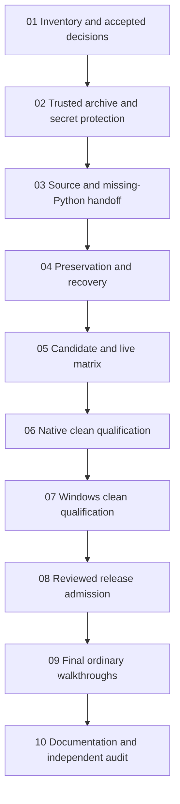

# EPIC #452 — Complete bootstrap and qualify the simple install paths

Workflow ID: issue-452-bootstrap-completion
workflowVersion: 1.1
Status: RELEVANCE REVIEWED; S452-01–10 implementation NOT STARTED; EPIC INCOMPLETE
Issue: https://github.com/MatthiasBurger-Coder/Tiny-Swarm-World/issues/452
Branch: `feature/workflow-bootstrap-452-20261017`
Baseline: `2bdee76038c433faef13595b981375b1baaf447c`
Execution profile: FULL_PATH — cross-host bootstrap, secret/source protection, admission policy and live qualification.

## Executive Summary and Target Picture

Deliver the original two preparation entrypoints followed by installation from a trusted extracted release or checkout, on qualified native Ubuntu and Windows11/WSL2 targets. Reuse all ten CLOSED children #453–#462. Their closure does not satisfy the parent: W10 explicitly records INCOMPLETE and W09 passed its amended existing-host scope only. This workflow covers all ten packages through a full requirement crosswalk and ten remaining-work slices, not ten repeated implementations.

The starting condition is possession of the complete trusted source. Account creation, elevation, unavoidable reboot/session boundaries and reruns remain guided operator interactions. The Linux-native source location must be an explicit starting condition or guided preparation step. Automatic source copying is optional under the existing bootstrap contract; undocumented source placement, manual pip/venv, Incus YAML or network setup cannot be hidden in the default path. Preparation READY is separate from installation, browser and authenticated service success.

## Requirement Clarification Gate

- Original request: EPIC title and #452.
- Interpreted intent: user answered “Create the full EPIC workflow” after choosing authoring versus child implementation.
- Change type / process strand: full remaining-gap workflow authoring; no product implementation or live operations now.
- Affected architecture: Linux/WSL bootstrap services/ports/adapters, dependency-light Windows modules, installer secret policy and existing bridge.
- Explicit requirements: BOOT-01–09, twelve parent acceptance criteria and W01–W10 child scope/acceptance in [requirement matrix](requirement-matrix.md).
- Implicit requirements: source trust without installed Git/Python, guarded release admission, ordinary-user continuity, truthful source/scenario evidence and canonical status/exit semantics.
- Assumptions: historical delivery is reusable only after fresh inventory; no closed child is reopened; remaining code decisions are mandatory S01 acceptance gates.
- Non-goals: reimplement #427; expand #440/#444 selection scope; DNS/Podman/K3s/Kubernetes/fleet/runtime replacement; Java/Spring/React; HA; whole-host rollback.
- Risks: credential exposure by bypassing Git guard; source transfer before integrity checks; self-referential qualification; false clean-host claims; broad/implicit mutation; shared-file conflicts.
- Open questions for execution: S01 settles archive-equivalent secret protection, trusted source delivery and admission identity/invalidation. S05 requires actual recoverable targets and fresh live consent.
- Blocking questions for authoring: none. Future execution gates do not grant their own approval.
- Confidence: 95%; clarification attempt 1 of maxRetries 3.
- Decision: READY_FOR_WORKFLOW authoring; not an implementation or live PASS.
- Active workflow relationship: replace completed #355 workflow entirely. Prior workflow remains in Git at baseline; all historical issue evidence is preserved.

## Verified Baseline and Reuse

All child issue states and full text are in [issue-source-snapshot.json](issue-source-snapshot.json), retrieved 2026-10-17. #427/#313/#363 are CLOSED; #440/#444 remain OPEN. The authoritative remaining-gap inventory is `documentation/evidence/issue-462-bootstrap-completion-audit.md`. Latest W09 amended campaign entries in `.tiny-swarm/evidence/issue-461/combined_qualification_20261017.json` remain scoped to their original exact SHA and existing targets.

| Package | Delivered capability to reuse | Remaining obligation / slices |
|---|---|---|
| W01 #453 | Plans, modes, readiness/exit contracts | Archive/source/admission decisions; S01–04 |
| W02 #454 | Ubuntu package/Python bootstrap and locked user venv | Absent-Python handoff and clean-host proof; S03/06/07/09 |
| W03 #455 | Incus daemon/access/storage/network/profile preparation | Clean initialization, actual group transition/preservation; S04/06/07 |
| W04 #456 | Windows/WSL/systemd lifecycle, candidate guard | Clean lifecycle, trusted source handoff, ordinary admission; S03/07/08/09 |
| W05 #457 | Capacity adaptation and preserved config | Resource boundaries/effective allocation evidence; S04/07 |
| W06 #458 | Scoped kernel/network and canonical bridge | Actual IP drift, routing/browser and preservation; S04/07/09 |
| W07 #459 | Non-destructive native/WSL reconcile and inspected handoff | Archive and source/runtime assumptions; S02/03/09 |
| W08 #460 | Protected checkpoints/evidence and recovery | Full-entrypoint failure/resume and preservation; S04/06/07/09 |
| W09 #461 | Amended existing-host scenario results | Original fresh-host and deferred matrix; S05–09 |
| W10 #462 | Short paths and honest INCOMPLETE audit | Witnessed final paths and independent EPIC audit; S09/10 |

Verified implementation gaps: downstream `PlatformPreflightService._ignore_policy_checks` requires Git-ignore proof; `linux-handoff.sh` invokes Python before missing-Python preparation; Windows source placement is manual; `Application.ps1` unconditionally blocks ordinary Apply and `Policy.ps1` emits `qualified=false`. Historical API/TLS results are not browser/Selenium success. No candidate release is globally qualified by this plan.

## Architecture Constraints and Scope

Keep domain independent and application dependent on ports; concrete filesystem/process/PowerShell/configuration details belong to adapters. Reuse native, Incus, network, installation, checkpoint and bridge owners. Runtime wiring stays in infrastructure composition; entrypoints remain thin. Docker/Swarm stay in Incus nodes. Native owners never construct Windows adapters. Canonical ports remain `infra/config/ports.yaml`; bridge ownership/ACL/service lifecycle is exclusive.

Accepted shared-Ubuntu, Windows lifecycle/capacity, Incus, scoped-network, recovery and WSL-reconciliation ADRs remain authoritative. The overall W01 ADR remains historically proposed except its named accepted transitions. S01 must accept a narrow release-integrity/admission ADR before changing these guards. No new orchestrator, global config replacement, automatic runtime replacement or live approval is introduced.

## Python Automation Assessment

Only S02/S03/S04/S08 authorize scoped product changes, after S01 contract acceptance. Use Python3.12-compatible ports/value objects; asynchronous command orchestration; locked dependency installation and user-owned venv; separate package elevation. Never invoke Windows product Python or bootstrap dependencies merely to plan. Mock commands/network/provider/Docker in local tests. Product inventory discovers any missing path before a reviewed scope amendment; no wildcard permission for unrelated refactoring.

## Frontend Assessment

There is no browser React frontend scope. Conditional console/status UX review covers plan visibility, readable status without color, consistent JSON/console exits, exact next commands preserving profile/target/overrides, and Windows reboot versus WSL-wide/distro restart versus logout/login. Browser testing in qualification tests deployed routing; it does not authorize a frontend application.

## Resilience and Security Requirements

Reinventory before mutation and invalidate consent on target/source/selection/config drift. Stop dependent stages on blocked/partial/failed/restart outcomes. Apply state locks, atomic protected checkpoint publication and redaction; never persist approval. Preserve confirmed versus uncertain effects, concrete stage remedy and prior records. APT/features are nontransactional; no automatic package removal, distro deletion, Incus reset, whole-host rollback, lock deletion or credential overwrite. Reset needs its own exact confirmation on an authorized disposable target. Downloads and subprocesses remain bounded and verified; no unverified remote execution.

## Test Strategy and Verification States

Every product slice: nearest declared unittest first, relevant PowerShell/Pester suites in an available declared Windows runtime, then `python3 tools/quality_gate.py quality`. Full gate authority is QUALITY.md: verification-policy, complexity, lint, arch-lint, arch-tests, typecheck, test. Add newly created meaningful regressions to targeted commands once files exist. Shell syntax uses `bash -n` for changed shell files. PowerShell absence/skipped tests remain unverified; no local pass implies Pester/live success.

S05 freezes a committed candidate after the full gate and defines exact scenarios. S06/S07/S09 require target inventory, recoverability, reviewed commands and fresh explicit consent. Default new live state: APPLICABLE_LIVE / LIVE_CONSENT_MISSING. Browser/Selenium and SonarQube retain independent applicability/access/result states. Do not infer them from API checks or local quality. A live-discovered defect routes to its owning product slice, requires a new one-slice corrective checkpoint and reruns all affected exact-source scenarios; live evidence slices cannot silently edit product code.

At minimum cover fresh release paths, no-write aggregate modes, second run, ordinary install preservation, actual session and IP changes, capacity limits, collisions, absent downloads, full-entrypoint interruption/resume, unrelated resource/config/credential preservation and separate reset isolation. Publish exact qualified Windows/WSL/distro versions. Unclaimed candidate versions can remain explicitly unqualified; original clean success on both families cannot be waived without an explicit EPIC-level scope decision.

## Slice Dependency Graph



Serial baseline is deliberate: source/trust/qualification decisions and shared files cross slices; final admission changes require new ordinary-path evidence. No cycle uses final qualification to authorize its own initial candidate run: guarded candidate mode exists already; final ordinary path is tested after reviewed admission.

## Relevance Review — 2026-10-17

The user's alternative request to check the ten steps is completed in [relevance-review.md](relevance-review.md). W01–W10 delivered capabilities remain reusable; closed children are not ten missing implementations. S02/S03/S08 retain concrete product gaps, S04 is a coverage-first follow-up, S01/S05 are targeted contract/candidate preparation, and S06/S07/S09/S10 retain original evidence/final-audit obligations. No slice is silently removed. Automatic source copying, a mandatory Selenium suite, blanket destructive retesting and whole-OS recovery are not added acceptance requirements.

This is a reviewed planning correction, not completion of S452-01 or authorization for live changes. Required architecture decisions and all product/live execution gates remain open.

## Ordered Slices

All slices inherit common issue evidence and workflow locks below. All statuses are NOT STARTED. NEW paths are proposals approved only within S01 architecture decisions, not evidence of existing implementation.

### Slice 01 — Inventory, decisions and complete requirement baseline

Purpose: Revalidate W01–W10 owners and historical evidence. Accept a narrowly scoped ADR for archive secret/source protection, dependency-light Linux source inventory before Python and evidence-bound Windows release admission. Define source identity, archive membership/traversal/ownership rules, ordinary-user checkout selection, independent expected revision, admission invalidation and exact status/exit compatibility. Define the supported starting point as an extracted trusted release or checkout; acquisition uses OS tools without remote pipe-to-shell. Decisions must preserve equivalent secret protection and must be accepted by architecture/security before S02/S03/S08. Do not retroactively accept the whole historical W01 proposal.

Prerequisites: checked branch/workflow/S3-S3D preflight; complete requirement intake. Owner: Senior System Architect. Allowed write scope and locks are exact metadata scopes; common evidence is integration-owned. All other files require reviewed amendment before edits.

```yaml
slice_id: "S452-01"
profile: "FULL_PATH"
owner: "Senior System Architect"
secondary_reviewers: ["Senior Requirement Engineer", "Senior System Architect", "Senior Tester", "Senior Security Sandbox Engineer"]
affected_files: ["documentation/contracts/bootstrap.md", "documentation/arc42/09_decisions/adr-bootstrap-command-readiness-contract.adoc", "documentation/arc42/09_decisions/adr-windows-wsl-lifecycle-preparation.adoc", "documentation/arc42/09_decisions/adr-wsl-install-reconciliation.adoc", "documentation/arc42/09_decisions/adr-bootstrap-release-integrity-and-admission.adoc", "documentation/workflow/**", ".tiny-swarm/evidence/issue-452/**", ".codex/evidence/slice-*-distribution.md", ".codex/evidence/slice-*-consolidation.md", "documentation/arc42/05_analysis/issue-452-bootstrap-completion-plan.md"]
affected_modules: ["bootstrap governance and evidence"]
affected_contracts: ["bootstrap readiness/source/consent", "qualification evidence"]
dependencies: []
parallel_group: "serial"
file_locks: ["documentation/contracts/bootstrap.md", "documentation/arc42/09_decisions/adr-bootstrap-command-readiness-contract.adoc", "documentation/arc42/09_decisions/adr-windows-wsl-lifecycle-preparation.adoc", "documentation/arc42/09_decisions/adr-wsl-install-reconciliation.adoc", "documentation/arc42/09_decisions/adr-bootstrap-release-integrity-and-admission.adoc", "documentation/workflow/**", ".tiny-swarm/evidence/issue-452/**", ".codex/evidence/slice-*-distribution.md", ".codex/evidence/slice-*-consolidation.md", "documentation/arc42/05_analysis/issue-452-bootstrap-completion-plan.md"]
contract_locks: ["bootstrap-source-and-readiness", "qualified-release-admission"]
architecture_locks: ["ports-adapters-bootstrap", "bridge-exclusive-owner"]
quality_gates: {"targeted": ["git diff --check"], "required": ["git diff --check", "python3 tools/quality_gate.py verification-policy"]}
documentation: {"arc42": "documentation/arc42/05_analysis/issue-452-bootstrap-completion-plan.md", "adr": "documentation/arc42/09_decisions/adr-bootstrap-release-integrity-and-admission.adoc"}
stop_conditions: ["Scope/branch/hash/lock mismatch", "Unaccepted governing decision", "Failed required quality gate", "Unsafe source/secret/consent behavior"]
```

Done criteria: Complete matrix and acceptance crosswalk; independent four-role plus security decision review; no unresolved contract. This slice may stop for a required ADR decision; later product slices cannot resolve it implicitly.

Requirement-to-verification mapping: [complete matrix](requirement-matrix.md), rows naming `S452-01`; S01 expands shared clauses, S05 assigns exact scenario IDs, and this slice records concrete implementation/test/evidence per row. Evidence: `.tiny-swarm/evidence/issue-452/` plus named scenario artifact. Preserve six issue files and per-slice distribution/consolidation evidence. No live mutation is authorized by this slice metadata.

Parallel execution eligibility: NOT_SAFELY_PARALLELIZABLE baseline. Conflicting workflows: #440/#444 and any owner of listed file/contract/architecture locks. Shared files: common evidence/context and overlapping preparation owners. Shared infrastructure: none; mocks for local checks. Isolated worktree: required. Serialized live validation: required. Merge order: prerequisites first. Rollback: review dependents then revert only this slice commit; no automatic host rollback. Failed/partial qualification never grants support/admission.

### Slice 02 — Trusted release and Git-independent installation protection

Purpose: Implement only the unresolved S01-approved archive secret policy through existing ports and probe adapters; reuse the accepted offline source-proof architecture and existing Gitless archive verifier instead of rebuilding them. The actual archive blocker is PlatformPreflightService._ignore_policy_checks and NativeHostPreflightProbe.path_ignored_by_git, not the optional installation evidence warning. Verify a complete versioned release and separately trusted revision without Git/Python as entrypoint prerequisites. Protect local credentials/evidence and reject unsafe owners, traversal, symlinks, tampering, missing assets and ambiguous source. Preserve Git checkout behavior; do not bypass existing ignore guards or silently initialize Git. Read-only paths write no state/evidence.

Prerequisites: S452-01. Owner: Senior Python Automation Developer. Allowed write scope and locks are exact metadata scopes; common evidence is integration-owned. All other files require reviewed amendment before edits.

```yaml
slice_id: "S452-02"
profile: "FULL_PATH"
owner: "Senior Python Automation Developer"
secondary_reviewers: ["Senior Requirement Engineer", "Senior System Architect", "Senior Tester", "Senior Security Sandbox Engineer"]
affected_files: ["src/tiny_swarm_world/application/ports/preflight/port_host_preflight_probe.py", "src/tiny_swarm_world/application/services/platform/preflight_service.py", "src/tiny_swarm_world/infrastructure/adapters/preflight/host_preflight_probe.py", "src/tiny_swarm_world/infrastructure/adapters/installation/evidence.py", "src/tiny_swarm_world/infrastructure/adapters/installation/credentials.py", "src/tiny_swarm_world/domain/preflight/secret_storage.py", "tools/build_windows_preparation_manifest.py", "tools/windows/preparation/SourceProof.ps1", "tests/application/services/platform/test_preflight_service.py", "tests/infrastructure/adapters/preflight/test_host_preflight_probe.py", "tests/domain/preflight/test_secret_storage.py", "tests/test_windows_source_proof.py", "tests/windows/source-proof.Tests.ps1", "tests/test_installer.py", "tests/test_simple_installer.py", "documentation/workflow/**", ".tiny-swarm/evidence/issue-452/**", ".codex/evidence/slice-*-distribution.md", ".codex/evidence/slice-*-consolidation.md", "documentation/arc42/05_analysis/issue-452-bootstrap-completion-plan.md"]
affected_modules: ["bootstrap", "installation", "Windows preparation"]
affected_contracts: ["bootstrap readiness/source/consent", "qualification evidence"]
dependencies: ["S452-01"]
parallel_group: "serial"
file_locks: ["src/tiny_swarm_world/application/ports/preflight/port_host_preflight_probe.py", "src/tiny_swarm_world/application/services/platform/preflight_service.py", "src/tiny_swarm_world/infrastructure/adapters/preflight/host_preflight_probe.py", "src/tiny_swarm_world/infrastructure/adapters/installation/evidence.py", "src/tiny_swarm_world/infrastructure/adapters/installation/credentials.py", "src/tiny_swarm_world/domain/preflight/secret_storage.py", "tools/build_windows_preparation_manifest.py", "tools/windows/preparation/SourceProof.ps1", "tests/application/services/platform/test_preflight_service.py", "tests/infrastructure/adapters/preflight/test_host_preflight_probe.py", "tests/domain/preflight/test_secret_storage.py", "tests/test_windows_source_proof.py", "tests/windows/source-proof.Tests.ps1", "tests/test_installer.py", "tests/test_simple_installer.py", "documentation/workflow/**", ".tiny-swarm/evidence/issue-452/**", ".codex/evidence/slice-*-distribution.md", ".codex/evidence/slice-*-consolidation.md", "documentation/arc42/05_analysis/issue-452-bootstrap-completion-plan.md"]
contract_locks: ["bootstrap-source-and-readiness", "qualified-release-admission"]
architecture_locks: ["ports-adapters-bootstrap", "bridge-exclusive-owner"]
quality_gates: {"targeted": ["PYTHONPATH=src python3 -m unittest tests.application.services.platform.test_preflight_service tests.infrastructure.adapters.preflight.test_host_preflight_probe tests.domain.preflight.test_secret_storage tests.test_windows_source_proof tests.test_installer tests.test_simple_installer"], "required": ["git diff --check", "python3 tools/quality_gate.py quality"]}
documentation: {"arc42": "documentation/arc42/05_analysis/issue-452-bootstrap-completion-plan.md", "adr": "documentation/arc42/09_decisions/adr-bootstrap-release-integrity-and-admission.adoc"}
stop_conditions: ["Scope/branch/hash/lock mismatch", "Unaccepted governing decision", "Failed required quality gate", "Unsafe source/secret/consent behavior"]
```

Done criteria: Archive and checkout modes have meaningful positive and negative regressions; architecture/security review accepts equivalent secret protection; full local quality passes. Live archive success remains unverified until S06/S07/S09.

Requirement-to-verification mapping: [complete matrix](requirement-matrix.md), rows naming `S452-02`; S01 expands shared clauses, S05 assigns exact scenario IDs, and this slice records concrete implementation/test/evidence per row. Evidence: `.tiny-swarm/evidence/issue-452/` plus named scenario artifact. Preserve six issue files and per-slice distribution/consolidation evidence. No live mutation is authorized by this slice metadata.

Parallel execution eligibility: NOT_SAFELY_PARALLELIZABLE baseline. Conflicting workflows: #440/#444 and any owner of listed file/contract/architecture locks. Shared files: common evidence/context and overlapping preparation owners. Shared infrastructure: none; mocks for local checks. Isolated worktree: required. Serialized live validation: required. Merge order: prerequisites first. Rollback: review dependents then revert only this slice commit; no automatic host rollback. Failed/partial qualification never grants support/admission.

### Slice 03 — Dependency-light Windows source and Linux runtime handoff

Purpose: Remove the need to run preparation manually merely to satisfy a Python-dependent source probe. Keep the source starting location explicit: an existing user-owned Linux-native checkout/release is supported by the current contract. Automatic copy is an optional remedy, not a new mandatory EPIC requirement; if selected, require the S01-reviewed exact local copy plan and consent. Reuse existing source proof, preserve account/root/symlink/source checks and refuse unrelated destination collisions. Keep early probes dependency-light and read-only. Apply consent must cover any source delivery and package work; never copy secrets or assume distro name proves release. Guide unavoidable ordinary account creation and stop at restart/session boundaries. An optional explicit install handoff delegates to the selected WSL user, retains separate install consent and propagates exits. Keep entrypoints thin and product Python Linux-only.

Prerequisites: S452-02. Owner: Senior Python Automation Developer. Allowed write scope and locks are exact metadata scopes; common evidence is integration-owned. All other files require reviewed amendment before edits.

```yaml
slice_id: "S452-03"
profile: "FULL_PATH"
owner: "Senior Python Automation Developer"
secondary_reviewers: ["Senior Requirement Engineer", "Senior System Architect", "Senior Tester", "Senior Security Sandbox Engineer"]
affected_files: ["prepare_windows.ps1", "prepare_linux.sh", "tools/windows/preparation/Handoff.ps1", "tools/windows/preparation/Adapters.ps1", "tools/windows/preparation/SourceProof.ps1", "tools/windows/preparation/linux-handoff.sh", "tools/windows/preparation/Preparation.psm1", "tools/ubuntu_python_prerequisites.sh", "src/tiny_swarm_world/prepare_linux.py", "src/tiny_swarm_world/application/services/native_preparation.py", "src/tiny_swarm_world/application/ports/native_preparation.py", "src/tiny_swarm_world/infrastructure/composition_native_preparation.py", "tests/test_install_handoff.py", "tests/test_prepare_windows.py", "tests/test_prepare_linux.py", "tests/test_ubuntu_bootstrap_integration.py", "tests/windows/prepare-windows.Tests.ps1", "documentation/workflow/**", ".tiny-swarm/evidence/issue-452/**", ".codex/evidence/slice-*-distribution.md", ".codex/evidence/slice-*-consolidation.md", "documentation/arc42/05_analysis/issue-452-bootstrap-completion-plan.md"]
affected_modules: ["bootstrap", "installation", "Windows preparation"]
affected_contracts: ["bootstrap readiness/source/consent", "qualification evidence"]
dependencies: ["S452-02"]
parallel_group: "serial"
file_locks: ["prepare_windows.ps1", "prepare_linux.sh", "tools/windows/preparation/Handoff.ps1", "tools/windows/preparation/Adapters.ps1", "tools/windows/preparation/SourceProof.ps1", "tools/windows/preparation/linux-handoff.sh", "tools/windows/preparation/Preparation.psm1", "tools/ubuntu_python_prerequisites.sh", "src/tiny_swarm_world/prepare_linux.py", "src/tiny_swarm_world/application/services/native_preparation.py", "src/tiny_swarm_world/application/ports/native_preparation.py", "src/tiny_swarm_world/infrastructure/composition_native_preparation.py", "tests/test_install_handoff.py", "tests/test_prepare_windows.py", "tests/test_prepare_linux.py", "tests/test_ubuntu_bootstrap_integration.py", "tests/windows/prepare-windows.Tests.ps1", "documentation/workflow/**", ".tiny-swarm/evidence/issue-452/**", ".codex/evidence/slice-*-distribution.md", ".codex/evidence/slice-*-consolidation.md", "documentation/arc42/05_analysis/issue-452-bootstrap-completion-plan.md"]
contract_locks: ["bootstrap-source-and-readiness", "qualified-release-admission"]
architecture_locks: ["ports-adapters-bootstrap", "bridge-exclusive-owner"]
quality_gates: {"targeted": ["PYTHONPATH=src python3 -m unittest tests.test_install_handoff tests.test_prepare_windows tests.test_prepare_linux tests.test_ubuntu_bootstrap_integration"], "required": ["git diff --check", "python3 tools/quality_gate.py quality"]}
documentation: {"arc42": "documentation/arc42/05_analysis/issue-452-bootstrap-completion-plan.md", "adr": "documentation/arc42/09_decisions/adr-bootstrap-release-integrity-and-admission.adoc"}
stop_conditions: ["Scope/branch/hash/lock mismatch", "Unaccepted governing decision", "Failed required quality gate", "Unsafe source/secret/consent behavior"]
```

Done criteria: Fresh absent-Python/source scenarios are test-backed; selected account/checkout/profile/overrides survive handoff and diagnostics; unsupported targets block before mutation; full quality passes.

Requirement-to-verification mapping: [complete matrix](requirement-matrix.md), rows naming `S452-03`; S01 expands shared clauses, S05 assigns exact scenario IDs, and this slice records concrete implementation/test/evidence per row. Evidence: `.tiny-swarm/evidence/issue-452/` plus named scenario artifact. Preserve six issue files and per-slice distribution/consolidation evidence. No live mutation is authorized by this slice metadata.

Parallel execution eligibility: NOT_SAFELY_PARALLELIZABLE baseline. Conflicting workflows: #440/#444 and any owner of listed file/contract/architecture locks. Shared files: common evidence/context and overlapping preparation owners. Shared infrastructure: none; mocks for local checks. Isolated worktree: required. Serialized live validation: required. Merge order: prerequisites first. Rollback: review dependents then revert only this slice commit; no automatic host rollback. Failed/partial qualification never grants support/admission.

### Slice 04 — Preservation, read-only and full-entrypoint recovery coverage

Purpose: Inventory the substantial existing recovery/preservation coverage first; add only demonstrated coverage gaps and fixes. Do not reimplement checkpoint, preservation or resource owners because their live verification remains incomplete. Cover aggregate no-write preflight/dry-run (host/config/state/evidence), plan drift and consent rejection, APT locks/download failure, full-entrypoint interruption/resume, protected checkpoint corruption/concurrency/ownership and uncertain effects. Cover minimum/insufficient/adequate capacity and Windows reserve; preserve .wslconfig, wsl.conf, unrelated distros/Incus pools/networks/profiles/nodes and credentials. Reuse the canonical port registry and bridge owner. Diagnostics show stage, confirmed/uncertain effects, scope of restart and one exact next command retaining selection. No automatic reset, state deletion, retries or whole-host rollback.

Prerequisites: S452-03. Owner: Senior Python Automation Developer. Allowed write scope and locks are exact metadata scopes; common evidence is integration-owned. All other files require reviewed amendment before edits.

```yaml
slice_id: "S452-04"
profile: "FULL_PATH"
owner: "Senior Python Automation Developer"
secondary_reviewers: ["Senior Requirement Engineer", "Senior System Architect", "Senior Tester", "Senior Security Sandbox Engineer"]
affected_files: ["src/tiny_swarm_world/prepare_linux.py", "src/tiny_swarm_world/application/services/native_preparation.py", "src/tiny_swarm_world/application/services/incus_preparation.py", "src/tiny_swarm_world/application/services/network_preparation.py", "src/tiny_swarm_world/infrastructure/adapters/bootstrap_state.py", "src/tiny_swarm_world/infrastructure/adapters/native_preparation_evidence.py", "src/tiny_swarm_world/infrastructure/adapters/incus_preparation/**", "src/tiny_swarm_world/infrastructure/adapters/network_preparation/**", "tools/windows/preparation/Adapters.ps1", "tools/windows/preparation/Application.ps1", "tools/windows/preparation/Resources.ps1", "tools/windows/preparation/ResourceAdapters.ps1", "tools/windows/preparation/ResourceHost.ps1", "tools/windows/preparation/Policy.ps1", "tests/test_bootstrap_recovery.py", "tests/test_prepare_linux.py", "tests/test_prepare_windows.py", "tests/test_incus_preparation.py", "tests/test_network_preparation.py", "tests/test_network_preparation_compatibility.py", "tests/test_wsl_resource_projection.py", "tests/test_preparation_login_session.py", "tests/windows/resources.Tests.ps1", "tests/windows/resource-files.Tests.ps1", "tests/windows/bridge-preparation.Tests.ps1", "tests/test_bootstrap_entrypoint_recovery.py", "documentation/workflow/**", ".tiny-swarm/evidence/issue-452/**", ".codex/evidence/slice-*-distribution.md", ".codex/evidence/slice-*-consolidation.md", "documentation/arc42/05_analysis/issue-452-bootstrap-completion-plan.md"]
affected_modules: ["bootstrap", "installation", "Windows preparation"]
affected_contracts: ["bootstrap readiness/source/consent", "qualification evidence"]
dependencies: ["S452-03"]
parallel_group: "serial"
file_locks: ["src/tiny_swarm_world/prepare_linux.py", "src/tiny_swarm_world/application/services/native_preparation.py", "src/tiny_swarm_world/application/services/incus_preparation.py", "src/tiny_swarm_world/application/services/network_preparation.py", "src/tiny_swarm_world/infrastructure/adapters/bootstrap_state.py", "src/tiny_swarm_world/infrastructure/adapters/native_preparation_evidence.py", "src/tiny_swarm_world/infrastructure/adapters/incus_preparation/**", "src/tiny_swarm_world/infrastructure/adapters/network_preparation/**", "tools/windows/preparation/Adapters.ps1", "tools/windows/preparation/Application.ps1", "tools/windows/preparation/Resources.ps1", "tools/windows/preparation/ResourceAdapters.ps1", "tools/windows/preparation/ResourceHost.ps1", "tools/windows/preparation/Policy.ps1", "tests/test_bootstrap_recovery.py", "tests/test_prepare_linux.py", "tests/test_prepare_windows.py", "tests/test_incus_preparation.py", "tests/test_network_preparation.py", "tests/test_network_preparation_compatibility.py", "tests/test_wsl_resource_projection.py", "tests/test_preparation_login_session.py", "tests/windows/resources.Tests.ps1", "tests/windows/resource-files.Tests.ps1", "tests/windows/bridge-preparation.Tests.ps1", "tests/test_bootstrap_entrypoint_recovery.py", "documentation/workflow/**", ".tiny-swarm/evidence/issue-452/**", ".codex/evidence/slice-*-distribution.md", ".codex/evidence/slice-*-consolidation.md", "documentation/arc42/05_analysis/issue-452-bootstrap-completion-plan.md"]
contract_locks: ["bootstrap-source-and-readiness", "qualified-release-admission"]
architecture_locks: ["ports-adapters-bootstrap", "bridge-exclusive-owner"]
quality_gates: {"targeted": ["PYTHONPATH=src python3 -m unittest tests.test_bootstrap_recovery tests.test_prepare_linux tests.test_prepare_windows tests.test_incus_preparation tests.test_network_preparation tests.test_network_preparation_compatibility tests.test_wsl_resource_projection tests.test_preparation_login_session"], "required": ["git diff --check", "python3 tools/quality_gate.py quality"]}
documentation: {"arc42": "documentation/arc42/05_analysis/issue-452-bootstrap-completion-plan.md", "adr": null}
stop_conditions: ["Scope/branch/hash/lock mismatch", "Unaccepted governing decision", "Failed required quality gate", "Unsafe source/secret/consent behavior"]
```

Done criteria: Meaningful coverage regressions pass with the full local gate and independent security/console review; live counterparts are separately pending. New test module is explicitly NEW and becomes runnable only after creation.

Requirement-to-verification mapping: [complete matrix](requirement-matrix.md), rows naming `S452-04`; S01 expands shared clauses, S05 assigns exact scenario IDs, and this slice records concrete implementation/test/evidence per row. Evidence: `.tiny-swarm/evidence/issue-452/` plus named scenario artifact. Preserve six issue files and per-slice distribution/consolidation evidence. No live mutation is authorized by this slice metadata.

Parallel execution eligibility: NOT_SAFELY_PARALLELIZABLE baseline. Conflicting workflows: #440/#444 and any owner of listed file/contract/architecture locks. Shared files: common evidence/context and overlapping preparation owners. Shared infrastructure: none; mocks for local checks. Isolated worktree: required. Serialized live validation: required. Merge order: prerequisites first. Rollback: review dependents then revert only this slice commit; no automatic host rollback. Failed/partial qualification never grants support/admission.

### Slice 05 — Freeze candidate and prepare full live qualification matrix

Purpose: Create scenario IDs, exact commands, expected exits, source/release artifact hashes, target/version inventory, before/after preservation observations and recovery procedures. Resolve native/WSL Ubuntu24.04/26.04 rows individually as qualified, unqualified or unsupported; do not claim all candidates are qualified. At least one clean supported target per family must exercise the full original EPIC path. Read latest W09 amendments without transplanting existing-host proof. Define browser, route and service-authentication checks separately from preparation readiness. Browser-routing recovery is required; Selenium is not a mandated implementation. Reuse the W09 scenario matrix and exact-source results that remain applicable. Define a recoverable fresh native host and clean Windows/WSL target, fault injection boundaries, safe snapshot/backup scope and candidate admission evidence. No live commands execute in this planning slice.

Prerequisites: S452-04. Owner: Senior DevOps Engineer. Allowed write scope and locks are exact metadata scopes; common evidence is integration-owned. All other files require reviewed amendment before edits.

```yaml
slice_id: "S452-05"
profile: "FULL_PATH"
owner: "Senior DevOps Engineer"
secondary_reviewers: ["Senior Requirement Engineer", "Senior System Architect", "Senior Tester"]
affected_files: ["documentation/evidence/issue-452-qualification-plan.md", "documentation/contracts/bootstrap.md", "documentation/workflow/**", ".tiny-swarm/evidence/issue-452/**", ".codex/evidence/slice-*-distribution.md", ".codex/evidence/slice-*-consolidation.md", "documentation/arc42/05_analysis/issue-452-bootstrap-completion-plan.md"]
affected_modules: ["bootstrap governance and evidence"]
affected_contracts: ["bootstrap readiness/source/consent", "qualification evidence"]
dependencies: ["S452-04"]
parallel_group: "serial"
file_locks: ["documentation/evidence/issue-452-qualification-plan.md", "documentation/contracts/bootstrap.md", "documentation/workflow/**", ".tiny-swarm/evidence/issue-452/**", ".codex/evidence/slice-*-distribution.md", ".codex/evidence/slice-*-consolidation.md", "documentation/arc42/05_analysis/issue-452-bootstrap-completion-plan.md"]
contract_locks: ["bootstrap-source-and-readiness", "qualified-release-admission"]
architecture_locks: ["ports-adapters-bootstrap", "bridge-exclusive-owner"]
quality_gates: {"targeted": ["git diff --check"], "required": ["git diff --check", "python3 tools/quality_gate.py quality"]}
documentation: {"arc42": "documentation/arc42/05_analysis/issue-452-bootstrap-completion-plan.md", "adr": null}
stop_conditions: ["Scope/branch/hash/lock mismatch", "Unaccepted governing decision", "Failed required quality gate", "Unsafe source/secret/consent behavior"]
```

Done criteria: Reviewed exact-command matrix, redaction plan and recoverability prerequisites exist; full local quality on frozen product candidate passes. Record LIVE_CONSENT_MISSING until explicit per-target consent exists; absent targets block S06/S07, not local work.

Requirement-to-verification mapping: [complete matrix](requirement-matrix.md), rows naming `S452-05`; S01 expands shared clauses, S05 assigns exact scenario IDs, and this slice records concrete implementation/test/evidence per row. Evidence: `.tiny-swarm/evidence/issue-452/` plus named scenario artifact. Preserve six issue files and per-slice distribution/consolidation evidence. No live mutation is authorized by this slice metadata.

Parallel execution eligibility: NOT_SAFELY_PARALLELIZABLE baseline. Conflicting workflows: #440/#444 and any owner of listed file/contract/architecture locks. Shared files: common evidence/context and overlapping preparation owners. Shared infrastructure: none; mocks for local checks. Isolated worktree: required. Serialized live validation: required. Merge order: prerequisites first. Rollback: review dependents then revert only this slice commit; no automatic host rollback. Failed/partial qualification never grants support/admission.

### Slice 06 — Qualify clean native Ubuntu, preservation and recovery

Purpose: After fresh target-specific consent and approved recovery, execute S05 native matrix on exact committed source. Include trusted extracted release without preinstalled Git/Python, clean preparation/install, repeated preparation/install, actual stale-to-new group session, compatible and foreign Incus resources, collisions/foreign executable rejection, capacity/download failures and full-entrypoint interruption/recovery. Compare no-write snapshots and preserved resource/credential identities. Verify service routes and authentication, recording commands/exits/versions and redacted outputs. Distinguish managed-root snapshots from whole-OS/external-volume recovery; make no broader recovery promise.

Prerequisites: S452-05. Owner: Senior DevOps Engineer. Allowed write scope and locks are exact metadata scopes; common evidence is integration-owned. All other files require reviewed amendment before edits.

```yaml
slice_id: "S452-06"
profile: "FULL_PATH"
owner: "Senior DevOps Engineer"
secondary_reviewers: ["Senior Requirement Engineer", "Senior System Architect", "Senior Tester"]
affected_files: ["documentation/evidence/issue-452-native-qualification.md", "documentation/workflow/**", ".tiny-swarm/evidence/issue-452/**", ".codex/evidence/slice-*-distribution.md", ".codex/evidence/slice-*-consolidation.md", "documentation/arc42/05_analysis/issue-452-bootstrap-completion-plan.md"]
affected_modules: ["bootstrap governance and evidence"]
affected_contracts: ["bootstrap readiness/source/consent", "qualification evidence"]
dependencies: ["S452-05"]
parallel_group: "serial"
file_locks: ["documentation/evidence/issue-452-native-qualification.md", "documentation/workflow/**", ".tiny-swarm/evidence/issue-452/**", ".codex/evidence/slice-*-distribution.md", ".codex/evidence/slice-*-consolidation.md", "documentation/arc42/05_analysis/issue-452-bootstrap-completion-plan.md"]
contract_locks: ["bootstrap-source-and-readiness", "qualified-release-admission"]
architecture_locks: ["ports-adapters-bootstrap", "bridge-exclusive-owner"]
quality_gates: {"targeted": ["git diff --check"], "required": ["git diff --check", "python3 tools/quality_gate.py verification-policy"]}
documentation: {"arc42": "documentation/arc42/05_analysis/issue-452-bootstrap-completion-plan.md", "adr": null}
stop_conditions: ["Scope/branch/hash/lock mismatch", "Unaccepted governing decision", "Failed required quality gate", "Unsafe source/secret/consent behavior", "Missing explicit live consent or recoverable target", "Uncommitted or changed candidate source"]
```

Done criteria: Every required native scenario has exact-source evidence and an independent evidence review; failed/partial/blocked rows remain non-success. No product edits here: defect routes back to its owning slice and affected qualification must rerun on the repaired committed candidate.

Requirement-to-verification mapping: [complete matrix](requirement-matrix.md), rows naming `S452-06`; S01 expands shared clauses, S05 assigns exact scenario IDs, and this slice records concrete implementation/test/evidence per row. Evidence: `.tiny-swarm/evidence/issue-452/` plus named scenario artifact. Preserve six issue files and per-slice distribution/consolidation evidence. Live commands are defined and reviewed in S05, not guessed here; explicit consent is still required.

Parallel execution eligibility: NOT_SAFELY_PARALLELIZABLE baseline. Conflicting workflows: #440/#444 and any owner of listed file/contract/architecture locks. Shared files: common evidence/context and overlapping preparation owners. Shared infrastructure: approved live target only. Isolated worktree: required. Serialized live validation: required. Merge order: prerequisites first. Rollback: review dependents then revert only this slice commit; no automatic host rollback. Failed/partial qualification never grants support/admission.

### Slice 07 — Qualify clean Windows/WSL lifecycle and browser routing

Purpose: After separate Windows/WSL consent and recovery prerequisites, execute S05 matrix on clean supported Windows11/WSL2 with the selected ordinary-user Ubuntu distro, using existing guarded candidate mode until S08 admission. Cover feature/distro/systemd creation, account interactions, reboot and WSL-wide/selected-distro restarts, capacity boundaries and preservation, verified Linux-native source starting point and dependency-light inventory before Python, prepare/install/rerun, actual group transition, actual IP change and existing bridge refresh, port collisions, download/interruption/resume, unrelated-resource and credential preservation. Verify browser routing and service authentication as separate outcomes; API tests alone are not browser/Selenium success. Evaluate existing exact-source reset-isolation evidence first. A new destructive reset run is not automatically required; only separately authorized, invalidated or uncovered acceptance needs a disposable live target. Ordinary installs never reset.

Prerequisites: S452-06. Owner: Senior DevOps Engineer. Allowed write scope and locks are exact metadata scopes; common evidence is integration-owned. All other files require reviewed amendment before edits.

```yaml
slice_id: "S452-07"
profile: "FULL_PATH"
owner: "Senior DevOps Engineer"
secondary_reviewers: ["Senior Requirement Engineer", "Senior System Architect", "Senior Tester"]
affected_files: ["documentation/evidence/issue-452-wsl-qualification.md", "documentation/workflow/**", ".tiny-swarm/evidence/issue-452/**", ".codex/evidence/slice-*-distribution.md", ".codex/evidence/slice-*-consolidation.md", "documentation/arc42/05_analysis/issue-452-bootstrap-completion-plan.md"]
affected_modules: ["bootstrap governance and evidence"]
affected_contracts: ["bootstrap readiness/source/consent", "qualification evidence"]
dependencies: ["S452-06"]
parallel_group: "serial"
file_locks: ["documentation/evidence/issue-452-wsl-qualification.md", "documentation/workflow/**", ".tiny-swarm/evidence/issue-452/**", ".codex/evidence/slice-*-distribution.md", ".codex/evidence/slice-*-consolidation.md", "documentation/arc42/05_analysis/issue-452-bootstrap-completion-plan.md"]
contract_locks: ["bootstrap-source-and-readiness", "qualified-release-admission"]
architecture_locks: ["ports-adapters-bootstrap", "bridge-exclusive-owner"]
quality_gates: {"targeted": ["git diff --check"], "required": ["git diff --check", "python3 tools/quality_gate.py verification-policy"]}
documentation: {"arc42": "documentation/arc42/05_analysis/issue-452-bootstrap-completion-plan.md", "adr": null}
stop_conditions: ["Scope/branch/hash/lock mismatch", "Unaccepted governing decision", "Failed required quality gate", "Unsafe source/secret/consent behavior", "Missing explicit live consent or recoverable target", "Uncommitted or changed candidate source"]
```

Done criteria: Required Windows/WSL scenarios are exact-source verified with independently reviewed redacted evidence, or remain explicitly blocked. Passing candidate mode does not enroll ordinary Apply; all source changes invalidate affected scenario proof.

Requirement-to-verification mapping: [complete matrix](requirement-matrix.md), rows naming `S452-07`; S01 expands shared clauses, S05 assigns exact scenario IDs, and this slice records concrete implementation/test/evidence per row. Evidence: `.tiny-swarm/evidence/issue-452/` plus named scenario artifact. Preserve six issue files and per-slice distribution/consolidation evidence. Live commands are defined and reviewed in S05, not guessed here; explicit consent is still required.

Parallel execution eligibility: NOT_SAFELY_PARALLELIZABLE baseline. Conflicting workflows: #440/#444 and any owner of listed file/contract/architecture locks. Shared files: common evidence/context and overlapping preparation owners. Shared infrastructure: approved live target only. Isolated worktree: required. Serialized live validation: required. Merge order: prerequisites first. Rollback: review dependents then revert only this slice commit; no automatic host rollback. Failed/partial qualification never grants support/admission.

### Slice 08 — Admit verified Windows releases through reviewed policy

Purpose: Implement the accepted S01 admission policy only after applicable S06/S07 evidence is accepted. Replace unconditional qualified=false/ordinary Apply rejection with evidence-bound, independently trusted release/target admission, preserving unknown-target refusal, source/proof verification, plan consent, identity binding and bounded candidate qualification. Reject stale, tampered, revoked and wrong-source/version records. Avoid self-referential SHA enrollment: S01 must define product/release identity versus reviewed publication metadata and which behavior changes require requalification. Declare new Qualification.ps1/catalog/test files NEW, subject to accepted design; do not add them as stubs. No opportunistic allowlist or QualificationRun bypass for users.

Prerequisites: S452-07. Owner: Senior Python Automation Developer. Allowed write scope and locks are exact metadata scopes; common evidence is integration-owned. All other files require reviewed amendment before edits.

```yaml
slice_id: "S452-08"
profile: "FULL_PATH"
owner: "Senior Python Automation Developer"
secondary_reviewers: ["Senior Requirement Engineer", "Senior System Architect", "Senior Tester", "Senior Security Sandbox Engineer"]
affected_files: ["prepare_windows.ps1", "tools/windows/preparation/Policy.ps1", "tools/windows/preparation/Application.ps1", "tools/windows/preparation/Adapters.ps1", "tools/windows/preparation/Preparation.psm1", "tools/windows/preparation/Qualification.ps1", "tools/windows/preparation/qualified-releases.json", "tests/test_prepare_windows.py", "tests/windows/prepare-windows.Tests.ps1", "tests/windows/qualification.Tests.ps1", "documentation/contracts/bootstrap.md", "documentation/arc42/09_decisions/adr-bootstrap-release-integrity-and-admission.adoc", "documentation/workflow/**", ".tiny-swarm/evidence/issue-452/**", ".codex/evidence/slice-*-distribution.md", ".codex/evidence/slice-*-consolidation.md", "documentation/arc42/05_analysis/issue-452-bootstrap-completion-plan.md"]
affected_modules: ["bootstrap", "installation", "Windows preparation"]
affected_contracts: ["bootstrap readiness/source/consent", "qualification evidence"]
dependencies: ["S452-07"]
parallel_group: "serial"
file_locks: ["prepare_windows.ps1", "tools/windows/preparation/Policy.ps1", "tools/windows/preparation/Application.ps1", "tools/windows/preparation/Adapters.ps1", "tools/windows/preparation/Preparation.psm1", "tools/windows/preparation/Qualification.ps1", "tools/windows/preparation/qualified-releases.json", "tests/test_prepare_windows.py", "tests/windows/prepare-windows.Tests.ps1", "tests/windows/qualification.Tests.ps1", "documentation/contracts/bootstrap.md", "documentation/arc42/09_decisions/adr-bootstrap-release-integrity-and-admission.adoc", "documentation/workflow/**", ".tiny-swarm/evidence/issue-452/**", ".codex/evidence/slice-*-distribution.md", ".codex/evidence/slice-*-consolidation.md", "documentation/arc42/05_analysis/issue-452-bootstrap-completion-plan.md"]
contract_locks: ["bootstrap-source-and-readiness", "qualified-release-admission"]
architecture_locks: ["ports-adapters-bootstrap", "bridge-exclusive-owner"]
quality_gates: {"targeted": ["PYTHONPATH=src python3 -m unittest tests.test_prepare_windows"], "required": ["git diff --check", "python3 tools/quality_gate.py quality"]}
documentation: {"arc42": "documentation/arc42/05_analysis/issue-452-bootstrap-completion-plan.md", "adr": "documentation/arc42/09_decisions/adr-bootstrap-release-integrity-and-admission.adoc"}
stop_conditions: ["Scope/branch/hash/lock mismatch", "Unaccepted governing decision", "Failed required quality gate", "Unsafe source/secret/consent behavior"]
```

Done criteria: Admission positive/negative tests and full local quality pass; independent security/architecture review accepts source/admission integrity. Candidate evidence never automatically qualifies the final admission implementation; S09 must exercise final ordinary path.

Requirement-to-verification mapping: [complete matrix](requirement-matrix.md), rows naming `S452-08`; S01 expands shared clauses, S05 assigns exact scenario IDs, and this slice records concrete implementation/test/evidence per row. Evidence: `.tiny-swarm/evidence/issue-452/` plus named scenario artifact. Preserve six issue files and per-slice distribution/consolidation evidence. No live mutation is authorized by this slice metadata.

Parallel execution eligibility: NOT_SAFELY_PARALLELIZABLE baseline. Conflicting workflows: #440/#444 and any owner of listed file/contract/architecture locks. Shared files: common evidence/context and overlapping preparation owners. Shared infrastructure: none; mocks for local checks. Isolated worktree: required. Serialized live validation: required. Merge order: prerequisites first. Rollback: review dependents then revert only this slice commit; no automatic host rollback. Failed/partial qualification never grants support/admission.

### Slice 09 — Exercise final ordinary two-command paths at final candidate

Purpose: Freeze final committed product and release artifact, review S08 source-change impact and obtain fresh consent for affected clean targets. Rerun final native and Windows ordinary operator paths with no candidate qualification flags, including extracted source. Count starting-condition acquisition, account creation and unavoidable restart/resume actions explicitly; undocumented checkout/Python/network prerequisites fail acceptance. Reverify affected lifecycle/preservation/recovery scenarios after any behavior change and preserve historical evidence with its original SHA. Publish exact qualified versions; mark all other rows unqualified or unsupported. Missing runtime/browser/Selenium/external access remains the canonical non-success state.

Prerequisites: S452-08. Owner: Senior DevOps Engineer. Allowed write scope and locks are exact metadata scopes; common evidence is integration-owned. All other files require reviewed amendment before edits.

```yaml
slice_id: "S452-09"
profile: "FULL_PATH"
owner: "Senior DevOps Engineer"
secondary_reviewers: ["Senior Requirement Engineer", "Senior System Architect", "Senior Tester"]
affected_files: ["documentation/evidence/issue-452-final-walkthroughs.md", "documentation/evidence/issue-452-qualification-plan.md", "documentation/workflow/**", ".tiny-swarm/evidence/issue-452/**", ".codex/evidence/slice-*-distribution.md", ".codex/evidence/slice-*-consolidation.md", "documentation/arc42/05_analysis/issue-452-bootstrap-completion-plan.md"]
affected_modules: ["bootstrap governance and evidence"]
affected_contracts: ["bootstrap readiness/source/consent", "qualification evidence"]
dependencies: ["S452-08"]
parallel_group: "serial"
file_locks: ["documentation/evidence/issue-452-final-walkthroughs.md", "documentation/evidence/issue-452-qualification-plan.md", "documentation/workflow/**", ".tiny-swarm/evidence/issue-452/**", ".codex/evidence/slice-*-distribution.md", ".codex/evidence/slice-*-consolidation.md", "documentation/arc42/05_analysis/issue-452-bootstrap-completion-plan.md"]
contract_locks: ["bootstrap-source-and-readiness", "qualified-release-admission"]
architecture_locks: ["ports-adapters-bootstrap", "bridge-exclusive-owner"]
quality_gates: {"targeted": ["git diff --check"], "required": ["git diff --check", "python3 tools/quality_gate.py verification-policy"]}
documentation: {"arc42": "documentation/arc42/05_analysis/issue-452-bootstrap-completion-plan.md", "adr": null}
stop_conditions: ["Scope/branch/hash/lock mismatch", "Unaccepted governing decision", "Failed required quality gate", "Unsafe source/secret/consent behavior", "Missing explicit live consent or recoverable target", "Uncommitted or changed candidate source"]
```

Done criteria: Both families have final-source clean, repeated and recovery results, ordinary Apply works only for admitted releases, README commands are witnessed, and requirement/evidence reviewer accepts all live-dependent criteria. If an original criterion stays open, stop INCOMPLETE/BLOCKED rather than silently amending the EPIC.

Requirement-to-verification mapping: [complete matrix](requirement-matrix.md), rows naming `S452-09`; S01 expands shared clauses, S05 assigns exact scenario IDs, and this slice records concrete implementation/test/evidence per row. Evidence: `.tiny-swarm/evidence/issue-452/` plus named scenario artifact. Preserve six issue files and per-slice distribution/consolidation evidence. Live commands are defined and reviewed in S05, not guessed here; explicit consent is still required.

Parallel execution eligibility: NOT_SAFELY_PARALLELIZABLE baseline. Conflicting workflows: #440/#444 and any owner of listed file/contract/architecture locks. Shared files: common evidence/context and overlapping preparation owners. Shared infrastructure: approved live target only. Isolated worktree: required. Serialized live validation: required. Merge order: prerequisites first. Rollback: review dependents then revert only this slice commit; no automatic host rollback. Failed/partial qualification never grants support/admission.

### Slice 10 — Synchronize operator docs and independently audit EPIC closure

Purpose: Update the existing delivered operator documentation with verified concise preparation/install commands and exact prerequisites and qualified versions, account/elevation guidance, resources, restart/session actions, access URLs/credential sources and concrete recovery. Keep developer setup separate. Update arc42 only to verified behavior and preserve W09/W10 historical amendments and evidence. Populate six issue evidence files and complete every parent/child matrix row. Independent Requirement Lead, Architect and Test/Evidence reviews precede issue-completion-auditor; implementer cannot be sole completion authority. Audit outputs PASS/INCOMPLETE/BLOCKED/REJECTED. Do not close or edit the GitHub EPIC without explicit instruction.

Prerequisites: S452-09. Owner: Senior Documentation Engineer. Allowed write scope and locks are exact metadata scopes; common evidence is integration-owned. All other files require reviewed amendment before edits.

```yaml
slice_id: "S452-10"
profile: "FULL_PATH"
owner: "Senior Documentation Engineer"
secondary_reviewers: ["Senior Requirement Engineer", "Senior System Architect", "Senior Tester"]
affected_files: ["README.md", "documentation/user_guide/installation.adoc", "documentation/user_guide/windows-preparation.md", "documentation/user_guide/network-preparation.md", "documentation/user_guide/troubleshooting.adoc", "documentation/manuals/developer-manual.md", "documentation/contracts/bootstrap.md", "documentation/evidence/issue-452-completion-audit.md", "documentation/arc42/06_runtime_view.adoc", "documentation/arc42/07_deployment_view.adoc", "documentation/arc42/11_risks_and_debt.adoc", "documentation/workflow/**", ".tiny-swarm/evidence/issue-452/**", ".codex/evidence/slice-*-distribution.md", ".codex/evidence/slice-*-consolidation.md", "documentation/arc42/05_analysis/issue-452-bootstrap-completion-plan.md"]
affected_modules: ["bootstrap governance and evidence"]
affected_contracts: ["bootstrap readiness/source/consent", "qualification evidence"]
dependencies: ["S452-09"]
parallel_group: "serial"
file_locks: ["README.md", "documentation/user_guide/installation.adoc", "documentation/user_guide/windows-preparation.md", "documentation/user_guide/network-preparation.md", "documentation/user_guide/troubleshooting.adoc", "documentation/manuals/developer-manual.md", "documentation/contracts/bootstrap.md", "documentation/evidence/issue-452-completion-audit.md", "documentation/arc42/06_runtime_view.adoc", "documentation/arc42/07_deployment_view.adoc", "documentation/arc42/11_risks_and_debt.adoc", "documentation/workflow/**", ".tiny-swarm/evidence/issue-452/**", ".codex/evidence/slice-*-distribution.md", ".codex/evidence/slice-*-consolidation.md", "documentation/arc42/05_analysis/issue-452-bootstrap-completion-plan.md"]
contract_locks: ["bootstrap-source-and-readiness", "qualified-release-admission"]
architecture_locks: ["ports-adapters-bootstrap", "bridge-exclusive-owner"]
quality_gates: {"targeted": ["git diff --check", "python3 tools/quality_gate.py verification-policy"], "required": ["git diff --check", "python3 tools/quality_gate.py quality"]}
documentation: {"arc42": "documentation/arc42/05_analysis/issue-452-bootstrap-completion-plan.md", "adr": null}
stop_conditions: ["Scope/branch/hash/lock mismatch", "Unaccepted governing decision", "Failed required quality gate", "Unsafe source/secret/consent behavior"]
```

Done criteria: Original EPIC requirements and all twelve acceptance criteria implemented and verified; complete evidence, current applicable quality and independent completion audit PASS. Any open row forbids DONE. Documentation-only edits must not be falsely presented as new product/live qualification.

Requirement-to-verification mapping: [complete matrix](requirement-matrix.md), rows naming `S452-10`; S01 expands shared clauses, S05 assigns exact scenario IDs, and this slice records concrete implementation/test/evidence per row. Evidence: `.tiny-swarm/evidence/issue-452/` plus named scenario artifact. Preserve six issue files and per-slice distribution/consolidation evidence. No live mutation is authorized by this slice metadata.

Parallel execution eligibility: NOT_SAFELY_PARALLELIZABLE baseline. Conflicting workflows: #440/#444 and any owner of listed file/contract/architecture locks. Shared files: common evidence/context and overlapping preparation owners. Shared infrastructure: none; mocks for local checks. Isolated worktree: required. Serialized live validation: required. Merge order: prerequisites first. Rollback: review dependents then revert only this slice commit; no automatic host rollback. Failed/partial qualification never grants support/admission.

## Parallel Execution

- Can this workflow run in parallel? Read-only role reviews may; implementation is serial until per-slice Three Amigos and S3D approve disjoint streams.
- Conflicting workflows: #440/#444 source/service selections, any bootstrap/installer/bridge or qualification owner sharing declared locks; re-evaluate actual branches and paths before execution.
- Shared files: workflow context/evidence, source/readiness/admission contracts, preparation modules; root integrates common evidence.
- Shared infrastructure: no live systems during authoring/local tests; S06/S07/S09 use only consented recoverable targets.
- Requires isolated worktree: yes for execution and each parallel stream.
- Requires serialized live validation: yes unless explicitly isolated targets are proved and approved.
- Merge-order constraints: S01 through S10; integrations remain Codex-owned; qualification changes invalidate affected source proof.

## Automatic Work Distribution Policy

Every workflow execute inspects each executable slice for safe specialist streams automatically, using real Codex subagents where supported. If unavailable, perform explicit role-based fallback and record it. Write `.codex/evidence/slice-<number>-distribution.md` before implementation and `.codex/evidence/slice-<number>-consolidation.md` after consolidation. Codex remains final integration/test/evidence/publication owner.

| Stream | Owner |
|---|---|
| Backend | Senior Python Automation Developer |
| Frontend | Console/status UI reviewer; no browser application |
| Tests | Senior Tester |
| Runtime | Senior DevOps Engineer |
| Documentation | Senior Documentation Engineer |
| Quality | Senior Tester / Quality Gate Orchestrator |
| Architecture | Senior System Architect |
| Security | Senior Security Sandbox Engineer |

Never parallelize overlapping files, unclear architecture, contradictory requirements, mandatory ordering, shared migrations, strict schema sequencing, generated-file conflicts, unclear secrets, weakened guards or a Three Amigos not-safely-parallelizable decision. Test streams split only after contracts stabilize and exact paths are disjoint; common evidence stays serialized.

## Git Worktree Execution Rule

Authoring uses verified branch `feature/workflow-bootstrap-452-20261017` in the current checkout. Future execution uses this same branch in an isolated execution worktree after verifying clean ownership; do not create a replacement workflow branch or move a checked-out branch unsafely. Stream branches: `feature/workflow-bootstrap-452-20261017-slice-<number>-<stream>`, each with its own worktree. Workers never merge directly to the workflow branch. Codex reviews, consolidates and tests before accepting a checkpoint. Refresh baseline drift, governing hashes, target identity and locks before every write-capable assignment.

## Issue Completion Discipline

- Requirement matrix path: `documentation/workflow/requirement-matrix.md`; issue copy `.tiny-swarm/evidence/issue-452/requirement_matrix.md`.
- Required evidence path: `.tiny-swarm/evidence/issue-452/`.
- Required evidence files: `requirement_matrix.md`, `implementation_summary.md`, `changed_files.md`, `test_results.md`, `remaining_risks.md`, `acceptance_checklist.md`.
- Requirement Lead review: all original parent/child behaviors captured, no W09 amendment silently applied to parent.
- System Architect Reviewer review: accepted transitions, equivalent secret/source protection, existing owners and dependency direction.
- Test / Evidence Reviewer review: exact tests/scenarios per row, latest candidate provenance and truthful unavailable states.
- Issue Completion Auditor review: independent reviewer applies `.agents/skills/issue-completion-auditor/SKILL.md`; author/implementer is not sole completion authority.
- DONE blocking rule: any open or unverified row forces INCOMPLETE, BLOCKED or FAILED; a planning artifact is not implementation DONE.

## Documentation Synchronization and arc42 Check Status

CHECKED: accepted current W07 reconciliation supersedes stale reset-default descriptions. This authoring corrects only that factual drift in runtime view and adds `documentation/arc42/05_analysis/issue-452-bootstrap-completion-plan.md` with explicitly PLANNED/UNQUALIFIED future transitions. Existing deployment/risk/ADR documents remain authority; S10 synchronizes verified results into runtime/deployment/risk and user docs. Proposed release/admission ADR is a NEW S01 deliverable, not an accepted authoring decision.

## Stop Conditions and Typed Error Router

Stop for unknown ownership, branch/hash mismatch, unrelated edits, lock conflicts, missing paths, unaccepted ADR, unsafe credentials/source/config semantics, unsupported targets, consent mismatch, false qualification, failed required gates or unavailable completion evidence. ARCH_VIOLATION -> Architect; BUILD_FAILURE -> Python owner/DevOps; TEST_FAILURE -> Tester/owner; DOC_GOVERNANCE_FAILURE -> Documentation/Requirements; LOCK_CONFLICT -> S3D orchestrator; UNKNOWN_FAILURE -> Root Architect. Correct ordinary in-scope defects without lowering gates. `workflow execute` never calls `workflow create` backwards.

## Definition of Done

Original BOOT-01–09 and all parent/child acceptance obligations implemented and verified, both families have final-candidate clean/repeat/recovery proof, ordinary admitted Windows path works, exact versions and source are published, meaningful quality gates pass, evidence package is complete, and independent auditor returns PASS. No new HA/fleet/whole-host rollback claim. No GitHub issue closure is performed as part of authoring or execution without instruction.

## Commit and Push Plan

Authoring publication: apply git-commit-preparation and message-preparation, stage only regenerated workflow, required arc42 sync and issue-452 authoring evidence, commit after independent diff review and documentation checks, push only HEAD to `origin/feature/workflow-bootstrap-452-20261017`, verify remote SHA. No PR/merge/force-push/deletion/cleanup. Workflow-create-only `push auto` remains guarded. Future workflow execute creates exactly one slice per commit/checkpoint push; corrections have their own current-slice checkpoint. Failed required gates block publication.

## Handoff to workflow execute

Resolve the workflow-authoring commit from Git and matching remote ref; verify clean state, branch, workflowVersion, governing hashes and source/issue drift. Run S3/S3D before writes; topological order is the serial graph above. Start S452-01, accepting policy decisions before product work. Live work pauses until concrete targets, recoverability and fresh consent exist; continue independent authorized local work when possible. Publication SHA and target are reported in the final handoff rather than a self-referential file hash.
